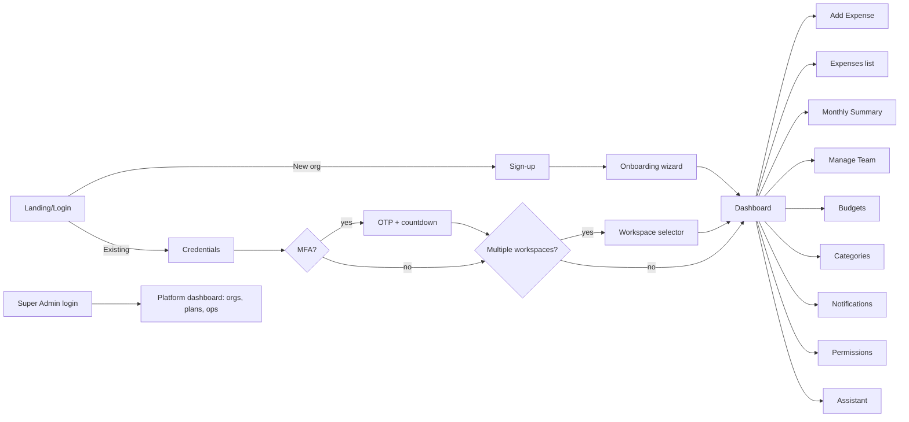
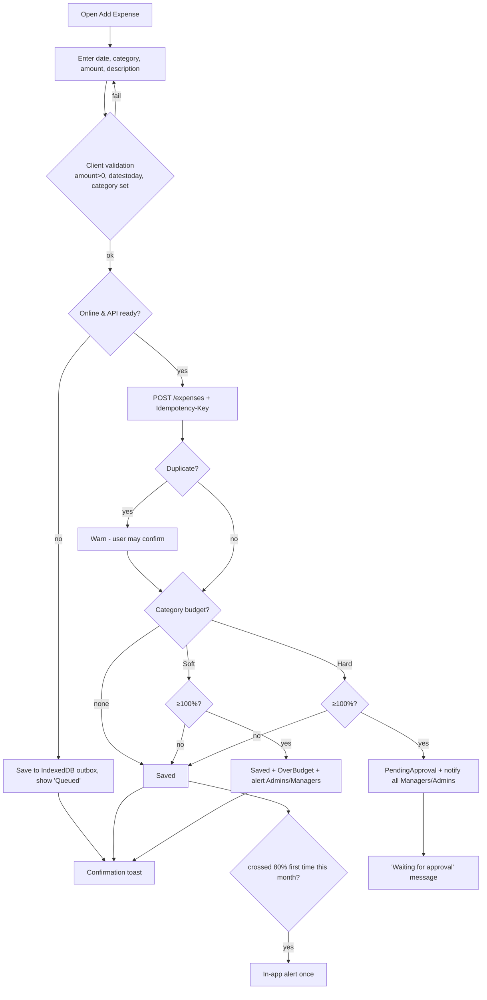
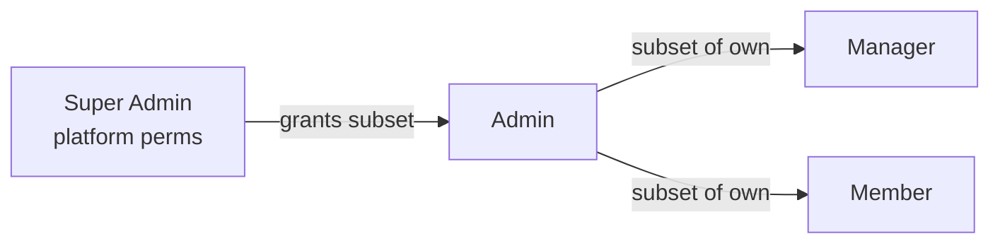
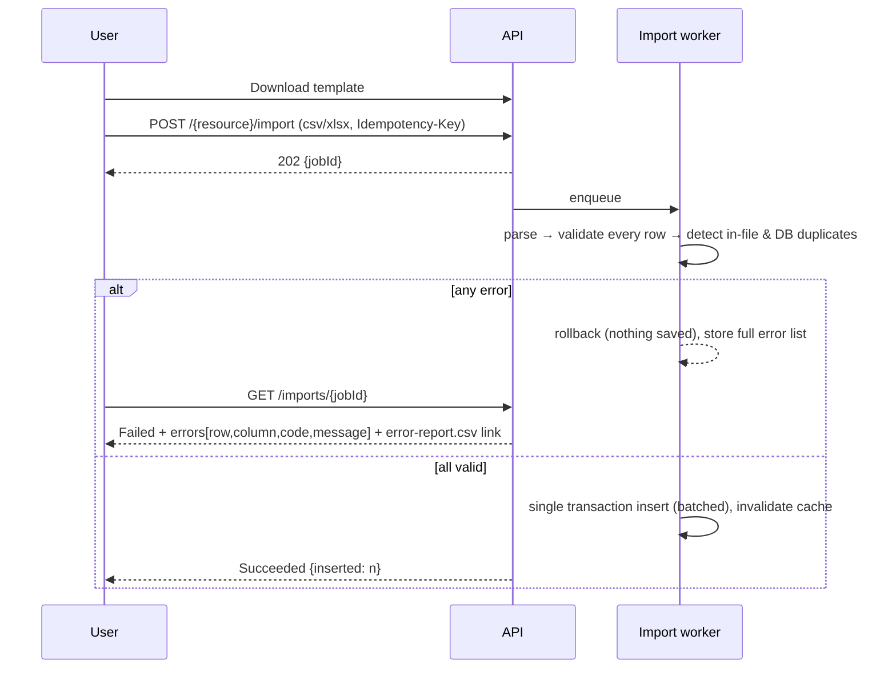

# AppFlow — Outlay

Diagrams are Mermaid (render on GitHub). `⚙` = system step. Error branches show the **localized message + support contact** behaviour from FR-DEG-01.

## 1. Navigation map



## 2. Flow 1 — Organisation sign-up
1. Visitor clicks **Create Workspace** (org name + work email).
2. Enters password (policy: ≥ 10 chars, mixed; strength meter). ⚙ BCrypt hash.
3. ⚙ Create `Tenant`, `User`, `Membership(Admin)`; send verification OTP (email) — dev OTP `111111`.
4. Wizard step 2 **Set up organisation**: name, industry, team size, currency.
5. Step 3 **Choose plan**: Starter / Pro / Enterprise (Enterprise ⇒ "Contact sales" lead record).
6. Step 4 **Invite team** (skippable) → then guided *Create categories → Set budgets*.
7. Workspace ready → Dashboard.

## 3. Flow 2 — Login (OAuth2 first-party, MFA, workspace)

```mermaid
sequenceDiagram
  participant U as Browser (Next.js)
  participant B as Next BFF
  participant A as API /api/auth
  participant O as OpenIddict /connect/token
  U->>B: email, password
  B->>A: POST /api/auth/login (+ optional sessionMinutes – API only)
  A-->>A: lockout check, BCrypt verify, 3-strike counter
  alt MFA enabled
    A-->>B: {status: mfa_required, challengeId, expiresIn:300}
    A->>A: generate OTP (prod: random; dev: 111111), send SMS+email
    U->>B: code
    B->>A: POST /api/auth/mfa/verify
  end
  alt many memberships and none chosen
    A-->>B: {status: workspace_required, workspaces[]}
    U->>B: choose workspace
  end
  A-->>B: {status: ok, loginTicket (one-time, 2 min)}
  B->>O: grant_type=login_ticket
  O-->>B: access_token (JWT, short), refresh_token (rotating)
  B-->>U: httpOnly cookie (refresh), access token in memory
```
Failure branches: wrong password → generic message, counter +1; 3rd wrong → account locked + audit (IP) + localized message "Account locked. Reset your password or contact your admin."; expired OTP → countdown hits 0 → "Resend code" enabled after cooldown.

## 4. Flow 3 — Token lifecycle
* Access token 15 min (config). Silent refresh via BFF 60 s before expiry.
* Refresh token rotates every use; reuse of an old token ⇒ whole token family revoked + audit "token reuse detected".
* Logout / password change / role change / lock ⇒ revoke refresh tokens (`/connect/revocation`).
* Optional `sessionMinutes` (API only) sets absolute session lifetime ≤ `Security:Session:MaxMinutes`.

## 5. Flow 4 — Add expense (Member)



## 6. Flow 5 — Over-budget approval
1. Manager opens Notifications → **Review & Approve** (expense details + current budget status).
2. **Approve** (optional note) → status `Approved`, approver/time stored, totals updated, member notified.
3. **Reject** (reason required) → expense removed from ledger, `ApprovalRequest` keeps snapshot, member notified with reason.
4. Concurrent decision by two managers → second gets "Already decided by X" (optimistic concurrency).

## 7. Flow 6 — Invite team member
1. Admin → Manage Team → email + role. 2. ⚙ Plan seat check (active + pending). If full → upgrade prompt, **no invite created**. 3. Send invitation (email; SMS if phone given) with 48 h token. 4. Invitee clicks link → sets password (or signs in if account exists → adds membership) → MFA enrolment prompt. 5. Status `Invited → Active`; Admin sees it; notification "New member joined".
Resend regenerates the token and invalidates the old one. Expired token ⇒ "Link expired — ask your admin to resend".

## 8. Flow 7 — Delegated permissions

Admin opens **Permissions** page → picks a team member → checkbox tree shows only permissions the Admin holds (others hidden/disabled) → Save → ⚙ validate ceiling, write grants, bump `PermissionVersion`, revoke tokens if reductions → audit. Removing a permission from an Admin cascades to everyone they delegated.

## 9. Flow 8 — Advanced search (any list)
Filter bar → "Add filter" → field ▸ operator ▸ value → chips → AND/OR group toggle → **Search** → API `POST /{resource}/search` → results + total + localized pagination text → **Save filter** (per user) → shareable URL.

## 10. Flow 9 — Bulk import


## 11. Flow 10 — Correction / refund
Member/Admin selects expense → **Add adjustment** → amount (positive) + direction (Reduce/Increase) + reason → saved as `ExpenseAdjustment`; original untouched; monthly report uses net; UI shows "Adjustment (reduces)" with positive magnitude.

## 12. Flow 11 — Offline & sync
Online-check = `/health/ready` + `navigator.onLine`. Offline: reads from IndexedDB (stale-while-revalidate); writes go to outbox (client GUID + Idempotency-Key). On reconnect (online event / Background Sync / app start): replay FIFO; 2xx ⇒ remove; 409 duplicate-key ⇒ treat as success; 412/conflict ⇒ conflict panel; 5xx ⇒ retry with backoff. Approvals, plan changes, permission changes are **online-only** (buttons disabled with explanation).

## 13. Flow 12 — Assistant
User types or speaks → STT (browser) → `POST /api/assistant/query {text, locale}` → ⚙ intent match → permission/scope check → MediatR query → localized template answer (+ table) → TTS optional. Out-of-scope ⇒ neutral refusal. Unknown ⇒ examples.

## 14. Flow 13 — Dependency failure
| Failure | Backend | Frontend |
|---|---|---|
| Redis down | Log Error, switch to in-proc cache, `/health/ready` degraded (still 200) | Nothing visible |
| DB down | Retry (policy), then problem `503 urn:outlay:problem:dependency-unavailable` with correlation ID + support contact | Toast: "Something went wrong. Please contact Outlay support — {name} · {phone} · {email}" (localized); app stays usable offline |
| SMS gateway down | Fallback to email OTP + Error log | "Code sent by email instead" |
| API unreachable | – | Offline banner; queue writes |

## 15. Flow 14 — Operations
* Super Admin → `GET /api/ops/backup` → streams backup of active provider. 
* `GET /api/ops/logs?category=query&date=28-10-2026` → file download. 
* `GET /api/release-notes/latest` (any authenticated role) → QA checklist.
