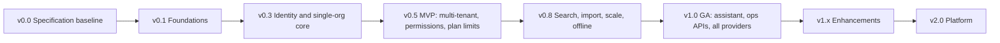

# Outlay — Roadmap

| Field | Value |
|---|---|
| Version | 0.0.0 · 2026-10-28 |
| Horizon | v0.5 MVP → v1.0 GA → v1.x → v2.0 |
| Detail | Task-level breakdown in [docs/Plan.md](docs/Plan.md). Feature IDs in [docs/PRD.md](docs/PRD.md). |

Releases are **scope-based**, not date-based. Dates are set at each milestone review, once velocity is known.

---

## Release Overview

| Release | Milestones | Theme | Status |
|---|---|---|---|
| **v0.0.0** | — | Specification baseline | ✅ Done (2026-10-28) |
| **v0.1.0** | M0 | Foundations: solution, logging, diagnostics middleware, DB abstraction (InMemory/PostgreSQL/SQL Server), Scalar, PWA shell, Docker, CI | ⏳ Next |
| **v0.3.0** | M1, M2 | Identity (OpenIddict, BCrypt, MFA, lockout, sessions) + single-organisation core (categories, budgets, expenses, alerts, dashboard, monthly summary) | Planned |
| **v0.5.0 – MVP** | M3, M4, M5, M6 | Multi-tenancy, onboarding, invitations, approvals, adjustments, email/SMS alerts, delegated permissions + UI, plan limits. **All P0 requirements of the training brief.** | Planned |
| **v0.8.0** | M7, M8, M9 | Advanced search + bulk import on every CRUD, caching/idempotency/resilience/rate limiting/load balancing, offline-first sync | Planned |
| **v1.0.0 – GA** | M10–M13 | Voice/text assistant with guardrails, backup/log/release-notes APIs, MySQL/Oracle/MongoDB/Access providers, security and a11y hardening, guides, full Postman/Newman suite, production pipeline | Planned |

---

## v1.x — Enhancements (post-GA, P2)

| Item | Requirement link | Notes |
|---|---|---|
| Fuzzy duplicate detection | US-21 / FR-EXP-07 | Deterministic first (trigram/Jaccard on normalised description + same amount/category within ±3 days). Optional ML embeddings later, only as a *suggestion* that never blocks. |
| Shared saved filters and dashboards | FR-SRCH-05 | |
| Enterprise SSO (Microsoft Entra ID, Google) | FR-AUTH-12 | OpenIddict external providers + Authorization Code + PKCE |
| Archive export (Enterprise) | Plans table | Full tenant export as zip (CSV + JSON) |
| Receipt attachments | — | Blob storage abstraction (local / S3 / Azure) |
| Web push notifications | FR-NOT | Service-worker push for approvals |
| Pomelo MySQL provider return | ADR-0009 | When it supports the EF Core major we're on |
| Central log sink by default (Seq / OpenTelemetry) | TRD §8 | For multi-replica operations |

## v2.0 — Platform

| Item | Notes |
|---|---|
| **.NET 11 / 12 upgrade** | Follow TRD §18 runbook. The CI "next" job already tracks .NET 11. LTS-to-LTS jumps are preferred for production (.NET 12 LTS expected Nov 2027). |
| Billing integration | Stripe / SSLCommerz for Pro subscriptions (Q-11) |
| Multi-currency per expense | FX rates, reporting currency |
| Accounting exports | Tally / QuickBooks formats |
| Optional LLM intent classifier for the assistant | Must keep guardrails: the model only classifies intent; data access stays in deterministic, authorised queries (ADR-0013 amendment required) |
| Native mobile wrapper | Only if PWA limits appear (e.g. iOS background sync) |

---

## Technology Lifecycle Watch

| Component | Current | Watch for |
|---|---|---|
| .NET | 10 LTS (support to Nov 2028) | .NET 11 GA (Nov 2026, STS); .NET 12 LTS (Nov 2027) |
| EF Core providers | EF Core 10 | Pomelo MySQL EF 10 support; Jet (Access) EF 10 support |
| MediatR | 14.x (Community licence) | Eligibility: stay under US$5M revenue / US$10M outside capital |
| React | 19.x | Next major. Renovate group update + codemods. |
| Tailwind CSS | v4 | Token changes stay inside `theme.css` |
| Node | 24 LTS | Node 26 LTS |
