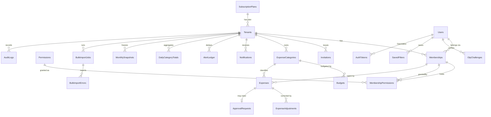

# Schema — Outlay Data Model

Conventions: PK `Id` = GUID (UUIDv7/ULID-sortable; stored `uuid`/`uniqueidentifier`/`RAW(16)`/`CHAR(36)`/ObjectId-as-string in Mongo). Every tenant table has `TenantId`. Audit columns: `CreatedAt`, `CreatedBy`, `UpdatedAt`, `UpdatedBy`, `RowVersion` (concurrency). Money `DECIMAL(18,2)`. Times UTC. Soft-delete only where stated. **Names are ≤ 30 chars (Oracle-safe) and PascalCase**; providers map quoting.

## 1. ER diagram

## 2. Tables

### Platform / identity
**SubscriptionPlans** — `Id`, `Code` (starter|pro|enterprise, unique), `Name`, `PriceMonthly` (null=custom), `MaxUsers` (null=∞), `MaxCategories` (null=∞), `HistoryMonths` (null=full), `AllowHardLimit` bool, `AllowEmailSms` bool, `AllowAdvancedReports` bool, `AllowApprovalWorkflow` bool, `IsActive`.

**Tenants** — `Id`, `Name` (unique per platform, case-insens.), `Slug` (unique), `Industry`, `TeamSize`, `CurrencyCode` (default `BDT`), `PlanId` ▸SubscriptionPlans, `Status` (Active|Suspended), `CreatedAt`, audit cols. *(No TenantId column; this is the tenant.)*

**Users** (global identity) — `Id`, `Email` (unique, normalised), `EmailVerified`, `Phone` (encrypted, nullable), `PhoneVerified`, `PasswordHash` (BCrypt), `DisplayName`, `PreferredLocale` (en|bn), `MfaEnabled`, `FailedLoginCount`, `IsLocked`, `LockedAt`, `LockedUntil` (nullable), `IsPlatformAdmin` (Super Admin flag), `PermissionVersion` int, `LastLoginAt`, `LastLoginIp`, audit cols.

**Memberships** — `Id`, `TenantId`, `UserId`, `Role` (Admin|Manager|Member), `Status` (Invited|Active|Removed), `CreatedByMembershipId`, `JoinedAt`, audit. Unique(`TenantId`,`UserId`). Super Admin has no membership.

**Permissions** (catalogue/seed) — `Code` PK (e.g. `expenses:approve`), `Scope` (Platform|Tenant), `Description`, `MinRole` (lowest role allowed to ever hold it).

**MembershipPermissions** — `MembershipId`, `PermissionCode`, `GrantedByMembershipId` (null = granted by Super Admin/system), `GrantedAt`. PK(`MembershipId`,`PermissionCode`). *Platform grants to Admins by Super Admin use `GrantedByUserId`.*

**Invitations** — `Id`, `TenantId`, `Email`, `Role`, `PermissionsJson`, `TokenHash`, `ExpiresAt` (+48 h), `Status` (Pending|Accepted|Expired|Revoked), `InvitedByMembershipId`, `AcceptedAt`, `ResendCount`.

**OtpChallenges** — `Id`, `UserId`, `Purpose` (login|reset|verify|invite), `Channel` (sms|email), `CodeHash`, `ExpiresAt`, `Attempts`, `MaxAttempts`, `ConsumedAt`, `SentAt`, `Destination` (masked copy).

**OpenIddict tables** (library-managed): `OpenIddictApplications`, `OpenIddictAuthorizations`, `OpenIddictScopes`, `OpenIddictTokens` (refresh tokens, rotation/revocation state). For Dapper/Mongo providers, OpenIddict uses its own store (EF Core default; Mongo store via `OpenIddict.MongoDb`). *Identity data stays in the primary store when provider = EfCore/Mongo; Dapper mode still uses the OpenIddict EF store against the same connection (documented exception).*

**LoginTickets** — cache-only (key `ticket:{hash}`), not a table.

### Expense domain
**ExpenseCategories** — `Id`, `TenantId`, `Name` (≤50), `NameNormalized` (upper-invariant, trimmed), `IsActive`, `SortOrder`, audit. Unique(`TenantId`,`NameNormalized`).

**Budgets** — `Id`, `TenantId`, `CategoryId`, `Year`, `MonthlyAmount` DECIMAL(18,2), `LimitType` (Soft|Hard), `IsLocked` (set when Year < current), audit. Unique(`TenantId`,`CategoryId`,`Year`). (A-01)

**Expenses** — `Id`, `TenantId`, `MembershipId` (owner), `CategoryId`, `ExpenseDate` (date), `Amount` (>0, check), `Description` (≤500), `Status` (Saved|OverBudget|PendingApproval|Approved), `BudgetYear`, `BudgetMonth`, `DuplicateHash` (hash of date+amount+category+normalised description), `ClientRequestId` (offline idempotency), `ApprovedByMembershipId`, `ApprovedAt`, `ApprovalNote`, audit + `RowVersion`. Indexes: (`TenantId`,`ExpenseDate`), (`TenantId`,`CategoryId`,`ExpenseDate`), (`TenantId`,`MembershipId`,`ExpenseDate`), (`TenantId`,`DuplicateHash`). Check: `Amount > 0`, `ExpenseDate <= created date`.
*Pending expenses are **not** counted in spent totals until approved* (BR: "held").

**ExpenseAdjustments** (append-only) — `Id`, `TenantId`, `ExpenseId`, `Direction` (Reduce|Increase), `Amount` (>0), `Reason`, `CreatedByMembershipId`, `CreatedAt`. Net expense = `Amount − ΣReduce + ΣIncrease`. No update/delete API.

**ApprovalRequests** — `Id`, `TenantId`, `ExpenseId` (null after reject), `ExpenseSnapshotJson`, `RequestedByMembershipId`, `Status` (Pending|Approved|Rejected), `DecidedByMembershipId`, `DecidedAt`, `DecisionNote/Reason`, `RowVersion` (first decision wins).

**Notifications** — `Id`, `TenantId`, `RecipientMembershipId`, `Kind` (ApprovalRequired|OverBudget|Threshold80|MemberJoined|SeatUsage|ApprovalDecision), `SeverityCode`, `TitleKey`, `BodyKey`, `ParamsJson` (**no amounts in logs; amounts allowed here for UI**), `RelatedEntityId`, `IsRead`, `ReadAt`, `CreatedAt`.

**AlertLedger** — `TenantId`, `CategoryId` (nullable), `Kind`, `PeriodKey` (`2026-06`), `CreatedAt`. Unique(`TenantId`,`CategoryId`,`Kind`,`PeriodKey`) ⇒ once-per-period.

**DailyCategoryTotals** — `TenantId`, `CategoryId`, `MembershipId`, `Day`, `Total`, `Count`. PK(all but totals). Updated transactionally with expense/approval/adjustment.

**MonthlySnapshots** — `TenantId`, `Year`, `Month`, `PayloadJson`, `ComputedAt`, `IsFinal`. Unique(`TenantId`,`Year`,`Month`).

### Platform services
**SavedFilters** — `Id`, `TenantId`, `UserId`, `Resource`, `Name`, `FilterJson`, `IsShared`.
**BulkImportJobs** — `Id`, `TenantId`, `UserId`, `Resource`, `FileName`, `Status` (Queued|Running|Succeeded|Failed), `TotalRows`, `InsertedRows`, `ErrorCount`, `StartedAt`, `FinishedAt`, `IdempotencyKey`.
**BulkImportErrors** — `Id`, `JobId`, `RowNumber`, `Column`, `Code`, `MessageKey`, `Message`, `ValueRedacted`.
**IdempotencyKeys** — see TRD §10.
**OutboxMessages** — `Id`, `Type`, `Payload`, `CreatedAt`, `ProcessedAt`, `Attempts`, `Error`.
**AuditLogs** — `Id`, `At`, `TenantId` (nullable), `UserId`, `Ip`, `UserAgent`, `Action`, `EntityType`, `EntityId`, `Outcome`, `CorrelationId`, `ChangedFields` (names only).
**AppSettingsOverrides** (optional) — runtime-editable non-secret settings.
**ReleaseNotesCache** — optional; source of truth is `RELEASENOTES.md`.

## 3. Key invariants (enforced in DB where possible, else Domain)
1. `Expenses.Amount > 0`, adjustment amount > 0 (CHECK).
2. Unique category name per tenant (unique index on normalised name).
3. One budget per tenant/category/year (unique index).
4. Locked budgets/expenses of previous years reject writes (Domain + trigger-free; tested).
5. Every FK on tenant tables includes `TenantId` composite or is validated in handler; isolation tests prove it.
6. `MembershipPermissions.PermissionCode` ⊆ grantor's effective set (Domain service; DB can't express it).
7. Starter plan: active+pending users ≤ 3; active categories ≤ 10 (checked in handler inside the transaction).

## 4. Provider mapping cheat-sheet

| Concept | SQL Server | PostgreSQL | MySQL | Oracle | Access | MongoDB |
|---|---|---|---|---|---|---|
| GUID | `uniqueidentifier` | `uuid` | `char(36)` | `RAW(16)` | `GUID`/text | `_id` string/UUID (standard) |
| Money | `decimal(18,2)` | `numeric(18,2)` | `decimal(18,2)` | `NUMBER(18,2)` | `Currency`/`Decimal` | `Decimal128` |
| Bool | `bit` | `boolean` | `tinyint(1)` | `NUMBER(1)` | `Yes/No` | bool |
| Timestamp | `datetime2` | `timestamptz` | `datetime(6)` | `TIMESTAMP(6)` | `Date/Time` | Date (UTC) |
| Concurrency | `rowversion` | `xmin`/int version | int version | int version | int version | `Version` int |
| Bulk insert | `SqlBulkCopy` | `COPY` | multi-row / `LOAD DATA` | array bind / `INSERT ALL` | batched | `InsertMany` |
| Paging | `OFFSET/FETCH` | `LIMIT/OFFSET` | `LIMIT/OFFSET` | `OFFSET/FETCH` (12c+) | `TOP` workaround | `skip/limit` |

Mongo layout: collections mirror tables; `Expenses` embeds `Adjustments[]` (still append-only via update operators) — repository hides this. Required indexes created at startup.

## 5. Seed data (dev, `SeedDemoData=true`)
* Plans: Starter / Pro / Enterprise as specified.
* Super Admin `superadmin@outlay.local`.
* Tenant **TechCorp BD** (Pro): Admin `rahim@techcorp.com.bd`, Manager `nusrat@techcorp.com.bd`, Members `fahmida@…`, `tarek@…`, `karim@…` (Invited); categories & budgets exactly as the brief (Travel ৳30,000 Hard; Meals 25,000; Software 40,000; Office 20,000; Training 35,000 Soft); June-2026-like sample expenses reproducing the report (৳86,400).
* Tenant **Medicore Ltd** (Starter, 3/3 users; Admin `admin@medicore.example`) for isolation + plan-limit tests; **NovaSoft Inc** (Enterprise), **GreenLeaf Co** (Starter).
* Dev-only password for all demo users: `Outlay@12345` — printed in `README.md` and only seeded when environment is Development/Testing. OTP `111111`.

## 6. Retention & history
Starter history window applies at **query time** (`ExpenseDate >= today − 6 months`); data retained. Logs: `RetentionDays`. Idempotency keys 24 h. OTP rows purged after 24 h. Audit rows retained ≥ 1 year (config).
