# Outlay — Application Flow (AppFlow)

| Field | Value |
|---|---|
| Document | AppFlow.md (2 of 6 core specs) |
| Version | 0.0.0 · 2026-10-28 |
| Purpose | Every user journey, step by step: screens, decisions, system checks, and what happens on failure. |
| Related | [PRD.md](PRD.md) (the *what*) · [UiSpec.md](UiSpec.md) (the *look*) · [TRD.md](TRD.md) (the *how*) |

> Flow IDs (`F-xx`) are referenced from UiSpec screens (`S-xx`) and Plan tasks. Diagrams use Mermaid (renders on GitHub/GitLab).

---

## 1. Navigation Map (route tree)

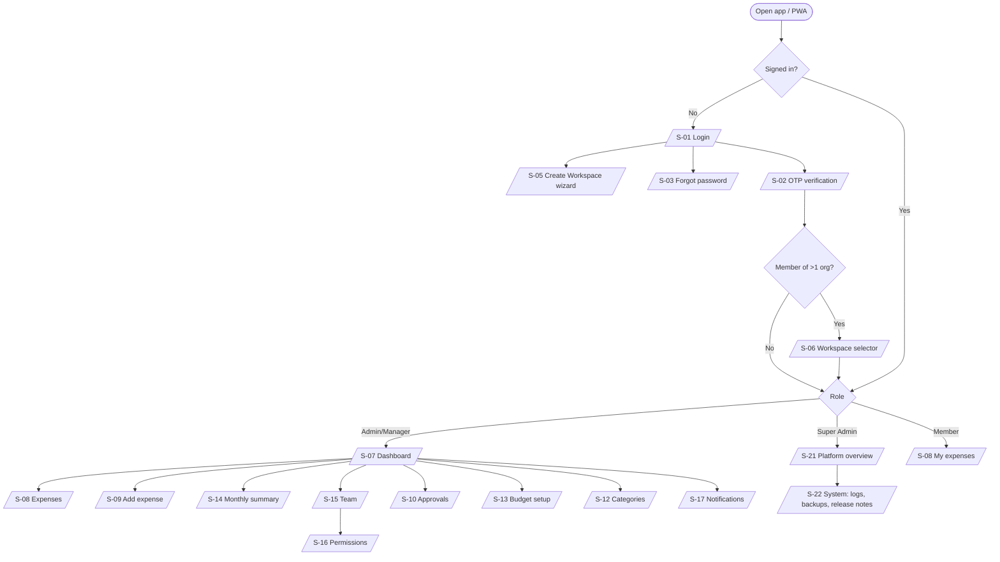

### 1.1 Route table

| Route | Screen | Default visibility (permission) |
|---|---|---|
| `/login` | S-01 Login | anonymous |
| `/login/verify` | S-02 OTP | partially authenticated (mfa_token) |
| `/forgot-password`, `/reset-password?token=` | S-03 | anonymous |
| `/signup` | S-05 Onboarding wizard | anonymous |
| `/invite/:token` | S-24 Accept invitation | anonymous |
| `/workspaces` | S-06 Workspace selector | authenticated |
| `/` → `/dashboard` | S-07 Dashboard | `dashboard.read` |
| `/expenses` | S-08 Expenses list | `expenses.read.own` |
| `/expenses/new`, `/expenses/:id` | S-09 Add/Edit | `expenses.create` / `expenses.update.own` |
| `/approvals`, `/approvals/:id` | S-10 | `expenses.approve` |
| `/adjustments` | S-11 | `adjustments.create` |
| `/categories` | S-12 | `categories.read` |
| `/budgets` | S-13 | `budgets.manage` |
| `/reports/monthly` | S-14 | `reports.monthly.read` |
| `/team` | S-15 | `users.read` |
| `/permissions` | S-16 | `permissions.manage` |
| `/notifications` | S-17 | `notifications.read` |
| `/imports/:resource` | S-18 Import wizard | `import.bulk` + resource create |
| (floating panel) | S-19 Assistant | `assistant.use` |
| `/me` | S-20 Profile & Security | authenticated |
| `/platform` | S-21 Platform overview | `tenants.read` (Super Admin) |
| `/system/logs`, `/system/backups`, `/system/release-notes` | S-22 | `system.logs.read`, `system.backup.download`, `system.releasenotes.read` |
| `*` | S-23 Not found / Offline / Service unavailable | — |

Menu items **only render if the user holds the permission**. Hidden is not the same as secure: the API re-checks every request.

---

## 2. F-01 Organisation Sign-Up & Onboarding

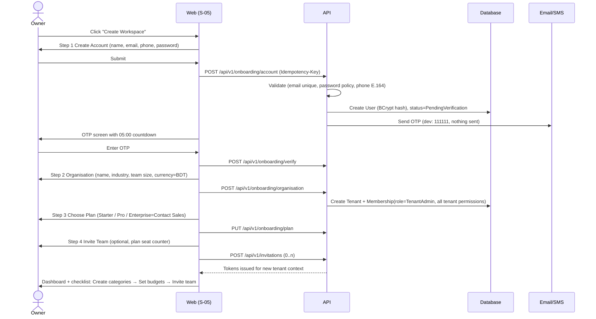

**Failure branches**
- Email already registered → "This email already has an Outlay account. Log in to create another workspace from the workspace menu." Existing users can create additional organisations after login.
- OTP expired → "Code expired" + Resend (enabled after 60 s).
- Enterprise chosen → creates the tenant on Starter limits, flags `UpgradeRequested=Enterprise`, and notifies Super Admin. Billing is out of scope.

---

## 3. F-02 Login, MFA, Lockout & Session

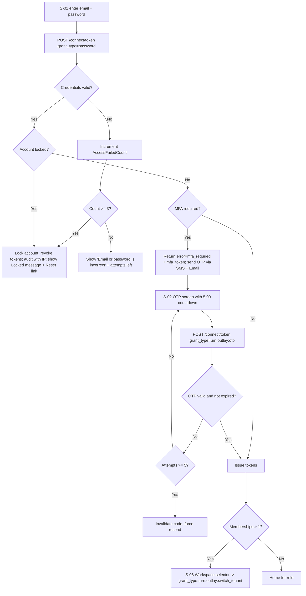

**Rules**
- Failed counter resets on successful login. Lockout duration comes from `Auth:Lockout:DurationMinutes` (default 15).
- Message wording never reveals whether the email exists.
- **Session duration (API only):** `session_duration` (e.g., `PT4H`, `P1D`, or `4h`/`1d`) on the password grant sets the absolute session lifetime, clamped to `[Auth:Session:Min, Auth:Session:Max]`. The web UI never sends it, so the UI uses `Auth:Session:Default` (8 h).
- **Web token storage:** access token in memory only; refresh token in an `HttpOnly; Secure; SameSite=Strict` cookie scoped to `/connect/token`. API clients such as Postman get the refresh token in the response body.
- **Silent refresh:** 60 s before access-token expiry the SPA calls the refresh grant. Rotation issues a new refresh token, and the old one becomes invalid. **Reuse of an old refresh token revokes the whole token family** (theft detection).

### 3.1 F-02b Password reset & change
1. Forgot password → enter email → always "If an account exists, we've sent instructions" → email link (valid 30 min) **and** OTP to phone.
2. Reset page → new password + confirm + OTP → password updated (BCrypt) → **all sessions revoked**, lockout cleared, audit entry.
3. Change password (S-20) → current password + new password + OTP → all *other* sessions revoked.

### 3.2 F-02c Logout
`POST /connect/revoke` (refresh token) + `/connect/logout` → clear in-memory token → **clear IndexedDB for this user/tenant** (configurable: "Keep offline data on this device" checkbox, default off on shared devices).

---

## 4. F-03 Add an Expense (Member)

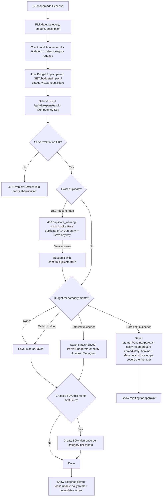

**Offline variant:** if the network is down, the expense goes to the IndexedDB **outbox** with an Idempotency-Key and shows **Pending sync**. The budget check runs on the server at sync time, and the user is notified of the outcome (F-11).

### 4.1 F-03b Edit or delete an expense (owner)

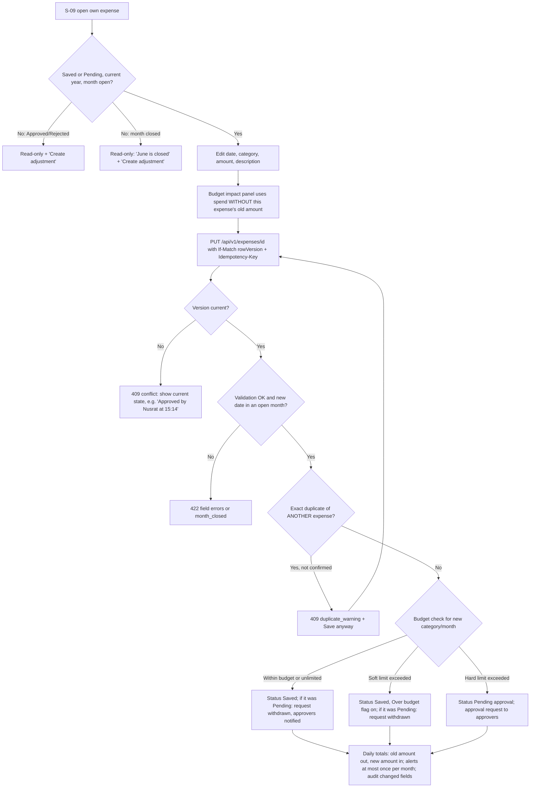

**Delete:** same eligibility as edit (own, Saved/Pending, open month) → `DELETE /api/v1/expenses/{id}` with `If-Match` → soft delete → amount leaves the totals → a pending approval request is cancelled and approvers notified → audited.

**Grace window:** between the 1st and the close date (default the 3rd), both months are open, so an edit can move an expense from June to July or back. Both months' totals update.

**Expense status lifecycle**

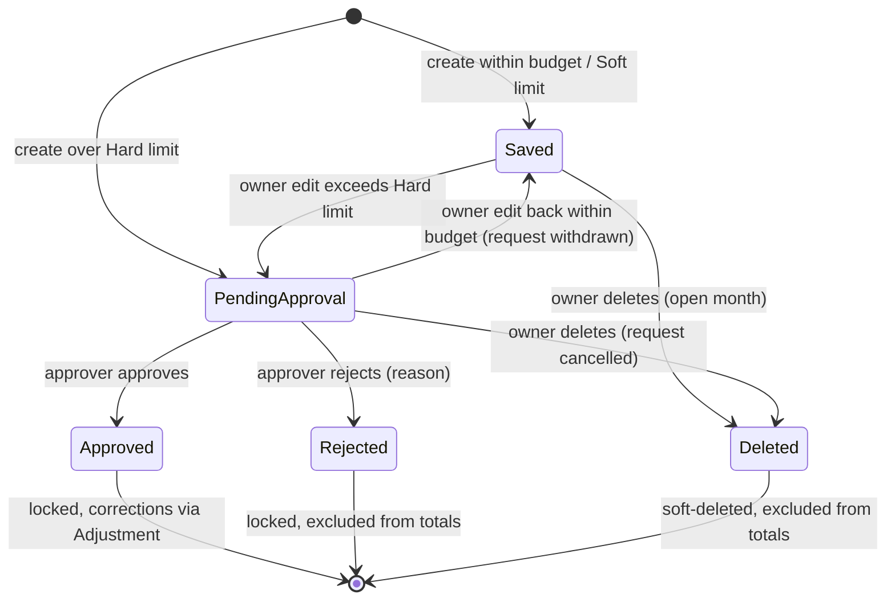

---

## 5. F-04 Over-Budget Approval (Manager)

1. Each **approver** receives **Approval Required** (real-time toast + notification + email/SMS on Pro+). Approvers are all Admins plus Managers with `expenses.approve` whose visibility covers the member (BR-NOT-04). A Manager narrowed to their team never receives requests for people outside it.
2. Opens S-17 Notifications or S-10 Approvals → **Review & Approve** → sees expense, member, category budget, month spent, pending total.
3a. **Approve** (optional note) → `POST /api/v1/expenses/{id}/approve` → status Approved, `ApprovedBy`, `ApprovedAt` → counted in Spent → member notified.
3b. **Reject** (reason **required**) → `POST /api/v1/expenses/{id}/reject` → status Rejected (excluded everywhere) → member notified with reason.
4. Concurrency: if two approvers act at once, the first wins. The second gets 409 "Already approved by Nusrat at 15:14".
5. A user cannot approve their own expense; it goes to another approver. If none exists, an Admin can self-approve, and that action is flagged in the audit log.
6. The approver group is evaluated when the queue loads and when approving. If an Admin narrows a Manager's scope while requests are pending, the out-of-scope requests disappear from that Manager's queue and approving them returns 404.
7. If the owner edits a Pending expense back within budget, or deletes it, the request is withdrawn or cancelled and approvers see it leave their queue (BR-EXP-09/10).

---

## 6. F-05 Invite a Team Member (Admin)

1. Admin opens S-15 Manage Team.
2. System checks seat usage. If the limit is reached, the invite form is replaced by an upgrade prompt and the invitation is blocked (BR-PLAN-01).
3. Admin enters email, role and (optionally) **permissions to grant** (subset of the Admin's own).
4. `POST /api/v1/invitations` → invitation email with a link that expires in **48 h**.
5. Invitee opens `/invite/:token` → sets name, phone and password (or, if they already have an Outlay account, logs in and accepts) → OTP verify → joins.
6. Admin sees status change **Invited → Active** (real-time) and a "New Member Joined" notification is created.
7. Expired → status "Expired" → **Resend** creates a new token and invalidates the old one.

---

## 7. F-06 Budget Setup (Admin)

1. S-13 lists **all active categories** for the selected year (default: current year).
2. For each row: amount (৳, decimals allowed) + limit type (Soft/Hard; Hard is disabled on Starter with a "Pro feature" tooltip). Empty means **Unlimited**.
3. Save → `PUT /api/v1/budgets/{year}` (batch upsert) → validation → audit → cache invalidation → budget monitor recalculates current month status (may raise 80%/over alerts *once*).
4. Previous years are shown read-only with a lock icon.

---

## 8. F-07 Adjustment / Correction

1. Member or Admin opens an expense → **Create adjustment** (or S-11).
2. Links the original expense. Enters direction (Reduction e.g. refund / Increase), amount (> 0), reason, date.
3. Validation: a Reduction cannot exceed the original amount net of earlier reductions. Date ≥ original date and not in the future.
4. Saved as a separate record. The original is untouched. Reports net it into the adjustment's month.

---

## 9. F-08 Monthly Summary & Export

1. Manager/Admin opens S-14 → filters: month (default current), member (Pro+), category.
2. `GET /api/v1/reports/monthly?year=2026&month=6&memberId=` → served from cache → else from **DailyCategoryTotals** (pre-aggregated) → else live aggregate. Closed months come from **MonthlySnapshots**.
3. Toggle **View by Member** → member-wise table.
4. **Export Report** → `GET /api/v1/reports/monthly/export?format=xlsx|csv` (Pro+). Starter sees an upgrade tooltip.

---

## 10. F-09 Advanced Search (all CRUD lists)

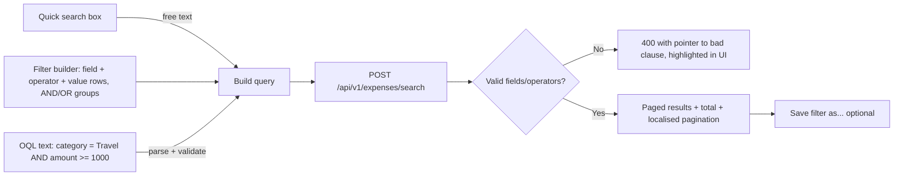

- The filter state is serialised into the URL (`?q=` base64url), so filtered views can be shared by link.
- Field and operator lists come from `GET /api/v1/{resource}/search/fields`, so the UI builder is generic.

---

## 11. F-10 Bulk Import (CSV / Excel)

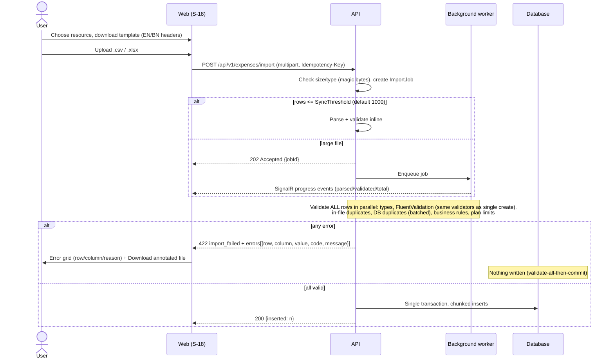

The user fixes the file and re-uploads. A new Idempotency-Key is used because the content has changed.

---

## 12. F-11 Offline Mode & Sync

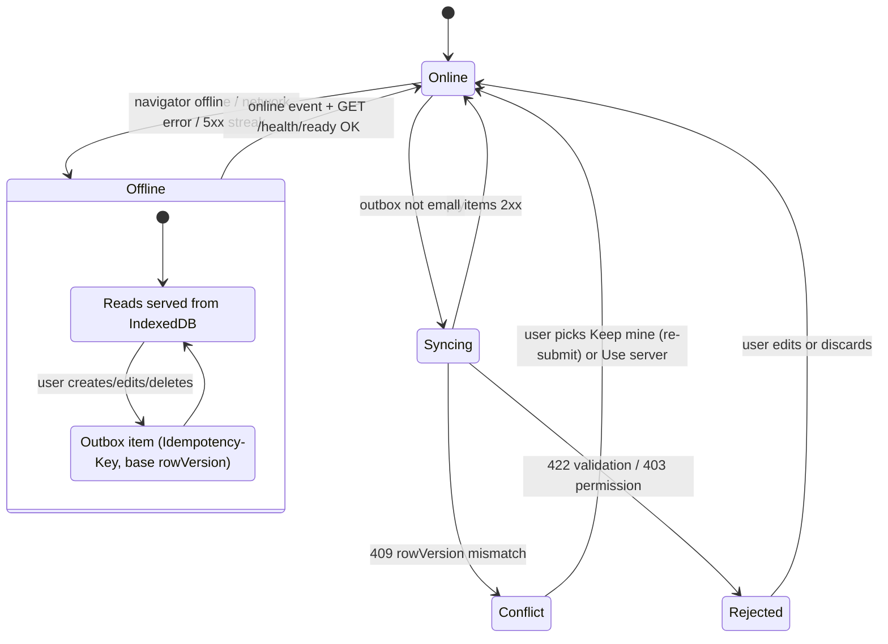

1. Replay is FIFO per entity. Each outbox item carries its original Idempotency-Key, so a retry after a timeout never duplicates.
   - An edit or delete for a month that closed while the device was offline comes back as `month_closed`. The sync panel shows "June is closed" with a **Create adjustment** button pre-filled from the rejected change (BR-EXP-12).
2. After the push, a **delta pull**: `GET /api/v1/sync/changes?since=<cursor>` returns changed records and tombstones within the user's scope.
3. A badge shows the pending count. The sync history panel lists the result of each item.

---

## 13. F-12 Permission Delegation

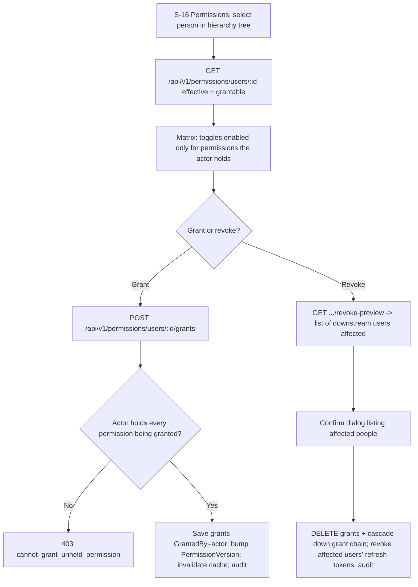

The Super Admin uses the same page from S-21 to manage Admins' permissions, but never sees tenant expense data.

---

## 14. F-13 Assistant (Text & Voice)

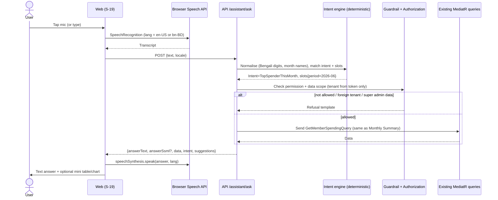

If no intent matches, the assistant returns "I can help with…" plus 4 localised example questions. If speech isn't supported (e.g., Firefox), the mic button is hidden and text chat still works.

---

## 15. F-14 Language Switch

1. User selects **EN / বাং** in the top bar (or on the login screen).
2. Frontend: `i18next.changeLanguage('bn')` → `document.documentElement.lang='bn'` → `document.title` re-rendered → all `Intl` formatters rebuilt → TanStack Query refetches the queries that carry server-localised text.
3. Backend: `PATCH /api/v1/me/preferences {language:'bn'}` (saved). Subsequent requests send `Accept-Language: bn-BD`, so validation and error messages come back in Bengali.

---

## 16. F-15 Dependency Failure & Graceful Errors

| Situation | Backend behaviour | Frontend behaviour |
|---|---|---|
| Redis down | Circuit opens → cache falls back to in-process memory → requests succeed → warning logged once per minute | Nothing visible |
| DB down / timeout after retries | 503 ProblemDetails `code=DEPENDENCY_UNAVAILABLE` + support contact | Full-page or inline "Something went wrong. Please contact **{Support.Name}** at **{Phone}** / **{Email}**" (localised) + reference ID (correlation ID) + switch to offline mode |
| Email/SMS provider down | Message stays in outbox, retried with backoff; OTP screen says "We couldn't send the SMS, try email or resend" | Countdown and alternative channel |
| Unhandled exception | 500 ProblemDetails (no stack trace), exception log with class/file/method/line + probable cause + fix | Friendly error + reference ID |
| Rate limited | 429 + `Retry-After` | "Too many attempts. Try again in N seconds." with countdown |
| Backend unreachable at first load | — | Support contact from build-time env fallback (`VITE_SUPPORT_*`), cached IndexedDB data if any |

---

## 17. F-16 PWA Install

1. The service worker registers on first load. The manifest is linked.
2. On Chromium, `beforeinstallprompt` is captured, and after the second visit or the first successful expense a **"Install Outlay as an app"** banner appears (dismissible, snoozed 14 days).
3. iOS Safari has no install prompt API, so a one-time hint is shown: "Tap Share → Add to Home Screen".
4. New version available → toast "A new version of Outlay is ready — Refresh" (`skipWaiting` on confirm).

---

## 18. F-17 Super Admin Operations

- **Platform overview** (S-21): organisations, plan, seat usage, status, joined date; actions: change plan, suspend/reactivate, create organisation + Admin, manage Admin permissions.
- **Logs** (S-22): pick category + date (dd-MM-yyyy) → preview the tail (slow queries highlighted red) → download.
- **Backups** (S-22): "Create backup" → job → download when ready. Each action requires a fresh OTP (step-up) and is audited.
- **Release notes** (S-22, also for SQA): latest and previous versions with "What to test" checklists.
