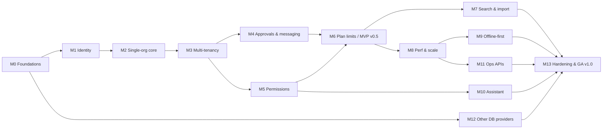

# Outlay — Implementation Plan

| Field | Value |
|---|---|
| Document | Plan.md (6 of 6 core specs) |
| Version | 0.0.0 · 2026-10-28 |
| Method | Milestones deliver **vertical, end-to-end increments** (API + UI + tests + docs). Within a milestone, tasks run top to bottom. |
| Build order | Follows the requirement's suggested order: **single organisation first** (expense entry, categories, budget alerts) → **add multi-tenancy and isolation** → **add plan limits last**, with the engineering foundations laid in M0. |
| Related | [PRD.md](PRD.md) · [TRD.md](TRD.md) · [Schema.md](Schema.md) · [../ROADMAP.md](../ROADMAP.md) · [../AI-HANDOVER.md](../AI-HANDOVER.md) |

**Legend:** `[ ]` todo · `[~]` in progress · `[x]` done · Size **S** ≤ ½ day · **M** 1–2 days · **L** 3–5 days (one developer + AI pair).
Every task ID (`M1-03`) goes into the branch name and commit (`feat(expenses): M1-03 create expense slice`).

---

## Definition of Done (applies to every task)

1. Code follows CLAUDE.md conventions. Architecture tests pass.
2. Unit tests (xUnit + NSubstitute + AwesomeAssertions in `Outlay.UnitTests`) and integration tests for every new endpoint (happy path, validation, RBAC, tenant isolation once M3 lands).
3. The endpoint has an OpenAPI summary, description, tags and examples, and appears in Scalar.
4. Postman requests added to the right role folders with scripts.
5. UI strings exist in **both** `en` and `bn`. Numbers and dates use `useFormat()`.
6. No secrets or sensitive values in logs (masking test passes).
7. Docs updated: the relevant spec section, `RELEASENOTES.md` "Unreleased" (with SQA checklist lines), and `AI-HANDOVER.md`.
8. CI green (backend, frontend, docker build).

---

## M0 — Foundations (engineering skeleton)

Goal: an empty but production-shaped system. `docker compose up` gives a healthy API, a PWA shell, logs in 5 folders, and Scalar docs.

| ID | Task | Size | Refs |
|---|---|---|---|
| [~] M0-01 | **Reconcile with the existing repo** `mtabassum/Outlay`. *Inspection done (commit `b5fc8f3`; specs updated to its layout: root `Outlay.slnx`, `src/Backend/*`, `src/Frontend/outlay-web`).* WeatherForecast files: the owner deleted them locally on 2026-10-28. As of that date GitHub still shows them at `b5fc8f3`, so push the change. Remaining: remove `AddControllers()`/`MapControllers()` from `Program.cs` and the `/weatherforecast` request in `Outlay.Api.http`, replace the Vite template content, add `README.md`. | S | TRD §4 table |
| [ ] M0-02 | Build config at the repo root: `global.json` (SDK 10, `rollForward: latestFeature`), `Directory.Build.props` (`OutlayTargetFramework`, nullable, implicit usings, analyzers, warnings as errors, embedded PDB, which lets the `.csproj` files drop their repeated properties), `Directory.Packages.props` (CPM, moving `Microsoft.AspNetCore.OpenApi` and the VS container tools package out of `Outlay.Api.csproj`), `.editorconfig` | S | TRD §18 |
| [ ] M0-03 | Projects: Domain, Application, Infrastructure, Api **already exist with correct references**. Add test projects under `tests/Backend/` (Outlay.UnitTests, Outlay.IntegrationTests, Outlay.ArchitectureTests, Outlay.PerformanceTests, Outlay.LoadTests (k6), Outlay.StressTests (k6), Outlay.Testing helpers), all on xUnit + NSubstitute + AwesomeAssertions (ADR-0017), and a `/tests/Backend/` folder in `Outlay.slnx` | M | TRD §16 |
| [ ] M0-04 | Architecture tests: layer dependencies, naming, sealed handlers | S | ADR-0002 |
| [ ] M0-05 | Domain primitives: `Entity`, `AggregateRoot`, `Result/Error`, `Money`, `YearMonth`, `Guard`, domain events | M | Schema §4 |
| [ ] M0-06 | MediatR + pipeline behaviours (Logging, Validation, Authorization stub, Transaction) + `ICommand/IQuery` markers + `IEndpoint` auto-registration | M | TRD §5 |
| [ ] M0-07 | **Logging:** Serilog categorised sub-loggers, `Sinks.Map` daily `dd-MM-yyyy.txt` files in the 5 folders, `OutlayLogging` options (hot reload), masking policy, caller-info helpers, retention job | L | TRD §8 |
| [ ] M0-08 | **Diagnostics middleware:** `CorrelationIdMiddleware`, `RequestLoggingMiddleware`, `GlobalExceptionMiddleware` + `ExceptionAdvisor` (initial rule set) + ProblemDetails + `UseOutlayDiagnostics()` | L | TRD §8.4, §9 |
| [ ] M0-09 | Configuration: options classes with validation (`ValidateOnStart`), `.env` loading (DotNetEnv, Development), `appsettings.*.json`, `.env.example` | S | TRD §17.2 |
| [ ] M0-10 | **DB abstraction v1:** `IDatabaseProvider`, `ProviderRegistry`, InMemory + PostgreSQL + SQL Server providers, pooled context factory, snake_case naming, interceptors skeleton (audit, query logging) | L | TRD §6, Schema §1 |
| [ ] M0-11 | **Query logging interceptor** + `TagWithCaller()` + slow-query threshold (red console, `[SLOW QUERY]` file prefix) | M | TRD §8.5 |
| [ ] M0-12 | Health checks (`/health/live`, `/health/ready`), `/api/v1/system/version`, `/api/v1/system/support-contact` | S | FR-OPS-04/05 |
| [ ] M0-13 | OpenAPI (built-in) + transformers + **Scalar with the Outlay theme** (`outlay.css`) + endpoint-summary architecture test | M | TRD §14.3, UiSpec §11 |
| [ ] M0-14 | Localisation backend: JSON localiser, `en`/`bn` resources, `RequestLocalization` | S | TRD §15 |
| [ ] M0-15 | Frontend setup in the **existing** `src/Frontend/outlay-web` (Vite 8, React 19.3, TS 6, ESLint 10 already there): strict mode is already on (TypeScript 6 default; optionally write `"strict": true` explicitly), Tailwind v4 `@theme` tokens, fonts (Anek Latin/Bangla), Prettier, Vitest, Playwright; set `<title>` and `lang` in `index.html` | M | UiSpec §2, TRD §12 |
| [ ] M0-16 | Frontend shell: router, app layout (rail, top bar, mobile tab bar), design-system components v1 (Button, Input, MoneyInput, StatusChip, DataTable, ProblemAlert, EmptyState) | L | UiSpec §3–4 |
| [ ] M0-17 | i18n frontend: i18next + ICU, `useFormat()` (Bengali digits, ৳ grouping), language toggle, `document.title`, CI missing-key check | M | UiSpec §8 |
| [ ] M0-18 | **PWA:** `public/manifest.json`, `src/service-worker.ts` → `service-worker.js` (injectManifest), install prompt, update toast | M | UiSpec §9, TRD §12.4 |
| [ ] M0-19 | HTTP client (`http.ts`): correlation ID, Accept-Language, Idempotency-Key, ProblemDetails parsing, support-contact fallback | S | TRD §12.1 |
| [ ] M0-20 | Docker: improve the existing `src/Backend/Outlay.Api/Dockerfile` (restore all projects, health check, DB tools arg), add `src/Frontend/outlay-web/Dockerfile`, `deploy/docker-compose.yml` (lb nginx, api×N, web, postgres, redis, mailpit) + profiles for other DBs | M | TRD §17.1 |
| [ ] M0-21 | CI: `backend-ci.yml`, `frontend-ci.yml`, `docker-publish.yml`, `codeql.yml`, Renovate/Dependabot | M | TRD §17.3 |
| [ ] M0-22 | `RELEASENOTES.md` + `release-notes.json` + Release Notes API + CI version check | S | FR-OPS-03 |

**Exit criteria:** `docker compose --profile postgres up --scale api=2` works, `/health/ready` is green, Scalar renders themed, a forced exception produces the full exception-log entry with file and line, a slow test query shows red, and the PWA is installable.

---

## M1 — Identity, Security & Sessions

| ID | Task | Size | Refs |
|---|---|---|---|
| [ ] M1-01 | ASP.NET Core Identity on `OutlayDbContext` + **BCrypt `IPasswordHasher`** (+ rehash-on-login) | M | ADR-0006 |
| [ ] M1-02 | OpenIddict server/validation: password, refresh (rolling), revoke, endsession, discovery; clients seeding; dev certificates | L | TRD §7.1 |
| [ ] M1-03 | Lockout after **3** failures + audit with IP; unlock flows | S | FR-AUTH-03 |
| [ ] M1-04 | **OTP service** (hash, 5 min, resend 60 s, 5 attempts, purposes) + **dev `111111` with startup guard** | M | TRD §7.6 |
| [ ] M1-05 | `urn:outlay:otp` grant (two-step MFA); `mfa_required` challenge response | M | F-02 |
| [ ] M1-06 | SMS providers (Console, TextBelt, Twilio) + SMTP email (MailKit, Mailpit) + resilience handlers | M | TRD §7.7 |
| [ ] M1-07 | Refresh-token cookie for `outlay-spa`, reuse detection → family revocation, `sstamp`/`pver` validation | M | TRD §7.1 |
| [ ] M1-08 | **`session_duration`** parameter (API only), clamping, `sexp` claim, `user_sessions` table, sessions endpoints | M | FR-AUTH-09 |
| [ ] M1-09 | Forgot/reset/change password (+ OTP, revoke sessions) | M | F-02b |
| [ ] M1-10 | Rate limiting policies (Default, Auth, Otp) | S | TRD §11.5 |
| [ ] M1-11 | Security headers, CORS, ForwardedHeaders with known proxies | S | TRD §7.8 |
| [ ] M1-12 | UI: S-01 Login (dev ribbon), S-02 OTP with countdown ring, S-03/S-04, token handling + silent refresh, logout clears IndexedDB | L | UiSpec S-01..S-04 |
| [ ] M1-13 | Postman: collection skeleton, environments, **role-based token pre-request script**, test script, `00 Auth & MFA` folder | M | TRD §14.4 |

**Exit:** a seeded user logs in with password + `111111` in Development. 3 wrong passwords lock the account. A refresh token can't be reused. `session_duration=1d` works from Postman only.

---

## M2 — Single-Organisation Core (MVP heart)

*(Requirement build step 1: one organisation, no multi-tenancy UI yet. The `tenant_id` column exists from day one with a single seeded tenant.)*

| ID | Task | Size | Refs |
|---|---|---|---|
| [ ] M2-01 | Domain: `ExpenseCategory`, `Budget`, `Expense`, `BudgetMonitor`, BR-* unit tests (xUnit `[Theory]` tables) | L | Schema §3.2, §4 |
| [ ] M2-02 | Categories slices: create, update, deactivate/reactivate, list, get (uniqueness, 50 chars) | M | FR-CAT |
| [ ] M2-03 | Budgets slices: get year, upsert year (batch), budget impact query; past-year lock | M | FR-BUD |
| [ ] M2-04 | Expenses slices: create (duplicate warning, soft limit), **update/delete own** (Saved/Pending, open month; **every edit re-runs validation, duplicate check excluding itself, and budget check excluding the old amount**; daily totals move old→new; `If-Match` concurrency; `month_closed`/`expense_locked` errors), get, list own. Tests: TRD §5.4 cases 3–13 that don't need Hard limits. | L | FR-EXP-06, BR-EXP-05/08…13, TRD §5.4 |
| [ ] M2-05 | Daily totals maintenance (domain event handlers, same transaction) | M | TRD §11.2 |
| [ ] M2-06 | Alert events + in-app notifications (80% once per month per category, over budget) + dedup | M | FR-NOT, BR-OVR-01 |
| [ ] M2-07 | Reports: dashboard + monthly summary (by category) from daily totals | M | FR-RPT-01/02 |
| [ ] M2-08 | Notifications slices + SignalR hub (single node) | M | FR-NOT-01/05 |
| [ ] M2-09 | Audit interceptor + `IAuditLogger` → DB + audit log file (IP) | M | TRD §8.6 |
| [ ] M2-10 | UI: S-07 Dashboard with **BudgetThread** signature component, S-09 Add Expense (impact panel, duplicate dialog), S-08 Expenses list (basic), S-12 Categories, S-13 Budget setup, S-14 Monthly summary, S-17 Notifications | L | UiSpec |
| [ ] M2-11 | Demo seed for TechCorp BD reproducing PRD §10 numbers | S | Schema §6 |

**Exit:** the June 2026 TechCorp numbers from the requirement appear on the Dashboard and in the Monthly Summary, and the 80% alert fires once.

---

## M3 — Multi-Tenancy, Onboarding & Team

*(Requirement build step 2: add a second organisation and enforce separation.)*

| ID | Task | Size | Refs |
|---|---|---|---|
| [ ] M3-01 | `ITenantContext` from claims, named query filter `Tenant`, SaveChanges guard, tenant-scoped cache keys | M | ADR-0008 |
| [ ] M3-02 | **Tenant isolation integration test suite** (two tenants × every endpoint) | M | TRD §7.4 |
| [ ] M3-03 | Memberships, multi-org users, workspace selector, `urn:outlay:switch_tenant` grant | M | FR-ORG-05 |
| [ ] M3-04 | Onboarding slices (account, verify, organisation, plan) + S-05 wizard | L | F-01 |
| [ ] M3-05 | Invitations (48 h, resend, revoke, accept existing/new user) + S-24 + S-15 Team | L | F-05 |
| [ ] M3-06 | Super Admin: tenants list/create/suspend/plan change, platform report (**no expense data**) + S-21 | M | FR-ORG-06/07, FR-RPT-05 |
| [ ] M3-07 | Role change, remove member (expenses kept), unlock, force reset | S | FR-TEAM |

**Exit:** TechCorp BD and Medicore Ltd run side by side, and the isolation suite is green.

---

## M4 — Approvals, Adjustments, Messaging

| ID | Task | Size | Refs |
|---|---|---|---|
| [ ] M4-01 | Hard limit → PendingApproval on create **and on edit** (Saved→Pending, Pending→Saved with withdrawal, delete→cancel); approve/reject slices (no self-approval, first-wins concurrency); `IApproverResolver`. Tests: TRD §5.4 cases 1, 2, 6, 9, 13–15, including **৳1,200 → ৳12,000**. | M | FR-APR, BR-EXP-09, BR-NOT-04/05 |
| [ ] M4-02 | Immediate approval, withdrawal and cancellation notifications to the **approver group** (all Admins + Managers with `expenses.approve` whose scope covers the member); decision notification to the member | S | BR-NOT-04/05 |
| [ ] M4-03 | Adjustments (Reduction/Increase, no negative net, monthly netting) | M | FR-ADJ |
| [ ] M4-04 | Outbox processor (email/SMS alerts, Pro+), templates in en/bn | M | FR-NOT-04 |
| [ ] M4-05 | Monthly snapshots job + late-approval rebuild | M | TRD §11.2 |
| [ ] M4-06 | Member-wise report + export (xlsx/csv, CSV-injection safe) | M | FR-RPT-03/04 |
| [ ] M4-07 | UI: S-10 Approvals + review sheet, S-11 Adjustments, export buttons | M | UiSpec |

---

## M5 — Permissions & Delegation

| ID | Task | Size | Refs |
|---|---|---|---|
| [ ] M5-01 | Permission catalogue + role templates + TypeScript generation | S | TRD §7.3 |
| [ ] M5-02 | Effective permission service (cached by `pver`) + `AuthorizationBehavior` full + `IDataScopeService` (own/team/all) | M | ADR-0007 |
| [ ] M5-03 | Permissions API: catalogue, hierarchy, user permissions, grant (subset rule), revoke + cascade preview, reset to template | L | FR-PERM |
| [ ] M5-04 | Direct user creation by Admin/Manager with grants (`POST /users`) | S | PRD §3.3 |
| [ ] M5-05 | S-16 Permissions page (tree + matrix + locked items + cascade dialog); `<Can>` and menu gating | L | UiSpec S-16 |
| [ ] M5-06 | Postman `05 RBAC negative matrix` + integration RBAC matrix tests | M | FR-DOC-03 |

---

## M6 — Plan Limits

*(Requirement build step 3: plan limits last.)*

| ID | Task | Size | Refs |
|---|---|---|---|
| [ ] M6-01 | `PlanLimitBehavior` + domain checks: users, categories, hard limit, alerts, exports, member reports | M | BR-PLAN |
| [ ] M6-02 | Starter 6-month history window in all expense queries (data kept) | S | BR-PLAN-03 |
| [ ] M6-03 | Downgrade guard; "Plan limit reached" status; seat banners; upgrade prompts in UI | M | BR-PLAN-01/04 |

**MVP release v0.5 cut here** (all P0 done). See ROADMAP.

---

## M7 — Advanced Search & Bulk Import (all CRUDs)

| ID | Task | Size | Refs |
|---|---|---|---|
| [ ] M7-01 | Search core: `FilterNode` DSL, operators, `SearchFieldMap<T>`, expression builder, limits; unit tests per operator × type | L | TRD §13.1 |
| [ ] M7-02 | OQL parser (shared test vectors with the frontend parser) | M | FR-SRCH-03 |
| [ ] M7-03 | `/search` + `/search/fields` for Expenses, Categories, Budgets, Users, Invitations, Adjustments, Notifications, Tenants, Audit | M | FR-SRCH-01 |
| [ ] M7-04 | Saved filters | S | FR-SRCH-05 |
| [ ] M7-05 | UI: generic FilterBuilder, OQL editor, chips, URL state, localised pagination | L | UiSpec §6.3 |
| [ ] M7-06 | Import core: readers (CsvHelper, ClosedXML), header aliases en/bn, parallel validation, in-file + DB duplicates, all-or-nothing commit, annotated error workbook | L | TRD §13.2 |
| [ ] M7-07 | Import definitions: categories, budgets, expenses, invitations, adjustments; templates endpoint; background jobs + SignalR progress | M | FR-IMP |
| [ ] M7-08 | UI: S-18 Import wizard (4 steps, error grid, download annotated file) | M | UiSpec S-18 |

---

## M8 — Performance, Caching, Reliability, Scale

| ID | Task | Size | Refs |
|---|---|---|---|
| [ ] M8-01 | FusionCache `IAppCache` (L1 + Redis/Memcached L2 + backplane), `CachingBehavior`, tag invalidation after commit | M | ADR-0010 |
| [ ] M8-02 | Redis-down drill: fail-safe, circuit breaker, warning-once logging; integration test with the container stopped | S | TRD §9 |
| [ ] M8-03 | **Idempotency filter** + store + replay/conflict semantics | M | TRD §11.3 |
| [ ] M8-04 | Resilience: EF execution strategies, HTTP standard handlers, Redis retries, all configurable | S | TRD §11.4 |
| [ ] M8-05 | Distributed rate limiting (Redis store), SignalR Redis backplane, Data Protection keys in Redis, distributed locks for jobs | M | TRD §11.6 |
| [ ] M8-06 | nginx load balancer config (least_conn, WebSockets), compose scale test | S | TRD §11.6 |
| [ ] M8-07 | Dependency-down UX: 503 mapping per provider, support contact (config), frontend error screens | S | F-15 |
| [ ] M8-08 | BenchmarkDotNet suite; k6 load (`Outlay.LoadTests`) and stress/spike/soak (`Outlay.StressTests`) with thresholds; nightly workflow | L | TRD §16 |

---

## M9 — Offline-First

| ID | Task | Size | Refs |
|---|---|---|---|
| [ ] M9-01 | `change_version` counters + `GET /sync/changes` (scope-aware, soft deletes) | M | TRD §12.3 |
| [ ] M9-02 | Dexie schema per user+tenant, network-first reads with fallback | M | ADR-0012 |
| [ ] M9-03 | Outbox + `useOfflineMutation` + replay with Idempotency-Key and If-Match; temp id swap; `month_closed` → "Create adjustment" pre-filled | L | F-11, BR-EXP-12 |
| [ ] M9-04 | Conflict and rejected-item UI; pending badge; sync history | M | UiSpec §7 |
| [ ] M9-05 | Background Sync in the service worker; Workbox runtime caching | S | TRD §12.4 |
| [ ] M9-06 | Playwright offline E2E (create offline → reconnect → single server record) | M | US-06 |

---

## M10 — Assistant (text, then voice)

| ID | Task | Size | Refs |
|---|---|---|---|
| [ ] M10-01 | Normaliser (en/bn), period resolver (frozen clock), member resolver (scope-bound) | M | TRD §13.3 |
| [ ] M10-02 | Intent catalogue + 10 intents + answer templates (en/bn) + suggestions | L | FR-AST-05 |
| [ ] M10-03 | `AssistantGuard` + guardrail test suite (foreign tenant, out-of-scope person, member asking team totals, super admin) | M | FR-AST-03/04 |
| [ ] M10-04 | `/assistant/ask` endpoint, rate limit, audit | S | |
| [ ] M10-05 | UI S-19: chat panel, text first | M | UiSpec S-19 |
| [ ] M10-06 | Voice: SpeechRecognition (en-US / bn-BD), speechSynthesis, feature detection, privacy note | M | TRD §12.6 |

---

## M11 — Operations APIs

| ID | Task | Size | Refs |
|---|---|---|---|
| [ ] M11-01 | Step-up OTP for sensitive actions | S | TRD §7.6 |
| [ ] M11-02 | **Log download API** (category + `dd-MM-yyyy`, whitelist paths, tail JSON) + S-22 log viewer (red slow lines) | M | TRD §13.6 |
| [ ] M11-03 | **DB backup API**: strategies (SQL Server native, pg_dump, mysqldump, mongodump, Access copy, Logical JSON), jobs, download, retention, audit + S-22 | L | TRD §13.5 |
| [ ] M11-04 | Release notes UI (S-22) + SQA checklist rendering | S | FR-OPS-03 |
| [ ] M11-05 | Postman `09 System` folder | S | |

---

## M12 — Remaining DB Providers

| ID | Task | Size | Refs |
|---|---|---|---|
| [ ] M12-01 | MySQL provider (Oracle `MySql.EntityFrameworkCore`; fork alternative behind a flag) + migrations + nightly CI | M | TRD §6.2 |
| [ ] M12-02 | Oracle provider + migrations + nightly CI (gvenzl/oracle-free) | M | |
| [ ] M12-03 | MongoDB provider: EF provider config, `ProjectSafe`, `MongoReportReadStore`, Identity/OpenIddict Mongo stores, index initialiser, command monitoring → query log | L | TRD §6.4 |
| [ ] M12-04 | MS Access provider (Windows-only build flag, EnsureCreated, file-copy backup), documented as experimental | M | |
| [ ] M12-05 | Provider matrix doc + switching guide (appsettings/.env examples per provider) | S | |

---

## M13 — Hardening, Documentation & GA

| ID | Task | Size | Refs |
|---|---|---|---|
| [ ] M13-01 | Security review: OWASP ASVS L2 checklist, ZAP baseline scan in CI, dependency audit, secrets scan | M | NFR-SEC-01 |
| [ ] M13-02 | Accessibility pass (axe, keyboard, screen reader EN/BN) | M | NFR-A11Y-01 |
| [ ] M13-03 | Full Postman suite run in CI via Newman | S | |
| [ ] M13-04 | `README.md` (quick start, dev accounts, OTP 111111, provider switching, docker) | M | FR-DOC-04 |
| [ ] M13-05 | `docs/guides/USER-GUIDE.md` (per role, EN + BN) | M | |
| [~] M13-06 | `docs/guides/BACKEND-DEVELOPER-GUIDE.md`: architecture, **"build a CRUD slice"** walkthrough, search/import registration, migrations per provider, logging usage, upgrade runbook. *First version written 2026-10-27. Verify every snippet against the real code as milestones land and finalise at M13.* | M | |
| [~] M13-07 | `docs/guides/FRONTEND-DEVELOPER-GUIDE.md`: structure, **"add a CRUD screen"** walkthrough, offline mutation, i18n, design tokens, PWA. *First version written 2026-10-27. Verify against the real code and finalise at M13.* | S | |
| [~] M13-08 | C4 diagrams in `docs/diagrams/C4-DIAGRAMS.md` (*done 2026-10-27*). Remaining: export SVGs to `docs/diagrams/svg/`, add an `mmdc` render check to CI, review ADRs | S | C4-DIAGRAMS.md, Schema §2 |
| [ ] M13-09 | `deploy.yml` with staging → production approval, migration job, rollback runbook | M | TRD §17.3 |
| [ ] M13-10 | Release v1.0.0: RELEASENOTES + release-notes.json + SQA sign-off | S | |

---

## Dependency Graph

M12 can run in parallel from M2 onward once the persistence abstraction is stable. M10's voice part can start after M10-05.
