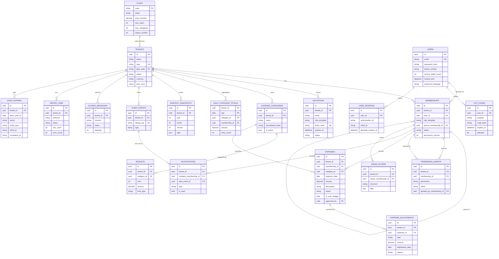
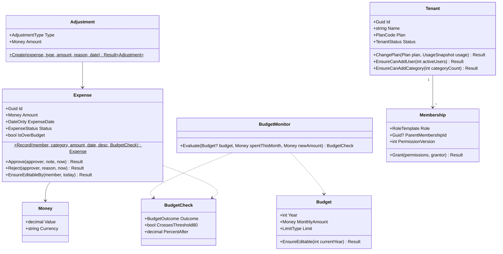

# Outlay — Data Schema

| Field | Value |
|---|---|
| Document | Schema.md (5 of 6 core specs) |
| Version | 0.0.0 · 2026-10-28 |
| ORM | EF Core 10 (code-first). Dapper for read stores. MongoDB driver for Mongo read stores. |
| Related | [PRD.md](PRD.md) (rules `BR-*`) · [TRD.md](TRD.md) §6 (providers) · [adr/0008](adr/0008-shared-database-multi-tenancy.md) · [adr/0009](adr/0009-multi-provider-persistence-tiers.md) |

---

## 1. Conventions

| Topic | Convention |
|---|---|
| Naming | Entities in PascalCase (C#). **Tables and columns in `snake_case`** on every relational provider (`EFCore.NamingConventions`), and Mongo collections use the same names. Index names: `ix_<table>_<cols>`, unique: `ux_<table>_<cols>`. |
| Keys | `id` = **UUID v7** (time-ordered, generated in the app with `Guid.CreateVersion7()`) on every table. Index-friendly and safe to generate offline. |
| Tenancy | Every tenant-owned table has `tenant_id uuid NOT NULL` as the **first column of every index**. The Platform pseudo-tenant `00000000-0000-0000-0000-000000000001` holds Super Admin memberships. |
| Auditing | `created_at`, `created_by` (membership id), `updated_at`, `updated_by` on auditable entities (set by interceptor) |
| Soft delete | `is_deleted`, `deleted_at`, `deleted_by` on `ISoftDeletable` entities (named query filter `SoftDelete`) |
| Concurrency | `row_version`: SQL Server `rowversion`; PostgreSQL `xmin` system column; MySQL/Oracle/Access/Mongo a `uuid` concurrency token regenerated on each update |
| Sync | `change_version bigint` on synced entities, taken from `tenant_change_counters` on every insert/update/soft-delete (TRD §12.3) |
| Money | `decimal(18,2)`, **always positive** (BR-EXP-01, FR-ADJ-02). Currency is ISO-4217 `char(3)` on the tenant (default `BDT`). |
| Time | Instants are `timestamptz`/`datetimeoffset` in **UTC**. Business dates (expense date, adjustment date) are `date`, interpreted in the tenant's time zone. |
| Text | Unicode everywhere (`nvarchar` on SQL Server, `NVARCHAR2` on Oracle) for Bengali. Normalised shadow columns (`normalized_*`, upper-invariant and trimmed) for case-insensitive uniqueness and search. |
| Enums | Stored as **strings** (`varchar(32)`) for readability and portability |

---

## 2. Entity-Relationship Diagram



> The ASP.NET Core Identity tables (`asp_net_user_claims`, `asp_net_user_logins`, `asp_net_user_tokens`) and the OpenIddict tables (`openiddict_applications`, `openiddict_authorizations`, `openiddict_scopes`, `openiddict_tokens`) use their standard schemas and are omitted from the diagram. Outlay doesn't use Identity *roles* for authorisation. Roles are membership templates and permissions are grants (ADR-0007).

---

## 3. Table Definitions

Types are shown in PostgreSQL notation. The provider mapping is in §5.

### 3.1 Platform & identity

#### `plans`
| Column | Type | Null | Notes |
|---|---|---|---|
| code | varchar(32) PK | ✗ | `starter`, `pro`, `enterprise` |
| name | varchar(64) | ✗ | Localised display via i18n key `plan.<code>` |
| price_monthly | numeric(18,2) | ✓ | null = custom pricing |
| max_users | int | ✓ | null = unlimited (Starter 3, Pro 15) |
| max_categories | int | ✓ | Starter 10 |
| history_months | int | ✓ | Starter 6; null = full |
| allows_hard_limit | bool | ✗ | Pro, Enterprise |
| allows_email_sms_alerts | bool | ✗ | Pro, Enterprise |
| allows_member_reports | bool | ✗ | Pro, Enterprise |
| allows_export | bool | ✗ | Pro (report export), Enterprise (full data) |
| allows_sso | bool | ✗ | Enterprise |
| is_active | bool | ✗ | |

#### `tenants`
| Column | Type | Null | Notes |
|---|---|---|---|
| id | uuid PK | ✗ | |
| name | varchar(120) | ✗ | |
| normalized_name | varchar(120) | ✗ | |
| slug | varchar(80) UK | ✗ | `techcorp-bd` |
| industry | varchar(64) | ✓ | |
| team_size_band | varchar(16) | ✓ | `1-5`, `6-15`, `16-50`, `50+` |
| currency | char(3) | ✗ | default `BDT` |
| time_zone | varchar(64) | ✗ | IANA, default `Asia/Dhaka` |
| default_language | varchar(8) | ✗ | `en` / `bn` |
| plan_code | varchar(32) FK → plans | ✗ | |
| status | varchar(32) | ✗ | `Active`, `Suspended` (computed badge "Plan limit reached" is derived, not stored) |
| upgrade_requested | varchar(32) | ✓ | e.g. `enterprise` |
| created_at, updated_at | timestamptz | | |
| row_version | — | | |

Indexes: `ux_tenants_slug`, `ix_tenants_status`.

#### `users` (ASP.NET Core Identity user, extended)
| Column | Type | Null | Notes |
|---|---|---|---|
| id | uuid PK | ✗ | |
| email, normalized_email | varchar(256) | ✗ | `ux_users_normalized_email` (global, one login per email) |
| user_name, normalized_user_name | varchar(256) | ✗ | = email |
| password_hash | varchar(100) | ✓ | **BCrypt** (`$2b$12$…`, enhanced/SHA-384 pre-hash). Null until the invitation is accepted. |
| security_stamp, concurrency_stamp | varchar(64) | ✗ | Security stamp rotates on password change and revocation |
| phone_number | varchar(20) | ✓ | E.164 (`+8801…`) |
| phone_number_confirmed, email_confirmed | bool | ✗ | |
| two_factor_enabled | bool | ✗ | |
| lockout_enabled | bool | ✗ | true |
| lockout_end | timestamptz | ✓ | |
| access_failed_count | int | ✗ | Lock at 3 (BR config) |
| full_name | varchar(120) | ✗ | |
| preferred_language | varchar(8) | ✗ | `en` / `bn` |
| theme | varchar(8) | ✗ | `system` / `light` / `dark` |
| is_super_admin | bool | ✗ | Also expressed by a Platform-tenant membership |
| last_login_at | timestamptz | ✓ | |
| created_at | timestamptz | ✗ | |

#### `memberships`
| Column | Type | Null | Notes |
|---|---|---|---|
| id | uuid PK | ✗ | |
| tenant_id | uuid FK → tenants | ✗ | Platform pseudo-tenant for Super Admins |
| user_id | uuid FK → users | ✗ | |
| role_template | varchar(32) | ✗ | `SuperAdmin`, `TenantAdmin`, `Manager`, `Member` |
| parent_membership_id | uuid FK → memberships | ✓ | Hierarchy (who manages and delegates to this person). May reference the Platform tenant for Admins created by a Super Admin. |
| data_scope_override | varchar(8) | ✓ | `own`/`team`/`all` (otherwise derived from permissions) |
| status | varchar(16) | ✗ | `Active`, `Removed`, `Suspended` |
| permission_version | int | ✗ | Incremented on every grant/revoke/role change, and mirrored in the token claim `pver` |
| joined_at | timestamptz | ✗ | |
| removed_at | timestamptz | ✓ | Past expenses remain (BR-ORG-03) |
| last_used_at | timestamptz | ✓ | Workspace selector ordering |

Indexes: `ux_memberships_tenant_user (tenant_id, user_id)`, `ix_memberships_tenant_parent (tenant_id, parent_membership_id)`, `ix_memberships_user`.

#### `permission_grants`
| Column | Type | Null | Notes |
|---|---|---|---|
| id | uuid PK | ✗ | |
| tenant_id | uuid | ✗ | |
| membership_id | uuid FK | ✗ | Receiver |
| permission | varchar(64) | ✗ | From the catalogue (TRD §7.3). Validated against the code constants. |
| effect | varchar(8) | ✗ | `Grant` or `Deny` (Deny removes a template default) |
| granted_by_membership_id | uuid FK | ✗ | Enables the revocation cascade (ADR-0007) |
| granted_at | timestamptz | ✗ | |

Indexes: `ux_permission_grants_membership_permission (tenant_id, membership_id, permission)`, `ix_permission_grants_granted_by (tenant_id, granted_by_membership_id, permission)`.

**Cascade query (relational, recursive CTE):**

```sql
WITH RECURSIVE chain AS (
    SELECT g.id, g.membership_id
    FROM permission_grants g
    WHERE g.tenant_id = @tenant AND g.permission = @permission AND g.granted_by_membership_id = @target
  UNION ALL
    SELECT g.id, g.membership_id
    FROM permission_grants g
    JOIN chain c ON g.granted_by_membership_id = c.membership_id
    WHERE g.tenant_id = @tenant AND g.permission = @permission
)
SELECT * FROM chain;   -- Oracle: same with CONNECT BY or recursive WITH; Mongo/InMemory: iterative BFS in code
```

#### `invitations`
| Column | Type | Null | Notes |
|---|---|---|---|
| id | uuid PK | ✗ | |
| tenant_id | uuid | ✗ | |
| email, normalized_email | varchar(256) | ✗ | |
| role_template | varchar(32) | ✗ | |
| permissions_json | jsonb / nvarchar(max) | ✓ | Grants to apply on acceptance (subset-checked at invite time **and** at acceptance) |
| token_hash | char(64) UK | ✗ | SHA-256 of the URL token. The raw token is never stored. |
| expires_at | timestamptz | ✗ | created + 48 h (BR-ORG-05) |
| status | varchar(16) | ✗ | `Pending`, `Accepted`, `Expired`, `Revoked` |
| invited_by_membership_id | uuid | ✗ | Becomes `parent_membership_id` of the new membership |
| accepted_at | timestamptz | ✓ | |

Index: `ix_invitations_tenant_email_status`.

#### `otp_codes`
| Column | Type | Null | Notes |
|---|---|---|---|
| id | uuid PK | ✗ | Returned to the client as an opaque `mfa_token`/`otp_id` |
| user_id | uuid FK | ✗ | |
| purpose | varchar(16) | ✗ | `Login`, `Signup`, `Reset`, `Change`, `StepUp`, `Invite` |
| code_hash | char(64) | ✗ | SHA-256(code + salt). The dev code is hashed too. |
| salt | char(32) | ✗ | |
| channels | varchar(32) | ✗ | `Sms,Email` |
| expires_at | timestamptz | ✗ | created + 5 min |
| resend_available_at | timestamptz | ✗ | created + 60 s |
| attempts | int | ✗ | Max 5 |
| consumed_at | timestamptz | ✓ | Single use |
| client_ip | varchar(45) | ✓ | |

Index: `ix_otp_codes_user_purpose_expires`. A cleanup job deletes rows older than 24 h.

#### `user_sessions`
| Column | Type | Null | Notes |
|---|---|---|---|
| id | uuid PK | ✗ | |
| user_id | uuid FK | ✗ | |
| tenant_id | uuid | ✓ | Current workspace |
| authorization_id | varchar(100) | ✗ | OpenIddict authorization (revoking it kills the token family) |
| client_id | varchar(64) | ✗ | `outlay-spa`, `outlay-postman` |
| device | varchar(200) | ✓ | Parsed user agent |
| client_ip | varchar(45) | ✓ | |
| created_at, last_seen_at | timestamptz | ✗ | |
| absolute_expires_at | timestamptz | ✗ | From `session_duration` / default (claim `sexp`) |
| revoked_at | timestamptz | ✓ | |

### 3.2 Expense domain (all tenant-owned)

#### `expense_categories`
| Column | Type | Null | Notes |
|---|---|---|---|
| id | uuid PK | ✗ | |
| tenant_id | uuid | ✗ | |
| name | varchar(50) | ✗ | BR-CAT-02 (≤ 50, not blank) |
| normalized_name | varchar(50) | ✗ | Upper-invariant + trimmed + collapsed whitespace |
| description | varchar(250) | ✓ | |
| is_active | bool | ✗ | BR-CAT-04 |
| deactivated_at | timestamptz | ✓ | |
| audit cols, row_version, change_version | | | |

Indexes: `ux_expense_categories_tenant_normalized_name` (BR-CAT-01), `ix_expense_categories_tenant_active`.

#### `budgets`
| Column | Type | Null | Notes |
|---|---|---|---|
| id | uuid PK | ✗ | |
| tenant_id | uuid | ✗ | |
| category_id | uuid FK | ✗ | |
| year | smallint | ✗ | |
| amount | numeric(18,2) | ✗ | > 0, decimals allowed (BR-BUD-04). **Monthly allowance** for each month of `year` (ADR-0014) |
| limit_type | varchar(8) | ✗ | `Soft` / `Hard` (Hard needs the plan flag) |
| audit cols, row_version, change_version | | | |

Index: `ux_budgets_tenant_category_year` (BR-BUD-01). No row means Unlimited (BR-BUD-02). Locking of past years is a domain rule, not a column.

#### `expenses`
| Column | Type | Null | Notes |
|---|---|---|---|
| id | uuid PK | ✗ | |
| tenant_id | uuid | ✗ | |
| membership_id | uuid FK | ✗ | Owner (the member who spent) |
| category_id | uuid FK | ✗ | |
| expense_date | date | ✗ | ≤ today (tenant TZ) |
| amount | numeric(18,2) | ✗ | > 0 |
| currency | char(3) | ✗ | Copied from the tenant |
| description | varchar(500) | ✓ | |
| normalized_description | varchar(500) | ✓ | For duplicate detection and search |
| status | varchar(20) | ✗ | `Saved`, `PendingApproval`, `Approved`, `Rejected` |
| is_over_budget | bool | ✗ | Soft-limit flag at time of saving |
| approved_by_membership_id | uuid | ✓ | |
| approved_at | timestamptz | ✓ | |
| approval_note | varchar(500) | ✓ | |
| rejected_by_membership_id | uuid | ✓ | |
| rejected_at | timestamptz | ✓ | |
| rejection_reason | varchar(500) | ✓ | Required when rejected |
| duplicate_confirmed | bool | ✗ | The user chose "Save anyway" |
| source | varchar(16) | ✗ | `Web`, `Import`, `OfflineSync`, `Api`, `Assistant` |
| import_job_id | uuid | ✓ | |
| client_reference | varchar(64) | ✓ | Offline temp id (`tmp_…`) for id swap |
| is_deleted, deleted_at, deleted_by | | | Soft delete (own current-year expenses only) |
| audit cols, row_version, change_version | | | |

Indexes:
- `ix_expenses_tenant_date_category (tenant_id, expense_date, category_id) INCLUDE (amount, status)`: reports and budget checks.
- `ix_expenses_tenant_membership_date (tenant_id, membership_id, expense_date DESC)`: "my expenses".
- `ix_expenses_tenant_status_pending (tenant_id, status) WHERE status = 'PendingApproval'` (filtered/partial where supported).
- `ix_expenses_duplicate (tenant_id, membership_id, expense_date, category_id, amount)`: duplicate check (BR-EXP-04).
- `ix_expenses_tenant_change_version (tenant_id, change_version)`: delta sync.

**Spend definition:** a row counts towards "Spent" when `status IN ('Saved','Approved') AND is_deleted = false`. Pending is shown separately and Rejected is excluded everywhere (BR-OVR-05/06).

#### `expense_adjustments`
| Column | Type | Null | Notes |
|---|---|---|---|
| id | uuid PK | ✗ | |
| tenant_id | uuid | ✗ | |
| expense_id | uuid FK | ✗ | The original is never modified (FR-ADJ-01) |
| type | varchar(10) | ✗ | `Reduction` (e.g. refund) / `Increase` |
| amount | numeric(18,2) | ✗ | > 0. For Reduction, Σ reductions ≤ original + Σ increases (no negative net) |
| adjustment_date | date | ✗ | ≥ expense_date, ≤ today. Reports net it in this month (FR-ADJ-03). |
| reason | varchar(500) | ✗ | |
| audit cols, change_version | | | Adjustments are immutable (no update/delete) |

Index: `ix_expense_adjustments_tenant_expense`, `ix_expense_adjustments_tenant_date`.

### 3.3 Reporting & alerts

#### `daily_category_totals` (US-20 pre-aggregation)
| Column | Type | Null | Notes |
|---|---|---|---|
| tenant_id | uuid | ✗ | PK part |
| day | date | ✗ | PK part |
| category_id | uuid | ✗ | PK part |
| membership_id | uuid | ✗ | PK part (enables member-wise reports) |
| amount | numeric(18,2) | ✗ | Net of adjustments dated that day |
| entry_count | int | ✗ | |
| updated_at | timestamptz | ✗ | |

Updated in the same transaction as the source change (TRD §11.2). Monthly summary = `SUM(amount) GROUP BY category_id` over the month's days, which is about 31 × categories × members rows instead of millions.

#### `monthly_snapshots`
| Column | Type | Null | Notes |
|---|---|---|---|
| id | uuid PK | ✗ | |
| tenant_id | uuid | ✗ | |
| year, month | smallint | ✗ | |
| version | int | ✗ | +1 when a late approval rebuilds it |
| data | jsonb / nvarchar(max) / CLOB / BSON | ✗ | `{ categories:[{id,name,budget,spent,status}], members:[{id,name,role,total,entries}], totals:{…} }` |
| created_at | timestamptz | ✗ | |

Index: `ux_monthly_snapshots_tenant_year_month_version`. Reads use the max version.

#### `alert_events`
| Column | Type | Null | Notes |
|---|---|---|---|
| id | uuid PK | ✗ | |
| tenant_id | uuid | ✗ | |
| type | varchar(32) | ✗ | `Threshold80`, `OverBudget`, `ApprovalRequired`, `ApprovalWithdrawn`, `ApprovalCancelled`, `MemberJoined`, `SeatsUsage`, `PlanLimitReached`, `ApprovalDecision` |
| dedup_key | varchar(200) | ✗ | e.g. `Threshold80:{categoryId}:2026-06`. **Unique per tenant**, so the event fires once per period (BR-OVR-01, BR-NOT-03) |
| payload | jsonb | ✗ | Template arguments |
| created_at | timestamptz | ✗ | |

Index: `ux_alert_events_tenant_dedup_key`. Insert-if-absent; a unique violation is treated as "already sent".

#### `notifications`
| Column | Type | Null | Notes |
|---|---|---|---|
| id | uuid PK | ✗ | |
| tenant_id | uuid | ✗ | |
| recipient_membership_id | uuid FK | ✗ | |
| alert_event_id | uuid FK | ✓ | |
| type | varchar(32) | ✗ | |
| severity | varchar(8) | ✗ | `Critical`, `Warning`, `Info` |
| title_key, body_key | varchar(100) | ✗ | i18n keys, rendered in the recipient's language |
| args | jsonb | ✗ | |
| link_url | varchar(300) | ✓ | e.g. `/approvals/{id}` |
| is_read | bool | ✗ | |
| read_at | timestamptz | ✓ | |
| created_at | timestamptz | ✗ | |
| change_version | bigint | ✗ | |

Index: `ix_notifications_tenant_recipient_read_created (tenant_id, recipient_membership_id, is_read, created_at DESC)`.

#### `outbox_messages`
| Column | Type | Null | Notes |
|---|---|---|---|
| id | uuid PK | ✗ | |
| tenant_id | uuid | ✓ | null for platform/auth messages |
| channel | varchar(8) | ✗ | `Email`, `Sms` |
| template | varchar(64) | ✗ | |
| recipient | varchar(256) | ✗ | Email/phone (not logged in files) |
| payload | jsonb | ✗ | Template args. **OTP codes are never stored here**: OTP is sent directly, and only the hash is stored. |
| status | varchar(16) | ✗ | `Pending`, `Sending`, `Sent`, `Failed`, `Dead` |
| attempts | int | ✗ | |
| next_attempt_at | timestamptz | ✗ | Exponential backoff |
| locked_until | timestamptz | ✓ | Multi-replica claim |
| locked_by | varchar(64) | ✓ | Instance id |
| last_error | varchar(1000) | ✓ | |
| created_at, sent_at | timestamptz | | |

Index: `ix_outbox_messages_status_next_attempt`.

### 3.4 Platform features

#### `import_jobs`
| Column | Type | Null | Notes |
|---|---|---|---|
| id | uuid PK | ✗ | |
| tenant_id | uuid | ✗ | |
| resource | varchar(32) | ✗ | `expenses`, `categories`, `budgets`, `invitations`, `adjustments` |
| file_name | varchar(260) | ✗ | |
| file_sha256 | char(64) | ✗ | |
| row_count | int | ✗ | |
| status | varchar(16) | ✗ | `Queued`, `Validating`, `Failed`, `Committing`, `Succeeded` |
| error_count | int | ✗ | |
| errors | jsonb | ✓ | `[{row, column, value, code, message}]` (capped at 10,000; the full list is in the error file) |
| error_file_path | varchar(400) | ✓ | Annotated workbook |
| inserted_count | int | ✗ | |
| idempotency_key | varchar(64) | ✓ | |
| created_by_membership_id | uuid | ✗ | |
| started_at, finished_at | timestamptz | ✓ | |

#### `saved_filters`
`id`, `tenant_id`, `owner_membership_id`, `resource` varchar(32), `name` varchar(80), `filter` jsonb (the JSON filter DSL), `is_shared` bool, `created_at`. Unique `(tenant_id, owner_membership_id, resource, name)`.

#### `idempotency_records`
| Column | Type | Null | Notes |
|---|---|---|---|
| id | uuid PK | ✗ | |
| tenant_id | uuid | ✓ | |
| user_id | uuid | ✓ | |
| key | varchar(64) | ✗ | |
| method, route | varchar(8), varchar(200) | ✗ | |
| request_hash | char(64) | ✗ | SHA-256 of the canonical body |
| state | varchar(12) | ✗ | `InProgress`, `Completed` |
| status_code | int | ✓ | |
| response_body | text | ✓ | Masked of nothing (tenant data is fine in DB), size-capped at 64 KB |
| content_type | varchar(100) | ✓ | |
| created_at, expires_at | timestamptz | ✗ | TTL 24 h. A cleanup job deletes expired rows. |

Index: `ux_idempotency_records_scope (tenant_id, user_id, key)`.

#### `audit_entries`
| Column | Type | Null | Notes |
|---|---|---|---|
| id | uuid PK | ✗ | |
| tenant_id | uuid | ✓ | null/Platform for platform actions |
| actor_user_id | uuid | ✓ | null = system |
| actor_membership_id | uuid | ✓ | |
| action | varchar(64) | ✗ | `Expense.Created`, `Auth.LoginFailed`, `Auth.LockedOut`, `Permission.Granted`, `System.BackupDownloaded`, … |
| entity_type | varchar(64) | ✓ | |
| entity_id | varchar(64) | ✓ | |
| changed_properties | jsonb | ✓ | Property names |
| old_values, new_values | jsonb | ✓ | Non-sensitive fields only. Money and secrets masked unless `Audit:StoreSensitiveValues=true` |
| client_ip | varchar(45) | ✓ | Real client IP after trusted proxy processing (BR-SEC-02) |
| user_agent | varchar(300) | ✓ | |
| correlation_id | varchar(64) | ✓ | |
| occurred_at | timestamptz | ✗ | |

Indexes: `ix_audit_entries_tenant_occurred (tenant_id, occurred_at DESC)`, `ix_audit_entries_entity (entity_type, entity_id)`, `ix_audit_entries_actor`. Append-only (no update/delete permission for the app's DB user where the provider supports it).

#### `backup_jobs`
`id`, `provider` varchar(16), `engine_version` varchar(64), `strategy` (`Native`/`Logical`), `status`, `file_path`, `file_size_bytes` bigint, `sha256`, `requested_by_user_id`, `created_at`, `completed_at`, `error`. Not tenant-owned (platform).

#### `tenant_change_counters`
`tenant_id` uuid PK, `last_change_version` bigint. Incremented atomically per SaveChanges (relational: `UPDATE … SET last_change_version = last_change_version + n RETURNING`; Mongo: `$inc` with `findOneAndUpdate`).

#### `data_protection_keys`
Standard EF Core Data Protection table (used when Redis is not the key store).

---

## 4. Domain Model (OOP view)



`BudgetMonitor.Evaluate` rules: no budget → `Unlimited`. `spent + new ≤ budget` → `WithinBudget` (plus `CrossesThreshold80` when it crosses 80%). `> budget`: Soft → `SavedOverBudget`, Hard → `RequiresApproval`.

---

## 5. Provider Type Mapping

| .NET type | SQL Server | PostgreSQL | MySQL | Oracle | MS Access (Jet) | MongoDB |
|---|---|---|---|---|---|---|
| `Guid` | `uniqueidentifier` | `uuid` | `char(36)` | `RAW(16)` | `GUID` | `UUID` (Binary subtype 4, `GuidRepresentation.Standard`) |
| `decimal(18,2)` | `decimal(18,2)` | `numeric(18,2)` | `decimal(18,2)` | `NUMBER(18,2)` | `DECIMAL(18,2)` | `Decimal128` |
| `DateOnly` | `date` | `date` | `date` | `DATE` | `DATETIME` | `Date` (midnight UTC) |
| `DateTimeOffset` (UTC) | `datetimeoffset(7)` | `timestamptz` | `datetime(6)` (UTC normalised) | `TIMESTAMP WITH TIME ZONE` | `DATETIME` (UTC normalised) | `Date` |
| `string` (Unicode) | `nvarchar(n)` | `varchar(n)` | `varchar(n)` utf8mb4 | `NVARCHAR2(n)` | `VARCHAR(n)` / `LONGTEXT` | `String` |
| JSON | `nvarchar(max)` (+ JSON functions) | `jsonb` | `json` | `CLOB` (IS JSON) | `LONGTEXT` | embedded document |
| `bool` | `bit` | `boolean` | `tinyint(1)` | `NUMBER(1)` | `BIT` | `Boolean` |
| Row version | `rowversion` | `xmin` | `char(36)` token | `RAW(16)` token | `GUID` token | `UUID` token |

Provider-specific notes:
- **PostgreSQL:** partial index for pending approvals. `citext` is not used; normalised columns are used instead (portable).
- **SQL Server:** filtered index for pending approvals, `INCLUDE` columns, and `READ_COMMITTED_SNAPSHOT ON`.
- **MySQL:** `utf8mb4_0900_ai_ci` collation, InnoDB, no partial index (full index instead).
- **Oracle:** identifiers ≤ 128 chars. Snake_case names avoid quoting issues. `NVARCHAR2` for Bengali. No `INCLUDE`.
- **MS Access:** 255-char text limit → `LONGTEXT` for description. No filtered indexes. Single-user file locking means it's for demos only.
- **MongoDB:** one collection per table (same names). Compound indexes created at startup by `MongoIndexInitializer`. `daily_category_totals` uses a compound `_id`. Transactions require a replica set (compose runs `rs0`).

---

## 6. Migrations & Seeding

- **Relational:** one migrations assembly per provider (TRD §6.5). Initial migration `0001_Initial`. Every model change requires a migration for **all Tier 1 and 2 providers** in the same PR (CI enforced).
- **MongoDB / InMemory / Access:** `EnsureCreated` + index initialiser. A schema version is stored in `__schema_version`.
- **Reference data (all environments):** `plans` (Starter, Pro, Enterprise), OpenIddict applications/scopes, the Platform pseudo-tenant.
- **Demo data (Development only, `Database:SeedDemoData=true`, guarded):**

| Entity | Data |
|---|---|
| Super Admin | `superadmin@outlay.app` |
| Tenants | TechCorp BD (Pro, 8 members), Medicore Ltd (Starter, 3/3), NovaSoft Inc (Enterprise, 47), GreenLeaf Co (Starter, 2/3) |
| TechCorp users | Rahim Ahmed (`rahim@techcorp.com.bd`, Admin), Nusrat Jahan (`nusrat@…`, Manager), Fahmida Akter (`fahmida@…`), Tarek Mahmud (`tarek@…`), Karim Hasan (`karim@…`, Invited), and 3 more Members |
| Categories & 2026 budgets | Travel & Transport ৳30,000 **Hard**; Meals & Entertainment ৳25,000 Soft; Software Subscriptions ৳40,000 Soft; Office Supplies ৳20,000 Soft; Training & Courses ৳35,000 Soft; Entertainment (no budget = Unlimited) |
| June 2026 expenses | 67 entries reproducing the PRD §10 totals (৳86,400; Travel ৳32,100 incl. pending ৳1,200 from Fahmida "Taxi to client — Gulshan") |
| Notifications | The 5 alerts shown in the requirement's Notifications mock |

Dev passwords are documented in `README.md` (e.g. `Outlay@Dev2026!`) and work **only** when `ASPNETCORE_ENVIRONMENT=Development`. The OTP is `111111`.

---

## 7. Data Retention & Privacy

| Data | Retention |
|---|---|
| Expenses, adjustments, budgets | Life of tenant. Starter hides data older than 6 months but never deletes it (BR-PLAN-03). |
| Notifications | 12 months |
| OTP codes | 24 h |
| Idempotency records | 24 h |
| Audit entries | 7 years (financial records). Configurable `Audit:RetentionDays`. |
| Log files | `OutlayLogging:RetainedDays` (30) |
| Backups | `Backup:RetentionDays` (14) |
| Removed members | Membership kept with status `Removed`. Personal profile data can be anonymised on request (name → "Former member", email hashed), and expenses remain. |
