# Outlay — Technical Requirements Document (TRD)

| Field | Value |
|---|---|
| Document | TRD.md (4 of 6 core specs) |
| Version | 0.0.0 · 2026-10-28 |
| Backend | .NET 10 (LTS) · ASP.NET Core 10 · EF Core 10 · C# 14 |
| Frontend | React 19 · TypeScript 6 · Vite 8 · Tailwind CSS v4 · PWA (repo: `src/Frontend/outlay-web`) |
| Related | [PRD.md](PRD.md) · [AppFlow.md](AppFlow.md) · [UiSpec.md](UiSpec.md) · [Schema.md](Schema.md) · [Plan.md](Plan.md) · ADRs in [adr/](adr/) |

> This document is the *how*. When it conflicts with the PRD on behaviour, the PRD wins. When it conflicts with an ADR on a decision, the newer ADR wins and this document must be updated.

---

## 1. Architectural Principles

| Principle | How it shows up in Outlay |
|---|---|
| **Clean Architecture** | Dependencies point inward: `Api → Application → Domain`, `Infrastructure → Application`. Domain has zero package references. Enforced by architecture tests (NetArchTest). |
| **Vertical Slice Architecture** | Code is organised by feature and use case (`Features/Expenses/CreateExpense/`), not by technical layer. A slice holds its command/query, handler, validator, DTOs and endpoint. |
| **CQRS with MediatR** | Commands change state and return `Result<T>`. Queries never change state and may bypass the domain to read projections. A pipeline of behaviours handles cross-cutting concerns. |
| **SOLID / OOP / OOAD** | Rich domain entities guard their invariants (`Expense.Approve(by, note)`). Small interfaces (`IClock`, `ITenantContext`, `ISmsSender`). Strategy pattern for providers (DB, SMS, cache, backup). |
| **KISS / YAGNI** | No generic repository over EF Core. No event sourcing. No microservices. One deployable API and one SPA. Abstractions only where a second implementation exists or is required (DB providers, SMS, cache). |
| **DRY** | One validator per command, reused by single create, bulk import and offline sync. Permission constants are generated to TypeScript. API types are generated from OpenAPI. |
| **Secure by default** | Tenant filter is always on. Permission is checked in the pipeline, not in the endpoint. Logs are masked. |

---

## 2. C4 Diagrams

The architecture diagrams live in **[docs/diagrams/C4-DIAGRAMS.md](diagrams/C4-DIAGRAMS.md)**, the single canonical copy, so this document and the diagrams can't drift apart.

| View | What it shows |
|---|---|
| Level 1: System Context | Outlay, its five kinds of users, and the SMS, email and browser-speech systems it depends on |
| Level 2: Containers | PWA + IndexedDB, nginx load balancer, Outlay API (N replicas), primary database (configurable provider), Redis, file volumes |
| Level 3: API components | Middleware pipeline (each step named), auth server, endpoints, OpenAPI + Scalar, MediatR pipeline, slices, shared engines, domain, persistence, cache, workers, SignalR hub, logging |
| Level 3: API by project | The same components grouped by .NET project, showing the dependency rule and that Infrastructure implements Application's abstractions |
| Level 3: Web components | Shell/router, feature modules, design system, data layer, offline engine, auth, i18n, real-time client, service worker, speech adapters |
| Dynamic | Member submits an expense over a Hard limit. The log pipeline from code to `logs/<category>/dd-MM-yyyy.txt`. |
| Deployment | Docker Compose topology, the environment table (local, compose, staging, production), and the InMemory single-instance rule |
| Level 4: Code | One vertical slice (CreateExpense) as a class diagram |

The ER diagram is in [Schema.md §2](Schema.md).

---

## 3. Technology Stack

| Area | Choice | Notes / licence |
|---|---|---|
| Runtime | **.NET 10 LTS** (`net10.0`) | LTS until Nov 2028. Upgrade path to .NET 11 in §18. |
| Web | ASP.NET Core 10 Minimal APIs, `Asp.Versioning.Http` | URL versioning `/api/v1` |
| CQRS | **MediatR 14.x** | **Licensing:** v13+ is dual RPL-1.5/commercial. Free *Community* licence for companies under US$5M revenue, non-profits, education and non-production. **Outlay uses 14.x with the Community licence key (owner's company qualifies, Q-06).** 12.5.0 was the last Apache-2.0 release. See ADR-0003 and Q-06. |
| Validation | FluentValidation | Apache-2.0 |
| Mapping | Hand-written `ToDto()` methods + projection expressions | AutoMapper 15+ is commercial and 14.0.0 (last MIT) has unpatched CVE-2026-32933. Explicit mapping also avoids runtime errors and over-exposing fields. Mapperly (Apache-2.0 source generator) is the approved escape hatch. (ADR-0016) |
| ORM | **EF Core 10** (primary) + **Dapper** (optional, reports and bulk reads) | |
| Identity | ASP.NET Core Identity + **BCrypt.Net-Next** | Custom `IPasswordHasher<AppUser>` (ADR-0006) |
| OAuth 2.0 / OIDC | **OpenIddict 7.x** (server + validation) | Apache-2.0 |
| Cache | **FusionCache** (L1 memory, L2 Redis or Memcached, Redis backplane, fail-safe) | MIT. Exposed behind `IAppCache` (ADR-0010) |
| Redis | StackExchange.Redis | Also SignalR backplane and distributed lock |
| Real-time | SignalR + `Microsoft.AspNetCore.SignalR.StackExchangeRedis` | |
| Logging | **Serilog** (+ Sinks.File, Sinks.Map, Sinks.Console, Enrichers) | Custom categorised file layout (§8) |
| Resilience | **Polly v8** + `Microsoft.Extensions.Http.Resilience`, EF Core execution strategies | |
| Rate limiting | `Microsoft.AspNetCore.RateLimiting` (+ `RedisRateLimiting.AspNetCore` for distributed) | |
| API docs | `Microsoft.AspNetCore.OpenApi` (OpenAPI 3.1) + **Scalar.AspNetCore** | Branded theme (§14.3) |
| Import/Export | **CsvHelper**, **ClosedXML** | MS-PL/Apache, MIT |
| SMS | Twilio SDK, TextBelt (HTTP), Console | §7.7 |
| Email | MailKit (SMTP); Mailpit in development | |
| Tests | **xUnit** (all .NET test projects) + **NSubstitute** (mocks) + **AwesomeAssertions** (`.Should()` assertions), WebApplicationFactory + **Testcontainers** + Respawn (integration), NetArchTest (architecture), BenchmarkDotNet (performance), **k6** (load/stress incl. failure injection) | All free/OSS: xUnit Apache-2.0, NSubstitute BSD, AwesomeAssertions Apache-2.0 (community fork of FluentAssertions 7, whose v8+ is paid), k6 AGPL tool (ADR-0017) |
| Frontend | **React 19** (19.3 in repo), TypeScript 6 (strict), **Vite 8**, **Tailwind CSS v4**, React Router 7, TanStack Query 5, TanStack Table, Zustand, React Hook Form + Zod, **Dexie** (IndexedDB), i18next (+ICU), @microsoft/signalr, Recharts, Radix UI, lucide-react, vite-plugin-pwa (Workbox, `injectManifest`) | Node **24 LTS** |
| Frontend tests | Vitest + React Testing Library + MSW, Playwright + @axe-core/playwright | |
| Containers | Docker (multi-stage), docker-compose with profiles, nginx | |
| CI/CD | GitHub Actions + GHCR + Renovate/Dependabot + CodeQL + Trivy | |

> **Version pinning policy:** exact versions live in `Directory.Packages.props` (Central Package Management) and `package-lock.json`. This document names majors only, so it doesn't go stale.

---

## 4. Repository & Solution Structure

> ✅ Verified against the repository `mtabassum/Outlay` at commit `b5fc8f3` ("Initial commit: solution structure with Clean Architecture backend and React frontend").
> Items marked **(exists)** are already in the repo. Everything else is added by the Plan tasks noted.

```
Outlay/
├── Outlay.slnx                              (exists) solution at the repo root; add test + persistence projects to it
├── global.json  Directory.Build.props  Directory.Packages.props  .editorconfig   (M0-02)
├── .gitignore  .dockerignore                (exists)
├── CLAUDE.md  README.md  MASTER-SPECIFICATION.md  MASTER-PROMPT.md
├── ROADMAP.md  RELEASENOTES.md  AI-HANDOVER.md
├── docs/
│   ├── PRD.md AppFlow.md UiSpec.md TRD.md Schema.md Plan.md
│   ├── adr/                         # Architecture Decision Records
│   ├── diagrams/                    # C4 + ER (Mermaid sources, exported SVG)
│   └── guides/                      # USER-GUIDE.md, BACKEND-DEVELOPER-GUIDE.md, FRONTEND-DEVELOPER-GUIDE.md
├── src/
│   ├── Backend/
│   │   ├── Outlay.Domain/                     (exists, empty)
│   │   ├── Outlay.Application/                (exists, empty; → Domain)
│   │   ├── Outlay.Infrastructure/             (exists, empty; → Application, Domain)
│   │   ├── Outlay.Api/                        (exists: WeatherForecast template, controllers, Dockerfile; → Application, Infrastructure)
│   │   ├── Outlay.Persistence.SqlServer/      # provider registration + migrations (M0-10)
│   │   ├── Outlay.Persistence.PostgreSql/     (M0-10)
│   │   ├── Outlay.Persistence.MySql/          (M12)
│   │   ├── Outlay.Persistence.Oracle/         (M12)
│   │   ├── Outlay.Persistence.Access/         # Windows-only, excluded from Linux builds by default (M12)
│   │   └── Outlay.Persistence.MongoDb/        (M12)
│   └── Frontend/
│       └── outlay-web/                        (exists: Vite 8 + React 19.3 + TypeScript 6 template)
│           ├── public/ (manifest.json, icons/, robots.txt)
│           ├── src/ (see §12.1)
│           ├── tests/e2e/                     # Playwright
│           └── Dockerfile                     # web image (M0-20)
├── tests/
│   └── Backend/
│       ├── Outlay.UnitTests/                  # xUnit + NSubstitute + AwesomeAssertions (Domain/, Application/, Infrastructure/ folders)
│       ├── Outlay.IntegrationTests/           # xUnit + WebApplicationFactory + Testcontainers + Respawn
│       ├── Outlay.ArchitectureTests/          # xUnit + NetArchTest
│       ├── Outlay.PerformanceTests/           # BenchmarkDotNet
│       ├── Outlay.LoadTests/                  # k6 scripts + thresholds
│       ├── Outlay.StressTests/                # k6 stress/spike/soak + Redis/DB failure injection
│       └── Outlay.Testing/                    # shared builders, FakeClock, personas (referenced by Unit + Integration)
├── postman/
│   ├── Outlay.postman_collection.json
│   └── environments/ (Local, Docker, Staging)
├── deploy/
│   ├── nginx/ (nginx.conf)
│   ├── docker-compose.yml  docker-compose.override.yml
│   └── .env.example
└── .github/workflows/ (backend-ci.yml, frontend-ci.yml, docker-publish.yml, deploy.yml, nightly-load.yml, codeql.yml)
```

**What the initial commit already has, and what to change (task M0-01):**

| Item in repo | Keep / change |
|---|---|
| `Outlay.slnx` at the root with `/src/Backend/` folder | **Keep.** Add a `/tests/Backend/` solution folder and the persistence projects. |
| Project references (Api → Application + Infrastructure; Infrastructure → Application + Domain; Application → Domain) | **Keep.** Already the Clean Architecture direction. Add architecture tests to lock it in. |
| `net10.0`, `Nullable`, `ImplicitUsings` repeated in every `.csproj` | Move to `Directory.Build.props` with `OutlayTargetFramework` (TRD §18) |
| Package versions inside `.csproj` (`Microsoft.AspNetCore.OpenApi 10.0.14`, `Microsoft.VisualStudio.Azure.Containers.Tools.Targets 1.24.2-preview.1`) | Move to `Directory.Packages.props` (Central Package Management) |
| `WeatherForecast.cs`, `Controllers/WeatherForecastController.cs`, `AddControllers()`/`MapControllers()`, `Outlay.Api.http` sample | **Delete.** Replace with `IEndpoint` Minimal API registration (ADR-0004). |
| `Program.cs` with `AddOpenApi()` / `MapOpenApi()` | **Keep and extend** with the composition-root extension methods and Scalar (M0-13) |
| `src/Backend/Outlay.Api/Dockerfile` (Visual Studio generated, build context = repo root, ports 8080/8081, `USER $APP_UID`) | **Keep the location** (VS "Container" launch profile uses it). Improve per §17.1: restore all projects for layer caching, health check, embedded PDBs, optional DB tools. |
| `launchSettings.json` profiles (http 5071, https 7024, Container) | **Keep** as the shared default ports. Developers override locally with `--urls` / `ASPNETCORE_URLS` instead of editing the file. |
| `appsettings.json` with default `Logging` section | Replace the `Logging` section with Serilog/`OutlayLogging` (M0-07) and add the sections in §6–§11 |
| `.gitignore` already ignores `[Ll]ogs/`, `*.log`, `*.bak`, `.env`, `*.pfx`, local DB files, Playwright/Storybook output | **Keep.** Runtime `logs/` and backup files won't be committed. Keep `Migrations/` tracked (they're source code for **both** dev startup and the production migration job). Only reword the comment, which says migrations run via `MigrateAsync()` on startup. Per §6.5 that happens only in Development (`Database:ApplyMigrationsOnStartup`), and production uses the migration job. Suggested wording is in the Backend Developer Guide §6.1. |
| `.dockerignore` | **Keep** |
| Frontend `src/Frontend/outlay-web`: React 19.3, Vite 8, TypeScript ~6.0, ESLint 10, `@vitejs/plugin-react` 6 | **Keep.** Add Tailwind v4 and the libraries in §3. **Strict mode is already on**: TypeScript 6.0 defaults `strict` to `true` when the key is absent (verified by compiling a probe with TS 6.0.3 against this tsconfig). Optionally write `"strict": true` explicitly so the intent is visible to readers and to tools that assume TypeScript 5 defaults. Replace the template `App.tsx`/`App.css`/assets and set `<title>`/`lang` in `index.html`. |
| No tests, `global.json`, CI, README, compose | Added in M0 |

### 4.1 Backend project internals

```
Outlay.Domain/
  Common/ (Entity, AggregateRoot, IAuditable, ITenantOwned, ISoftDeletable, DomainEvent, Result, Error, Guard)
  ValueObjects/ (Money, EmailAddress, PhoneNumber, YearMonth, CategoryName)
  Tenants/ (Tenant, Plan, PlanLimits, SubscriptionStatus)
  Users/ (AppUser*, Membership, Role, Invitation)        *Identity user lives in Infrastructure; Domain has UserProfile
  Permissions/ (Permission, PermissionGrant, PermissionCatalog, DataScope)
  Categories/ (ExpenseCategory)
  Budgets/ (Budget, LimitType, BudgetStatus, BudgetMonitor domain service)
  Expenses/ (Expense, ExpenseStatus, Adjustment, AdjustmentType, DuplicateKey)
  Notifications/ (Notification, NotificationType, DedupKey)
  Reports/ (DailyCategoryTotal, MonthlySnapshot)

Outlay.Application/
  Abstractions/ (IAppDbContext, ITenantContext, ICurrentUser, IClock, IAppCache, ISmsSender, IEmailSender,
                 IOtpService, IPermissionService, IDataScopeService, IBackgroundQueue, IFileStore, IReportReadStore)
  Behaviors/ (LoggingBehavior, ValidationBehavior, AuthorizationBehavior, TenantGuardBehavior,
              PlanLimitBehavior, CachingBehavior, CacheInvalidationBehavior, TransactionBehavior)
  Common/ (PagedResult, SearchRequest, FilterNode, Messaging markers: ICommand, IQuery, ICacheableQuery,
           IIdempotentCommand, IRequirePermission, ITransactionalCommand)
  Features/
    Expenses/
      CreateExpense/   CreateExpenseCommand.cs  CreateExpenseHandler.cs  CreateExpenseValidator.cs  ExpenseDto.cs
      UpdateExpense/ DeleteExpense/ ApproveExpense/ RejectExpense/ GetExpense/ SearchExpenses/
      ImportExpenses/ ExportExpenses/ GetBudgetImpact/
    Budgets/ Categories/ Adjustments/ Users/ Invitations/ Permissions/ Tenants/ Plans/
    Reports/ Notifications/ Imports/ Sync/ Assistant/ Audit/ System/ Onboarding/ Me/
  Search/ (FilterParser (OQL), FilterExpressionBuilder, SearchFieldMap<T>, Operators)
  Import/ (ImportPipeline<TRow,TCommand>, RowError, IImportDefinition<T>)
  Assistant/ (IntentCatalog, Normalizer, SlotResolvers, AnswerTemplates)

Outlay.Infrastructure/
  Persistence/ (OutlayDbContext, Configurations/, Interceptors/ (Audit, Tenant, DomainEvents, QueryLogging),
                ProviderRegistry, IDatabaseProvider strategies, DapperExecutor, ReadStores/)
  Identity/ (AppUser, BcryptPasswordHasher, OpenIddict setup, TokenHandlers, OtpService)
  Caching/ (FusionCacheAppCache, CacheKeys)
  Logging/ (SerilogSetup, LogCategories, MaskingPolicy, ExceptionAdvisor, CallerInfo)
  Messaging/ (SmsSenders/{Console,TextBelt,Twilio}, SmtpEmailSender, NotificationOutboxProcessor)
  Background/ (ChannelBackgroundQueue, Workers, DistributedLock)
  Backup/ (IBackupStrategy: SqlServerNative, PgDump, MySqlDump, MongoDump, AccessFileCopy, LogicalJson)
  Files/ (CsvReader, ExcelReader, ErrorWorkbookWriter)
  Localization/ (JsonStringLocalizer resources en/bn)

Outlay.Api/
  Program.cs (composition root only, < 80 lines; everything via extension methods)
  Endpoints/ (IEndpoint + one folder per feature mirroring Application/Features)
  Middleware/ (CorrelationIdMiddleware, RequestLoggingMiddleware, GlobalExceptionMiddleware)
  Filters/ (IdempotencyFilter, ValidationProblemFilter)
  Hubs/ (NotificationsHub)
  OpenApi/ (transformers, examples), wwwroot/scalar/outlay.css
  Resources/ (release-notes.json embedded at build)
```

---

## 5. Application Architecture

### 5.1 Request lifecycle

```mermaid
flowchart LR
    R[HTTP request] --> M1[ForwardedHeaders] --> M2[CorrelationId] --> M3[RequestLogging] --> M4[GlobalException]
    M4 --> M5[Localization] --> M6[RateLimiter] --> M7[AuthN/AuthZ] --> E[Endpoint + IdempotencyFilter]
    E --> B1[LoggingBehavior] --> B2[ValidationBehavior] --> B3[AuthorizationBehavior] --> B4[TenantGuard + PlanLimit]
    B4 --> B5[CachingBehavior for queries] --> B6[TransactionBehavior for commands] --> H[Handler]
    H --> D[(DbContext / Read store)]
```



**Behaviour order matters:** validation runs before authorization so that malformed requests fail cheaply. Authorization still runs before any data is read. Caching runs only for queries marked `ICacheableQuery`. The transaction wraps only commands marked `ITransactionalCommand`.

### 5.2 Slice anatomy (canonical example)

```csharp
// Application/Features/Expenses/CreateExpense/CreateExpenseCommand.cs
public sealed record CreateExpenseCommand(
    DateOnly ExpenseDate, Guid CategoryId, decimal Amount, string? Description, bool ConfirmDuplicate)
    : ICommand<Result<CreateExpenseResponse>>, IRequirePermission, IIdempotentCommand, ITransactionalCommand
{
    public string Permission => Permissions.Expenses.Create;
}

public sealed record CreateExpenseResponse(Guid Id, ExpenseStatus Status, bool IsOverBudget, string MessageKey);

// CreateExpenseValidator.cs — reused by ImportExpenses and offline sync (DRY)
public sealed class CreateExpenseValidator : AbstractValidator<CreateExpenseCommand>
{
    public CreateExpenseValidator(IClock clock, IStringLocalizer<SharedResource> l)
    {
        RuleFor(x => x.Amount).GreaterThan(0).WithMessage(l["Expense.AmountPositive"]);
        RuleFor(x => x.ExpenseDate).LessThanOrEqualTo(_ => clock.TodayInTenantZone())
            .WithMessage(l["Expense.DateNotFuture"]);
        RuleFor(x => x.CategoryId).NotEmpty().WithMessage(l["Expense.CategoryRequired"]);
        RuleFor(x => x.Description).MaximumLength(500);
    }
}

// CreateExpenseHandler.cs
internal sealed class CreateExpenseHandler(
    IAppDbContext db, ICurrentUser user, IBudgetMonitor monitor, IClock clock)
    : ICommandHandler<CreateExpenseCommand, Result<CreateExpenseResponse>>
{
    public async Task<Result<CreateExpenseResponse>> Handle(CreateExpenseCommand cmd, CancellationToken ct)
    {
        var category = await db.Categories.TagWithCaller()
            .FirstOrDefaultAsync(c => c.Id == cmd.CategoryId && c.IsActive, ct);
        if (category is null) return ExpenseErrors.CategoryNotFoundOrInactive;

        if (!cmd.ConfirmDuplicate &&
            await db.Expenses.TagWithCaller().AnyAsync(Expense.IsDuplicateOf(user.Id, cmd.ExpenseDate, cmd.CategoryId, cmd.Amount, cmd.Description), ct))
            return ExpenseErrors.PossibleDuplicate;   // → 409 with code "duplicate_warning"

        var check = await monitor.EvaluateAsync(category.Id, YearMonth.From(cmd.ExpenseDate), cmd.Amount, ct);
        var expense = Expense.Record(user.Id, category, Money.Bdt(cmd.Amount), cmd.ExpenseDate, cmd.Description, check, clock.UtcNow);

        db.Expenses.Add(expense);           // domain events (OverBudget, ApprovalRequested, ThresholdCrossed) dispatched in SaveChanges
        return new CreateExpenseResponse(expense.Id, expense.Status, expense.IsOverBudget, expense.ResultMessageKey);
    }
}

// Api/Endpoints/Expenses/CreateExpenseEndpoint.cs
internal sealed class CreateExpenseEndpoint : IEndpoint
{
    public void Map(IEndpointRouteBuilder app) => app.MapGroup("/api/v1/expenses").WithTags("Expenses")
        .MapPost("/", async (CreateExpenseCommand cmd, ISender sender, CancellationToken ct) =>
            (await sender.Send(cmd, ct)).ToHttpResult(StatusCodes.Status201Created))
        .AddEndpointFilter<IdempotencyFilter>()
        .WithName("CreateExpense")
        .WithSummary("Create an expense")
        .WithDescription("Records an expense for the current user. Applies duplicate detection and budget rules (Soft limit → saved and flagged; Hard limit → Pending approval).")
        .Produces<CreateExpenseResponse>(201).ProducesValidationProblem().ProducesProblem(409).ProducesProblem(403);
}
```

**Rules of a slice**
1. One folder per use case. Files are small, and the handler has a single public method.
2. Handlers return `Result<T>` and never throw for business outcomes. Exceptions are for the truly exceptional.
3. Endpoints contain **no logic**: bind, send, map the result.
4. Handlers depend on abstractions from `Application/Abstractions`, never on Infrastructure types.
5. Queries project straight to DTOs (`Select`). On providers without server-side projection (MongoDB) use `.ProjectSafe(caps, selector)`, see §6.4.

### 5.3 Result → HTTP mapping

| Error type | HTTP | ProblemDetails `code` |
|---|---|---|
| `Validation` | 422 | `validation_failed` + `errors{field:[messages]}`, `month_closed` |
| `NotFound` | 404 | `not_found` |
| `Conflict` (concurrency, duplicate, already approved, locked) | 409 | `concurrency_conflict` (+ current state), `duplicate_warning`, `already_decided`, `expense_locked` |
| `Forbidden` (permission/scope/plan) | 403 | `forbidden`, `plan_limit_reached`, `cannot_grant_unheld_permission` |
| `Unauthorized` | 401 | `unauthorized` |
| `RateLimited` | 429 | `rate_limited` |
| Dependency unavailable | 503 | `dependency_unavailable` |
| Unhandled | 500 | `internal_error` |

All ProblemDetails include `traceId`, `correlationId`, `instance`, and localised `title`/`detail` (RFC 9457).

### 5.4 Editing and deleting expenses (`UpdateExpense`, `DeleteExpense`)

Business rules: PRD BR-EXP-05 and BR-EXP-08…13, BR-NOT-04/05. Flow: AppFlow F-03b. Edits reuse the **same validator and `IBudgetMonitor`** as create (DRY), so an edit can never bypass a rule that create enforces.

```csharp
public sealed record UpdateExpenseCommand(
    Guid Id, DateOnly ExpenseDate, Guid CategoryId, decimal Amount, string? Description,
    bool ConfirmDuplicate, string RowVersion)                                   // RowVersion from If-Match
    : ICommand<Result<ExpenseDto>>, IRequirePermission, IIdempotentCommand, ITransactionalCommand
{
    public string Permission => Permissions.Expenses.UpdateOwn;
}

internal sealed class UpdateExpenseHandler(
    IAppDbContext db, ICurrentUser user, IBudgetMonitor monitor, IAccountingCalendar months, IClock clock)
    : ICommandHandler<UpdateExpenseCommand, Result<ExpenseDto>>
{
    public async Task<Result<ExpenseDto>> Handle(UpdateExpenseCommand cmd, CancellationToken ct)
    {
        var expense = await db.Expenses.TagWithCaller()
            .FirstOrDefaultAsync(e => e.Id == cmd.Id && e.MembershipId == user.MembershipId, ct);
        if (expense is null) return ExpenseErrors.NotFound;                          // not own → 404 (BR-EXP-13)
        if (!expense.HasVersion(cmd.RowVersion)) return ExpenseErrors.ConcurrencyConflict(expense);   // 409 + current state

        var editable = expense.EnsureEditable(months, clock.Today);                 // Saved/Pending, current year, month open
        if (editable.IsFailure) return editable.Error;                              // expense_locked (409) / month_closed (422)
        if (!months.IsOpen(YearMonth.From(cmd.ExpenseDate), clock.Today)) return ExpenseErrors.MonthClosed;

        var category = await db.Categories.TagWithCaller().FirstOrDefaultAsync(c => c.Id == cmd.CategoryId && c.IsActive, ct);
        if (category is null) return ExpenseErrors.CategoryNotFoundOrInactive;

        if (!cmd.ConfirmDuplicate && await db.Expenses.TagWithCaller().AnyAsync(
                Expense.IsDuplicateOf(user.Id, cmd.ExpenseDate, cmd.CategoryId, cmd.Amount, cmd.Description, excludeId: expense.Id), ct))
            return ExpenseErrors.PossibleDuplicate;                                  // 409 duplicate_warning

        var check = await monitor.EvaluateAsync(category.Id, YearMonth.From(cmd.ExpenseDate), cmd.Amount,
                                                excludeExpenseId: expense.Id, ct);   // spend WITHOUT the old amount
        var revised = expense.Revise(category, Money.Of(cmd.Amount), cmd.ExpenseDate, cmd.Description, check, clock.UtcNow);
        return revised.IsFailure ? revised.Error : expense.ToDto();
        // Revise() raises ExpenseRevised(old, new) → daily totals move old→new (same transaction),
        // plus ApprovalRequested or ApprovalWithdrawn when the status changes, plus deduplicated alert events.
    }
}
```

**`Expense.Revise` status rules (domain):**

| Current status | Budget outcome of the edit | New status | Events |
|---|---|---|---|
| Saved | Within / unlimited / Soft over | Saved (Over budget flag recalculated) | `ExpenseRevised` |
| Saved | Hard over | **PendingApproval** | `ExpenseRevised`, `ApprovalRequested` |
| PendingApproval | Hard over | PendingApproval | `ExpenseRevised` (approvers see the new amount) |
| PendingApproval | Within / unlimited / Soft over | **Saved** | `ExpenseRevised`, `ApprovalWithdrawn` |
| Approved / Rejected | — | refused | `expense_locked` |

`DeleteExpenseCommand(Id, RowVersion)` applies the same ownership, version and open-month checks, soft-deletes the expense, raises `ExpenseDeleted` (totals out) and, if it was Pending, `ApprovalCancelled`.

**Approver resolution:**

```csharp
public interface IApproverResolver   // Application/Abstractions
{
    // All Admins of the tenant + Managers holding expenses.approve whose data scope (own/team/all)
    // covers expense.MembershipId. The submitter is excluded, except an Admin when nobody else qualifies
    // (self-approval, audit-flagged). Evaluated on every queue read and approve call; never stored.
    Task<IReadOnlyList<MembershipId>> GetApproversAsync(Expense expense, CancellationToken ct);
    Task<bool> CanApproveAsync(MembershipId actor, Expense expense, CancellationToken ct);
}
```

Notification handlers for `ApprovalRequested`, `ApprovalWithdrawn` and `ApprovalCancelled` send to `GetApproversAsync(...)`. `ApproveExpense` and `RejectExpense` call `CanApproveAsync` and return **404** (not 403) when it's false, so out-of-scope expenses aren't revealed. The Approvals queue query filters with the same rule.

**Required tests (`Outlay.UnitTests` + `Outlay.IntegrationTests`):**

| # | Case | Expected |
|---|---|---|
| 1 | **Saved ৳1,200 in Hard-limit Travel (৳20,000 spent of ৳30,000) edited to ৳12,000** | Budget check uses ৳30,800 → status **PendingApproval**, not counted in Spent, approvers get "Approval Required" |
| 2 | That Pending expense edited back to ৳1,200 | Status Saved, approvers get "Request withdrawn", the row leaves their queue |
| 3 | ৳29,000 spent including this ৳1,000 expense, budget ৳30,000, edit to ৳2,000 | ৳30,000 ≤ ৳30,000 → stays **Saved** (old amount excluded) |
| 4 | Edit with no changes to an existing expense | **No** duplicate warning (self excluded) |
| 5 | Edit that makes it identical to another expense | 409 `duplicate_warning`; with `ConfirmDuplicate` → saved |
| 6 | Edit or delete an **Approved** or **Rejected** expense | 409 `expense_locked` |
| 7 | Edit after the month closed (direct and via offline replay) | 422 `month_closed`, nothing changed |
| 8 | On 2 July, move a June expense to 1 July (grace window) | Both months' daily totals updated |
| 9 | Stale `If-Match` after a Manager approved it | 409 `concurrency_conflict` with current state "Approved" |
| 10 | Member edits another member's expense; Admin edits a member's expense | 404 for both (Admins use adjustments) |
| 11 | Category changed from Travel to Meals | Travel total decreases, Meals total increases, Meals 80% alert fires at most once that month |
| 12 | Soft-limit category edit crosses the budget | Stays Saved, `IsOverBudget` = true, one over-budget alert per month |
| 13 | Delete a Pending expense / delete a Saved expense | Request cancelled and approvers notified / totals reduced |
| 14 | Team-scoped Manager, expense from outside the team | Not in `GetApproversAsync`, not in queue, approve → 404. Whole-organisation Manager **is** an approver. |
| 15 | Admin narrows a Manager while a request is pending | Request leaves that Manager's queue, approve → 404 |
| 16 | Every edit and delete | Audit entry with changed field names, no amounts in log files |

---

## 6. Persistence & Database Abstraction

### 6.1 Provider selection (configuration only)

```jsonc
"Database": {
  "Provider": "InMemory",          // InMemory | SqlServer | PostgreSql | MySql | Oracle | Access | MongoDb
  "ConnectionStrings": {
    "SqlServer":  "Server=sqlserver;Database=Outlay;User Id=sa;Password=${SQLSERVER_PASSWORD};TrustServerCertificate=True;Max Pool Size=200",
    "PostgreSql": "Host=postgres;Database=outlay;Username=outlay;Password=${POSTGRES_PASSWORD};Maximum Pool Size=200",
    "MySql":      "Server=mysql;Database=outlay;User=outlay;Password=${MYSQL_PASSWORD};Maximum Pool Size=200",
    "Oracle":     "User Id=outlay;Password=${ORACLE_PASSWORD};Data Source=oracle:1521/FREEPDB1;Max Pool Size=200",
    "Access":     "Provider=Microsoft.ACE.OLEDB.12.0;Data Source=C:\\data\\Outlay.accdb;",
    "MongoDb":    "mongodb://mongo:27017/?replicaSet=rs0"
  },
  "MongoDatabaseName": "outlay",
  "UseDapperForReports": true,
  "ApplyMigrationsOnStartup": false,      // true only in Development / docker demo
  "SeedDemoData": true,                    // Development only (startup guard)
  "CommandTimeoutSeconds": 30,
  "ContextPoolSize": 256
}
```

`.env` equivalent: `Database__Provider=PostgreSql`, `Database__ConnectionStrings__PostgreSql=...` (environment variables override `appsettings.json`).

At startup `ProviderRegistry` resolves `IDatabaseProvider` by name. Each provider assembly contributes:

```csharp
public interface IDatabaseProvider
{
    string Name { get; }                                   // "PostgreSql"
    DatabaseCapabilities Capabilities { get; }             // transactions, migrations, server projection, Dapper, native backup
    void ConfigureDbContext(DbContextOptionsBuilder b, string connectionString, DatabaseOptions o);
    IDbConnection? CreateDapperConnection(string connectionString);   // null for MongoDb / InMemory
    IBackupStrategy BackupStrategy { get; }
}
```

### 6.2 Support tiers (honest capability matrix)

| Provider | EF Core package (EF 10) | Tier | Migrations | Transactions | Dapper | Native backup | Notes |
|---|---|---|---|---|---|---|---|
| **InMemory** | Microsoft.EntityFrameworkCore.InMemory | Dev/demo | n/a (EnsureCreated) | ✗ (ignored) | ✗ | Logical JSON | Default for first run. Data lost on restart. **Not for production.** **One API instance only**: startup fails if `Deployment:ExpectedReplicas > 1`. |
| **SQL Server** | Microsoft.EntityFrameworkCore.SqlServer | **1 (full)** | ✔ | ✔ | ✔ | `BACKUP DATABASE` | Retry strategy on |
| **PostgreSQL** | Npgsql.EntityFrameworkCore.PostgreSQL | **1 (full)** | ✔ | ✔ | ✔ | `pg_dump` | Default in docker-compose |
| **MySQL** | **MySql.EntityFrameworkCore** (Oracle) 10.x by default; `Microting.EntityFrameworkCore.MySql` fork as an alternative | 2 | ✔ | ✔ | ✔ | `mysqldump` | Pomelo has **no EF Core 10 build** as of Oct 2026. Switch back when it ships (ADR-0009). |
| **Oracle** | Oracle.EntityFrameworkCore (EF 10 line) | 2 | ✔ | ✔ | ✔ | Logical JSON (Data Pump needs server directory access) | Identifier length ≤ 128. Use uppercase-insensitive naming convention. |
| **MS Access** | EntityFrameworkCore.Jet (+ .OleDb) | 3 (experimental) | Limited → EnsureCreated | ✔ (Jet) | ✔ (OleDb) | File copy | **Windows only** (ACE OLE DB driver). Not available in Linux Docker images. Excluded from the default build (`-p:IncludeAccessProvider=true`). |
| **MongoDB** | MongoDB.EntityFrameworkCore 10.x + MongoDB.Driver | 3 (limited) | ✗ (schemaless; indexes created in code) | ✔ (replica set required) | ✗ | `mongodump` | Provider lacks Select projections, migrations and foreign keys. Reports use the **driver aggregation pipeline** read store. Identity and OpenIddict use their MongoDB stores. |

> **Tier meaning:** Tier 1 runs the full integration suite in CI on every PR. Tier 2 runs it nightly. Tier 3 runs a smoke suite nightly and is documented as limited.

### 6.3 DbContext, pooling and multi-tenancy

- `AddPooledDbContextFactory<OutlayDbContext>(…, poolSize: Database:ContextPoolSize)`. A **scoped** `OutlayDbContext` is created from the pooled factory, and the per-request `TenantId` is set on the rented instance (this is the documented EF Core pattern for multi-tenancy with context pooling, because a pooled context can't take scoped services in its constructor).
- ADO.NET connection pooling via connection string (`Max Pool Size`). Redis uses a single multiplexer. `HttpClient`s come from `IHttpClientFactory`.
- **Global named query filters** (EF Core 10): `Tenant` (`e.TenantId == _tenantId`) and `SoftDelete` (`!e.IsDeleted`) on every `ITenantOwned` / `ISoftDeletable` entity. Bypassing requires `IgnoreQueryFilters(["SoftDelete"])` explicitly. Ignoring the `Tenant` filter is allowed only inside `Features/Tenants`, `Features/System` and `Features/Reports/Platform` (architecture test).
- `TenantSaveChangesInterceptor` stamps `TenantId` on insert and **throws** if an entity's `TenantId` ≠ current tenant on update or delete (defence in depth).
- Optimistic concurrency: `RowVersion` (`byte[]` timestamp on SQL Server, `xmin` on PostgreSQL, a Guid concurrency token elsewhere).

### 6.4 Queries, Dapper and MongoDB specifics

- **EF Core first.** Every query is tagged with caller info for the query log (§8.5):
  ```csharp
  public static IQueryable<T> TagWithCaller<T>(this IQueryable<T> q,
      [CallerMemberName] string member = "", [CallerFilePath] string file = "", [CallerLineNumber] int line = 0)
      => q.TagWith($"outlay-caller|{Path.GetFileNameWithoutExtension(file)}|{member}|{file}|{line}");
  ```
- **Dapper** (relational providers only) for heavy report reads, behind `IReportReadStore`. Calls go through `IDapperExecutor`, which takes the same `[Caller*]` parameters and writes query logs.
- **MongoDB:** handlers call `.ProjectSafe(caps, selector)`, which runs `Select` on the server when `caps.SupportsServerProjection` and otherwise materialises the **already-paged** entity list and projects in memory. Reports use `MongoReportReadStore` (aggregation pipeline). Command monitoring (`CommandStartedEvent`/`CommandSucceededEvent`) feeds the query log.
- **Transactions:** `TransactionBehavior` uses `db.Database.CreateExecutionStrategy().ExecuteAsync(...)`, so retries and user transactions co-exist. On InMemory the transaction is a no-op, which is why bulk import uses **validate-all-then-commit** (§13.2).

### 6.5 Migrations

- One migrations assembly per relational provider (`Outlay.Persistence.<Provider>`). Commands are documented in BACKEND-DEVELOPER-GUIDE:
  `dotnet ef migrations add <Name> -p src/Outlay.Persistence.PostgreSql -s src/Outlay.Api -- --Database:Provider=PostgreSql`
- CI checks that every Tier-1/2 provider has a migration for each model change (`dotnet ef migrations has-pending-model-changes`).
- Production applies migrations via a **migration job** (`Outlay.Api --migrate`) before rollout, never on app start.

---

## 7. Security

### 7.1 Authentication: OpenIddict + ASP.NET Core Identity

| Endpoint | Purpose |
|---|---|
| `POST /connect/token` | Grants: `password`, `urn:outlay:otp` (MFA step 2), `refresh_token`, `urn:outlay:switch_tenant`, `client_credentials` (internal jobs/monitoring only) |
| `POST /connect/revoke` | Revoke refresh/access token |
| `POST /connect/endsession` | Logout (revokes the authorization) |
| `POST /connect/introspect` | For future resource servers |
| `GET /.well-known/openid-configuration` | Discovery |

**Clients (seeded):** `outlay-spa` (public, first-party), `outlay-postman` (public, dev/staging only), `outlay-service` (confidential, client credentials).

> **Why the password grant?** OAuth 2.1 discourages the resource-owner password grant for *third-party* clients. Outlay uses it only for **first-party** clients, so that the API can expose `session_duration` and a two-step OTP challenge to Postman/SQA, combined with refresh rotation, HttpOnly cookie storage and short-lived access tokens. Authorization Code + PKCE is enabled for future third-party and SSO clients (ADR-0005).

**Token settings (configurable):**

```jsonc
"Auth": {
  "Issuer": "https://api.outlay.local/",
  "AccessTokenLifetime": "00:10:00",
  "RefreshTokenSlidingLifetime": "08:00:00",
  "Session": { "Default": "08:00:00", "Min": "00:15:00", "Max": "30.00:00:00" },
  "RefreshTokenReuseLeeway": "00:00:30",
  "UseReferenceAccessTokens": false,
  "SigningCertificate": { "Path": "/run/secrets/outlay-signing.pfx", "Password": "${SIGNING_CERT_PASSWORD}" },
  "EncryptionCertificate": { "Path": "/run/secrets/outlay-encryption.pfx", "Password": "${ENCRYPTION_CERT_PASSWORD}" },
  "Lockout": { "MaxFailedAttempts": 3, "DurationMinutes": 15 },
  "Password": { "BcryptWorkFactor": 12, "MinLength": 12, "RequireBreachedCheck": false },
  "Mfa": { "Mode": "Required" },        // Required | Optional | Off (Off is rejected in Production)
  "Cors": { "AllowedOrigins": [ "https://app.outlay.local" ] }
}
```

- **Access tokens** are JWT, **encrypted** (JWE) and signed. OpenIddict's default keeps claims unreadable to clients. Lifetime 10 min.
- **Refresh token rotation:** OpenIddict rolling refresh tokens (each redemption issues a new token and marks the old one redeemed). **Reuse detection:** redeeming an already-redeemed token outside the leeway revokes the whole authorization (token family).
- **Revocation triggers:** logout, password change/reset, lockout, admin removal, role change, permission revocation, tenant suspension. All implemented through `IOpenIddictTokenManager.RevokeBySubjectAsync` / authorization revocation.
- **Instant invalidation of access tokens:** each token carries `sstamp` (Identity security stamp) and `pver` (permission version). `OnValidateToken` compares them with cached values (FusionCache, 60 s) and rejects stale tokens, so a revoked user is out within ≤ 60 s even with a JWT.
- **`session_duration`** (password grant, optional): parsed as ISO-8601 (`PT4H`, `P1D`) or short form (`4h`, `1d`), clamped to `Auth:Session:Min..Max`, stored as claim `sexp` (absolute expiry). Each refresh sets the refresh lifetime to `min(Sliding, sexp − now)`, and when `sexp` has passed the refresh fails with `invalid_grant`. The SPA never sends it, so it gets `Session:Default`.
- **Web storage:** for `client_id=outlay-spa`, an OpenIddict `ApplyTokenResponse` handler moves `refresh_token` out of the JSON body into a cookie `__Host-outlay-rt` (`HttpOnly; Secure; SameSite=Strict; Path=/connect`). For refresh, the SPA posts `grant_type=refresh_token` with the header `X-Outlay-Client: spa`, and the server reads the cookie. That header acts as CSRF protection together with SameSite=Strict.
- **Signing/encryption keys:** X.509 certificates loaded from secrets (dev: ephemeral development certificates). Rotation: add the new certificate as primary and keep the old one for validation until all tokens expire.

### 7.2 Password hashing (BCrypt)

```csharp
public sealed class BcryptPasswordHasher(IOptions<PasswordOptions> o) : IPasswordHasher<AppUser>
{
    public string HashPassword(AppUser user, string password)
        => BCrypt.Net.BCrypt.EnhancedHashPassword(password, o.Value.BcryptWorkFactor);   // SHA-384 pre-hash avoids the 72-byte limit

    public PasswordVerificationResult VerifyHashedPassword(AppUser user, string hash, string provided)
    {
        if (!BCrypt.Net.BCrypt.EnhancedVerify(provided, hash)) return PasswordVerificationResult.Failed;
        return BCrypt.Net.BCrypt.PasswordNeedsRehash(hash, o.Value.BcryptWorkFactor)
            ? PasswordVerificationResult.SuccessRehashNeeded : PasswordVerificationResult.Success;
    }
}
```

> **Hashed, not encrypted.** The brief asks for passwords "hashed and encrypted by bcrypt". BCrypt is a one-way, salted, adaptive **hash**, which is the correct control. Encrypting passwords (reversible) would *weaken* security, so Outlay doesn't. Database-level encryption at rest (TDE / disk encryption) covers the whole store (ADR-0006).

### 7.3 Authorisation: permissions, delegation and data scope

**Permission catalogue** (`Domain/Permissions/PermissionCatalog.cs`, exported to TypeScript at build):

| Module | Permissions |
|---|---|
| Platform (Super Admin) | `tenants.read`, `tenants.manage`, `plans.manage`, `platform.reports.read` |
| System | `system.logs.read`, `system.backup.download`, `system.releasenotes.read`, `system.health.read` |
| Team | `users.read`, `users.create`, `users.invite`, `users.update`, `users.remove`, `users.unlock`, `roles.assign` |
| Permissions | `permissions.read`, `permissions.manage` |
| Categories | `categories.read`, `categories.manage` |
| Budgets | `budgets.read`, `budgets.manage` |
| Expenses | `expenses.read.own`, `expenses.read.team`, `expenses.read.all`, `expenses.create`, `expenses.update.own`, `expenses.delete.own`, `expenses.approve` |
| Adjustments | `adjustments.create.own`, `adjustments.create.any` |
| Reports | `dashboard.read`, `reports.monthly.read`, `reports.member.read`, `reports.export` |
| Import/Export | `import.bulk`, `export.data` |
| Notifications | `notifications.read` |
| Assistant | `assistant.use` |
| Audit | `audit.read` |

**Role templates (defaults):**

| Template | Default permissions |
|---|---|
| SuperAdmin | Platform + System + `permissions.*` (for Admins only) + `users.create` (Admins only) |
| TenantAdmin | Everything tenant-level: Team, Permissions, Categories, Budgets, all Expenses, Adjustments any, Reports, Import/Export, Notifications, Assistant, Audit |
| Manager | `users.read`, `categories.read`, `budgets.read`, `expenses.read.own/all`, `expenses.create/update.own/delete.own/approve`, `adjustments.create.own`, `dashboard.read`, `reports.monthly.read`, `reports.member.read`, `notifications.read`, `assistant.use` |
| Member | `categories.read`, `expenses.read.own/create/update.own/delete.own`, `adjustments.create.own`, `dashboard.read` (personal variant), `notifications.read`, `assistant.use` |

**Delegation rules (enforced in `GrantPermissionsHandler`):**
1. `granted ⊆ effective(actor)`, otherwise 403 `cannot_grant_unheld_permission`.
2. Target must be **below** the actor in the hierarchy (`Membership.ParentMembershipId` chain). SuperAdmin → Admin → Manager → Member. An Admin can also directly manage Members.
3. Each grant row stores `GrantedByMembershipId`. **Revocation cascade:** a recursive CTE (or iterative BFS on Mongo/InMemory) finds grants of the same permission whose grant chain passes through the target, and removes them. The preview endpoint returns them first.
4. Every change increments `Membership.PermissionVersion` (→ `pver` claim check) and is audited.

**Effective permissions** = template defaults ∪ explicit grants − explicit denials (cached per `tenant:membership:pver`).

**Enforcement points:**
- `AuthorizationBehavior` checks `IRequirePermission.Permission` (or an `any-of` list) for every request.
- `IDataScopeService.ApplyScope(IQueryable<Expense>)` narrows queries: `own` → `UserId == me`; `team` → `UserId ∈ subtree(me)`; `all` → tenant. Every expense query **must** call it (architecture test checks that handlers in `Features/Expenses` and `Features/Reports` reference `IDataScopeService`).
- Endpoints also declare `.RequireAuthorization(PermissionPolicy.For(...))` for OpenAPI documentation. This duplicates the pipeline check intentionally (defence in depth, and it shows the lock in Scalar).

### 7.4 Multi-tenancy enforcement checklist

| Layer | Mechanism |
|---|---|
| Token | `tenant_id` + `membership_id` claims. Switching tenant needs a new token (`urn:outlay:switch_tenant`). |
| Data | Named global query filter + SaveChanges interceptor |
| Cache | Every key is prefixed `t:{tenantId}:`, so no cross-tenant key can be built (`CacheKeys` helper is the only way to build keys) |
| Search | Field whitelist. Tenant filter is applied before user filters. |
| Import/Export | Tenant from token. A `TenantId` column in a file is ignored. |
| SignalR | Groups `tenant:{id}`, `user:{id}`. Join is validated server-side from claims. |
| Assistant | Tenant and scope from token only; names resolved within scope only |
| Files | Upload/export paths are `{root}/{tenantId}/…` |
| Tests | `TenantIsolationTests` create two tenants and assert every endpoint returns 404/empty for the foreign tenant |

### 7.5 Lockout, password reset, change

- Identity lockout: `MaxFailedAccessAttempts=3`, `DefaultLockoutTimeSpan=15 min`, `AllowedForNewUsers=true`.
- Reset token: Identity `DataProtectorTokenProvider` (30 min) + OTP. Success clears lockout, rotates the security stamp, and revokes all authorizations.
- Every auth event goes to the audit log with IP and user agent: login success/failure, lockout, OTP sent/failed, reset, change, token reuse detected.

### 7.6 OTP / MFA

```jsonc
"Otp": {
  "Length": 6,
  "Lifetime": "00:05:00",
  "ResendCooldown": "00:01:00",
  "MaxAttempts": 5,
  "UseFixedDevelopmentCode": true,     // honoured ONLY when ASPNETCORE_ENVIRONMENT=Development
  "FixedDevelopmentCode": "111111",
  "Channels": [ "Sms", "Email" ]
}
```

- Generated with `RandomNumberGenerator.GetInt32(0, 1_000_000)`, zero-padded, and stored **hashed** (SHA-256 + per-code salt) with `ExpiresAt`, `Attempts` and `Purpose` (Login, Signup, Reset, Change, StepUp).
- **Startup guard:** if `UseFixedDevelopmentCode=true` and the environment is not Development, the app logs Critical and **refuses to start**.
- Response to the client includes `expiresAt` (UTC) and `resendAvailableAt`, which drive the UI countdown.
- **Step-up OTP** is required for: DB backup, log download, permission grants to Admins, plan changes.

### 7.7 SMS & Email providers

```jsonc
"Sms": {
  "Provider": "Console",                 // Console | TextBelt | Twilio
  "SenderName": "Outlay",
  "TextBelt": { "BaseUrl": "https://textbelt.com", "ApiKey": "textbelt" },   // "textbelt" = free tier, ~1 SMS/day, testing only
  "Twilio":   { "AccountSid": "${TWILIO_ACCOUNT_SID}", "AuthToken": "${TWILIO_AUTH_TOKEN}", "FromNumber": "+1XXXXXXXXXX", "MessagingServiceSid": "" }
},
"Email": {
  "Provider": "Smtp",                    // Smtp | Console
  "Smtp": { "Host": "mailpit", "Port": 1025, "UseStartTls": false, "User": "", "Password": "", "From": "Outlay <no-reply@outlay.app>" }
}
```

- `ISmsSender` implementations: `ConsoleSmsSender` (logs a masked message: "OTP sent to ••••4821"; **the code is never logged**), `TextBeltSmsSender`, `TwilioSmsSender`. Selected by config (Strategy pattern).
- **Honest note on "free SMS":** no free gateway is reliable for production. The TextBelt free key is rate-limited to roughly one message per day and is for smoke tests only. For Bangladesh production traffic, use Twilio or plug a local aggregator into `ISmsSender` (one class). OTP **also always goes by email**, so login never depends on SMS alone.
- All outbound HTTP uses `AddStandardResilienceHandler()` (retry, circuit breaker, timeout).

### 7.8 Other security controls

- HTTPS + HSTS. Security headers middleware: CSP (`default-src 'self'`; `connect-src` API + WSS), `X-Content-Type-Options`, `Referrer-Policy`, `Permissions-Policy: microphone=(self)` (assistant).
- CORS allow-list from config. Credentials only for the SPA origin.
- **Forwarded headers:** `ForwardedHeadersOptions` with `KnownProxies`/`KnownNetworks` set to the load balancer, so `HttpContext.Connection.RemoteIpAddress` is the real client IP for audit and rate limiting. Unknown proxies are never trusted.
- Upload validation: extension + content sniffing (magic bytes for xlsx/zip) + size limit + row limit. Excel formulas are never evaluated. CSV export escapes `= + - @` (CSV injection).
- Secrets: never in `appsettings.json` committed values. Use `.env` (git-ignored), Docker secrets or a vault. `dotnet user-secrets` locally.
- Data Protection keys persisted to Redis (or DB) so all replicas share them.
- Dependency scanning (Dependabot), CodeQL, Trivy image scan, `dotnet list package --vulnerable` in CI.

---

## 8. Logging & Diagnostics

### 8.1 Log categories and files

| Category | Path (per day) | Contents | Default level |
|---|---|---|---|
| Application | `logs/application-logs/dd-MM-yyyy.txt` | Request summaries, business events, startup, background jobs | Information |
| Error | `logs/application-error-logs/dd-MM-yyyy.txt` | Errors (5xx, failed dependencies, failed jobs) as one-line summaries with a link (`ExceptionId`) to the exception log | Error |
| Exception | `logs/application-exceptions-logs/dd-MM-yyyy.txt` | Full exception detail: type, message, **class, file, method, line**, inner exceptions, stack trace, **probable cause, suggested fixes** | Error |
| Query | `logs/application-query-logs/dd-MM-yyyy.txt` | SQL/Mongo commands with caller location and timings. **Slow queries flagged.** | Information (all) or Warning (slow only) |
| Audit | `logs/application-audit-logs/dd-MM-yyyy.txt` | Who did what, when, from which **IP**, on which entity, with correlation ID | Information |

> The brief lists the error-log file as `dd-mmyyyy.txt`. Outlay uses **`dd-MM-yyyy.txt` for every category** for consistency (Q-07).

### 8.2 Configuration (appsettings.json or .env), hot-reloadable

```jsonc
"OutlayLogging": {
  "Enabled": true,
  "RootPath": "logs",
  "FileDateFormat": "dd-MM-yyyy",
  "RetainedDays": 30,
  "IncludeInstanceSubfolder": false,     // true → logs/{instance}/application-logs/... for multi-replica on a shared volume
  "Console": { "Enabled": true, "Colored": true },
  "Categories": {
    "Application": { "Enabled": true, "MinimumLevel": "Information", "Folder": "application-logs" },
    "Error":       { "Enabled": true, "MinimumLevel": "Error",       "Folder": "application-error-logs" },
    "Exception":   { "Enabled": true, "MinimumLevel": "Error",       "Folder": "application-exceptions-logs", "IncludeStackTrace": true, "IncludeAdvice": true },
    "Query":       { "Enabled": true, "Folder": "application-query-logs", "LogAllQueries": false, "SlowQueryThresholdMs": 500,
                     "IncludeParameters": false, "IncludeSqlText": true },
    "Audit":       { "Enabled": true, "Folder": "application-audit-logs" }
  },
  "Masking": {
    "PropertyNames": [ "password", "newPassword", "currentPassword", "otp", "code", "token", "access_token", "refresh_token",
                       "authorization", "secret", "apiKey", "cardNumber", "amount", "budgetAmount", "totalSpent", "salary" ],
    "Mask": "***"
  },
  "CentralSink": { "Type": "None", "Url": "" }    // None | Seq | Otlp — optional, recommended for multi-replica
}
```

- `.env`: `OutlayLogging__Categories__Query__SlowQueryThresholdMs=300`, `OutlayLogging__Categories__Audit__Enabled=false`.
- `Enabled` flags and levels are read through `IOptionsMonitor`, so editing `appsettings.json` takes effect **without restart**. Environment variables need a restart.

### 8.3 Implementation

- Serilog with **one sub-logger per category**. Each event gets a `LogCategory` property (set by the logging helpers or interceptors) and a `LogDate` property (`dd-MM-yyyy`, organisation-neutral server date). Each sub-logger uses `Serilog.Sinks.Map` keyed on `LogDate` to write `{Root}/{Folder}/{LogDate}.txt`, which gives the exact required file name. Retention is a daily cleanup job.
- Filters: `Filter.ByIncludingOnly(e => monitor.CurrentValue.Categories.X.Enabled && Matches(e))`.
- Enrichers: CorrelationId, TenantId, UserId (opaque id, never email), ClientIp, RequestPath, MachineName/Instance, Environment, AppVersion.
- **Masking:** a Serilog destructuring policy and enricher masks properties whose names match `Masking.PropertyNames` (case-insensitive), and DTO properties marked `[Sensitive]`. A regex scrubber removes JWT-like strings and 6-digit OTP patterns in message templates bound to `otp`/`code`. EF `EnableSensitiveDataLogging()` is **never** enabled outside Development, and query parameter values are logged only when `IncludeParameters=true` **and** Development.
- **Caller info** on every manual log:
  ```csharp
  logger.AppInfo("Budget saved for {Year}", year);   // extension adds Class, Method, File, Line via [Caller*] attributes
  ```

### 8.4 The custom middleware (owner requirement)

Registered with one call, `app.UseOutlayDiagnostics()`, which adds three small single-responsibility middlewares in order:

1. **`CorrelationIdMiddleware`**: reads `X-Correlation-Id` (or generates a UUIDv7). Pushes it to `LogContext`, `Activity`, the response header, and outbound `HttpClient` calls (delegating handler).
2. **`RequestLoggingMiddleware`**: one application-log line per request: method, path template (no query string values), status, duration, tenant, user, IP, correlation ID. Requests above `SlowRequestThresholdMs` are logged at Warning.
3. **`GlobalExceptionMiddleware`**: catches everything. It:
   - classifies the exception (client cancelled → Information, validation → 422 without exception log, dependency → 503, other → 500),
   - extracts the **first stack frame inside `Outlay.*`** (`new StackTrace(ex, fNeedFileInfo: true)`; the build sets `<DebugType>embedded</DebugType>` so file/line exist in Release and Docker),
   - asks `IExceptionAdvisor` for the **probable cause and suggested fixes**,
   - writes the Error log line and the full Exception log entry,
   - returns localised ProblemDetails (no stack trace) with `correlationId` and, for 5xx, the **support contact**.

**Exception log entry format:**

```
==== EXCEPTION 2026-10-27 14:03:11.482 +06:00 | Id: EX-01JB9Z7Q4M | Correlation: 8f3c21a0b7e4 ====
Tenant: 3f1c…  User: 9a2e…  IP: 103.4.145.22  Request: POST /api/v1/expenses
Type:     Microsoft.EntityFrameworkCore.DbUpdateException → Npgsql.PostgresException (23505)
Message:  duplicate key value violates unique constraint "ux_expense_categories_tenant_normalized_name"
Location: Class=CreateCategoryHandler  Method=Handle  File=src/Outlay.Application/Features/Categories/CreateCategory/CreateCategoryHandler.cs  Line=41
Probable cause: A category with the same name (case-insensitive) already exists in this organisation.
Suggested fixes:
  1. Validate uniqueness in CreateCategoryValidator before saving (check NormalizedName).
  2. If this came from bulk import, duplicates in the file must be reported by the import validator.
  3. If concurrent requests, return 409 Conflict instead of 500 (map PostgresException 23505 in ExceptionAdvisor).
Stack trace:
   at …
Inner exception: …
====
```

**`ExceptionAdvisor` knowledge base (excerpt, extensible table in code + localised resources):**

| Signal | Probable cause | Suggested fixes |
|---|---|---|
| SqlException 2627/2601, PostgresException 23505, MySqlException 1062, ORA-00001, Mongo DuplicateKey | Unique constraint violated | Validate before insert, map to 409, check import duplicate detection |
| SqlException -2, `TimeoutException`, Npgsql timeout | Query too slow / blocking | Check the query log for this correlation ID, add an index, reduce the result set, raise `CommandTimeoutSeconds` only as a last resort |
| SqlException 4060/18456, Npgsql 28P01/3D000, ORA-12541, MongoConnectionException | Cannot connect / authenticate to DB | Verify `Database:Provider` and connection string, check the DB container is healthy, check credentials in .env |
| `RedisConnectionException` | Redis unreachable | Check `Cache:Redis:Configuration`, the Redis container, or set `Cache:L2=None` (the app continues on L1) |
| `DbUpdateConcurrencyException` | Row changed by another user | Reload and retry; the client should send the latest `rowVersion` |
| `BrokenCircuitException`, `TimeoutRejectedException` | Downstream dependency failing repeatedly | Check the dependency's health endpoint; the circuit closes automatically |
| `InvalidOperationException` "No service for type" | DI registration missing | Register the service in the feature's `DependencyInjection.cs` |
| `NullReferenceException` | Unchecked null | Add a guard clause at the reported line and a unit test reproducing it |
| `OperationCanceledException` (request aborted) | Client cancelled | No action. Logged at Information, not as an error. |

### 8.5 Query logging and slow-query detection

- **EF Core:** `QueryLoggingInterceptor : DbCommandInterceptor` hooks `ReaderExecuting/Executed`, `NonQueryExecuting/Executed` and `ScalarExecuting/Executed` (sync and async). It parses the `outlay-caller|…` tag from the command text. If the tag is missing (e.g. `SaveChanges`), it falls back to the **current MediatR request/handler name** (AsyncLocal set by `LoggingBehavior`), and when the query is slow it does a stack walk to the first `Outlay.*` frame.
- **Dapper:** `IDapperExecutor` records the same fields.
- **MongoDB:** driver command events → same format.

**Query log entry:**

```
[2026-10-27 14:05:02.118 +06:00] [SLOW QUERY ⚠ 1,284 ms > 500 ms] Correlation=8f3c21a0b7e4 Tenant=3f1c… Provider=PostgreSql
Caller:   Class=GetMonthlySummaryHandler Method=Handle File=src/Outlay.Application/Features/Reports/GetMonthlySummary/GetMonthlySummaryHandler.cs Line=37
Start:    14:05:00.834  End: 14:05:02.118  Duration: 1,284 ms  Rows: 5
SQL:      -- outlay-caller|GetMonthlySummaryHandler|Handle|…|37
          SELECT c.id, c.name, sum(e.amount) … FROM expenses e JOIN expense_categories c … WHERE e.tenant_id = @p0 AND …
Params:   (hidden — set IncludeParameters=true in Development)
Hint:     Consider DailyCategoryTotals read path or index ix_expenses_tenant_date_category.
```

- **Red colour:** the console sink renders slow-query lines in **ANSI red**. Text files can't carry colour without polluting them with escape codes, so files use the `[SLOW QUERY ⚠ …]` prefix and Warning level. The **log viewer UI (S-22) renders those lines red**. `Query.AnsiColorInFile=true` is available if a team views files with `less -R`.
- `LogAllQueries=false` logs only slow queries. `true` logs every query (Development default).

### 8.6 Audit log

- `AuditSaveChangesInterceptor` writes an `AuditEntry` row (DB) **and** an audit-log file line for every create/update/delete of auditable entities: entity, id, action, changed **property names**, actor, tenant, IP, user agent, correlation ID, UTC timestamp. **Values of sensitive/monetary fields are not written to files.** The DB table stores old/new values only for non-sensitive fields; monetary fields are masked unless `Audit:StoreSensitiveValues=true` (off by default, see Q-08).
- Security events (login, lockout, OTP, token reuse, permission grants, backup and log downloads) are written explicitly via `IAuditLogger`.
- **Client IP** comes from `RemoteIpAddress` after `ForwardedHeaders` processing (trusted proxies only) and is stored as text (IPv4/IPv6).

### 8.7 Health & telemetry

- `/health/live` (process up), `/health/ready` (DB, Redis (degraded, not unhealthy, when L2 is optional), SMTP (degraded)).
- OpenTelemetry tracing/metrics (optional exporter via `OTEL_EXPORTER_OTLP_ENDPOINT`). Correlation ID = trace ID when present.

---

## 9. Error Handling & Graceful Degradation

```jsonc
"Support": { "TeamName": "Outlay Team", "Phone": "+880 1XXX-XXXXXX", "Email": "support@outlay.app", "Hours": "Sun–Thu 9:00–18:00 BST" }
```

- `GET /api/v1/system/support-contact` (anonymous, cached) returns the support contact. The SPA stores it in IndexedDB, so it's available even when the API is down, and falls back to `VITE_SUPPORT_*` build variables.
- **Dependency-down detection:** `GlobalExceptionMiddleware` maps DB connectivity exceptions (per provider), `BrokenCircuitException`, and `TimeoutRejectedException` to **503**:

```json
{
  "type": "https://docs.outlay.app/problems/dependency-unavailable",
  "title": "Something went wrong",
  "status": 503,
  "detail": "We couldn't complete your request. Please contact Outlay Team at +880 1XXX-XXXXXX or support@outlay.app.",
  "code": "dependency_unavailable",
  "correlationId": "8f3c21a0b7e4",
  "support": { "teamName": "Outlay Team", "phone": "+880 1XXX-XXXXXX", "email": "support@outlay.app" }
}
```

- **Redis down does not fail requests:** FusionCache's distributed-cache circuit breaker plus fail-safe serve L1 or stale values, and the app logs Warning once per minute. SignalR falls back to single-instance delivery and rate limiting falls back to in-memory per instance (documented degradation).
- **DB down:** reads that hit cache still succeed (fail-safe stale data up to `FailSafeMaxDuration`). Writes return 503, and the SPA queues them in the outbox.

---

## 10. Caching

```jsonc
"Cache": {
  "Enabled": true,
  "L2": "Redis",                           // Redis | Memcached | None
  "Redis": { "Configuration": "redis:6379,abortConnect=false,connectTimeout=2000", "InstanceName": "outlay:" },
  "Memcached": { "Servers": [ "memcached:11211" ] },
  "UseBackplane": true,                    // Redis only: cross-node L1 invalidation
  "DefaultDuration": "00:05:00",
  "FailSafeMaxDuration": "01:00:00",
  "DistributedCacheCircuitBreakerDuration": "00:00:30"
}
```

- `IAppCache` (Application) → `FusionCacheAppCache` (Infrastructure). L1 is always in-process memory. L2 is Redis or Memcached (any `IDistributedCache`), or none. `Cache:Enabled=false` turns caching off completely.
- **Read-through cache in the pipeline:** queries implementing `ICacheableQuery` declare a `CacheKey` and `Tags`, and `CachingBehavior` handles them. Commands implementing `IInvalidatesCache` declare the tags to invalidate. `CacheInvalidationBehavior` runs **after** the transaction commits.
- **Keys and tags are always tenant-scoped:** `t:{tenantId}:expenses:list:{hash(filter,scope,user)}`, tags `t:{tenantId}:expenses`, `t:{tenantId}:reports:2026-06`.
- What is cached: permission sets, plan limits, categories, budgets, dashboard and monthly summary, support contact, release notes, search field metadata. **Writes always go to the DB.** The cache is never the system of record.
- Stampede protection (FusionCache), jittered expirations, eager refresh for hot report keys.

---

## 11. Performance, Concurrency, Reliability

### 11.1 Concurrency model ("work in different threads")
- All I/O is `async` end to end, so request threads return to the pool while waiting on DB, Redis or HTTP. This is what makes the API fast under load. Outlay doesn't wrap I/O in `Task.Run`.
- **CPU-bound** work (validating 50k import rows, building Excel error files) uses `Parallel.ForEachAsync` with `MaxDegreeOfParallelism = Environment.ProcessorCount`.
- **Long-running** work (large imports, backups, notification fan-out, daily aggregation) runs on **background workers**: `IBackgroundQueue` (bounded `Channel<T>`) + `BackgroundService`, with job state persisted (`ImportJobs`, `BackupJobs`) so clients can poll or receive SignalR progress.
- Scheduled jobs (`PeriodicTimer`) take a **distributed lock** (Redis `SET NX PX`, or a DB lock row when Redis is off), so only one replica runs them.

### 11.2 Pre-aggregation (US-20)
- `DailyCategoryTotals(TenantId, Date, CategoryId, UserId, Amount, Count)` is updated **in the same transaction** as the change that affects spend (expense saved/approved/deleted, adjustment created) via domain-event handlers.
- *Answer to the requirement's discussion question:* when a Manager approves an expense submitted 3 days ago, the `ExpenseApproved` event adds it to the totals row **for the expense's date**, in the approval transaction, and invalidates the cached report tags for that month.
- `MonthlySnapshots` are created by a job on the 1st of each month, once the grace period (`Reports:MonthCloseGraceDays`, default 3) has passed. A late approval for a closed month rebuilds that month's snapshot (version + 1).
- Report read order: cache → snapshot (closed months) → daily totals → live aggregate (fallback, logged).

### 11.3 Idempotency
- Header `Idempotency-Key` (UUID). It's required for `POST`/`PATCH` on commands marked `IIdempotentCommand`; when it's missing the server generates one and logs at Debug (Postman scripts always send one).
- `IdempotencyFilter`: key scope = `tenant + user + method + route + key`. It stores `RequestHash`, `Status`, `ResponseBody`, `ExpiresAt` (24 h) in cache **and** the `IdempotencyRecords` table.
  - Same key + same payload → **replay** the stored response (header `Idempotent-Replayed: true`).
  - Same key + different payload → 422 `idempotency_key_reuse`.
  - Same key while the first request is still processing → 409 `request_in_progress`.

### 11.4 Resilience

```jsonc
"Resilience": {
  "Database": { "EnableRetryOnFailure": true, "MaxRetryCount": 3, "MaxRetryDelay": "00:00:05" },
  "Http":     { "Retry": { "MaxAttempts": 3, "BaseDelay": "00:00:01", "BackoffType": "Exponential", "UseJitter": true },
                "CircuitBreaker": { "FailureRatio": 0.5, "SamplingDuration": "00:00:30", "MinimumThroughput": 10, "BreakDuration": "00:00:15" },
                "AttemptTimeout": "00:00:10", "TotalTimeout": "00:00:30" },
  "Redis":    { "Retry": { "MaxAttempts": 2, "BaseDelay": "00:00:00.200" } }
}
```

### 11.5 Rate limiting

```jsonc
"RateLimiting": {
  "Enabled": true,
  "Store": "Memory",                       // Memory | Redis (distributed across replicas)
  "Policies": {
    "Default": { "PermitLimit": 100, "Window": "00:00:10", "PartitionBy": "User" },     // falls back to IP for anonymous
    "Auth":    { "PermitLimit": 10,  "Window": "00:01:00", "PartitionBy": "Ip" },       // /connect/token, password reset
    "Otp":     { "PermitLimit": 5,   "Window": "00:10:00", "PartitionBy": "UserOrIp" },
    "Import":  { "PermitLimit": 5,   "Window": "00:01:00", "PartitionBy": "Tenant" },
    "Assistant": { "PermitLimit": 30, "Window": "00:01:00", "PartitionBy": "User" }
  }
}
```

The API returns 429 with `Retry-After` and a localised message. nginx adds a coarse edge limit (`limit_req`) per IP.

### 11.6 Load balancing & scale-out
- nginx `upstream outlay_api { least_conn; server api:8080 … }` across N API replicas (`docker compose up --scale api=3`). WebSocket upgrade headers are passed for SignalR.
- **Exception: the InMemory provider.** It keeps data inside one process, so scaling out would give each replica different data. `Database:Provider=InMemory` therefore requires exactly one API instance (startup guard on `Deployment:ExpectedReplicas`, and the compose `inmemory` profile runs one container).
- The API is stateless: JWT auth, Data Protection keys in Redis, FusionCache backplane, SignalR Redis backplane. No sticky sessions are needed when clients use WebSockets (`skipNegotiation` + WebSockets transport in the SPA).
- Logs: per-replica volume or `IncludeInstanceSubfolder=true`. The central sink is recommended for multi-replica (the Logs API reads the replica that serves the request, which is a documented limitation).

---

## 12. Frontend Architecture

### 12.1 Structure

```
src/Frontend/outlay-web/src/
  app/            main.tsx, App.tsx, router.tsx, providers.tsx (QueryClient, i18n, Theme, Auth, Sync), layouts/
  features/
    auth/ dashboard/ expenses/ approvals/ adjustments/ categories/ budgets/ reports/
    team/ permissions/ notifications/ imports/ assistant/ profile/ platform/ system/
      └─ each: api.ts (typed calls), queries.ts (TanStack hooks), schema.ts (Zod), components/, pages/, index.ts
  shared/
    ui/           design-system components (UiSpec §4)
    lib/          http.ts (fetch client: auth, Accept-Language, X-Correlation-Id, Idempotency-Key, refresh),
                  format.ts (Intl, Bengali digits), permissions.ts (generated), problem.ts (ProblemDetails)
    hooks/        usePermission, useFormat, useOnlineStatus, useCountdown
    search/       FilterBuilder, OQL parser (shared grammar with backend tests)
  offline/        db.ts (Dexie schema), outbox.ts, sync-engine.ts, conflict.ts
  locales/        en/*.json, bn/*.json
  styles/         theme.css (@theme tokens), fonts.css
  service-worker.ts
  api-types.ts    (generated by openapi-typescript from /openapi/v1.json — never edited by hand)
```

### 12.2 State & data
- **Server state:** TanStack Query. Query keys include `tenantId` and `language`. Mutations go through `useOfflineMutation()`, which runs online or enqueues to the outbox.
- **Client state:** Zustand (session, UI prefs, sync status). The access token is **in memory only**.
- **Forms:** React Hook Form + Zod. Zod schemas mirror the backend validators, and messages are i18n keys.
- **Permissions:** `usePermission('expenses.approve')` reads from `/api/v1/me/permissions` (refetched when `pver` changes via a SignalR `permissionsChanged` event). `<Can permission="…">` wraps UI.

### 12.3 Offline-first sync engine (ADR-0012)
- **Dexie DB** per user + tenant: `outlay_{userId}_{tenantId}` with tables `expenses`, `categories`, `budgets`, `notifications`, `reportsCache`, `outbox`, `meta` (cursor, supportContact, lastSyncedAt).
- **Reads:** network-first. On network failure or 5xx, serve from Dexie and mark the UI "offline data".
- **Writes:** `outbox.add({ id, idempotencyKey: uuidv7(), method, url, body, baseRowVersion, createdAt, attempts:0, status:'pending' })` + an optimistic local record with a temporary id (`tmp_…`).
- **Sync triggers:** `online` event, app focus, every 30 s while pending, Background Sync API (`sync` tag `outlay-outbox`, Chromium) from the service worker.
- **Replay:** FIFO with the same Idempotency-Key and `If-Match: rowVersion`. Responses: 2xx → swap temp id, drop item. 409 → `conflict` status → resolution UI. 422/403 → `rejected` with errors. 5xx/network → exponential backoff (max 5 min).
- **Delta pull:** `GET /api/v1/sync/changes?since={cursor}&resources=expenses,categories,budgets,notifications` returns upserts and tombstones within the user's data scope plus a new cursor (`ChangeVersion`, a monotonically increasing `bigint` per tenant).
- **Security:** no tokens in IndexedDB. Logout clears the user's Dexie DB unless "Keep offline data on this device" is on.

### 12.4 PWA
- `public/manifest.json` (UiSpec §9) linked from `index.html`. vite-plugin-pwa with `strategies: 'injectManifest'`, `srcDir: 'src'`, `filename: 'service-worker.ts'`, which builds **`service-worker.js`**. `manifest: false` because we ship our own `manifest.json`.
- Workbox: precache the app shell. `NetworkFirst` for `/api/v1/**` GETs (3 s timeout) as a second fallback layer. `CacheFirst` for fonts/icons. `BackgroundSyncPlugin` for the outbox flush.
- Install prompt: `beforeinstallprompt` captured in `useInstallPrompt()`. iOS hint is shown separately.

### 12.5 i18n
- i18next + ICU, with language detection order: user preference → localStorage → `navigator.language` → `en`. Namespaces are lazy-loaded per feature, and the **bn** bundles are precached for offline use.
- `useFormat()` exposes `money()`, `number()`, `date()`, `percent()`, `pageInfo()` built on `Intl` for `en-IN`-grouped English and `bn-BD`.

### 12.6 Assistant (client side)
- `SpeechRecognition`/`webkitSpeechRecognition` with `lang = 'bn-BD' | 'en-US'`, `interimResults=true`. Support is detected at runtime, and the mic is hidden if missing. Speech recognition in Chromium uses the browser vendor's cloud service, which the user is told in a one-time privacy note.
- `speechSynthesis` speaks the `answerText` in the selected language, picking a Bengali voice if one is installed and otherwise showing text only.

---

## 13. Cross-Cutting Feature Engines

### 13.1 Advanced search engine (every CRUD)

**Request** (`POST /api/v1/{resource}/search`):

```json
{
  "text": "taxi",
  "filter": {
    "logic": "and",
    "conditions": [
      { "field": "category", "op": "eq", "value": "Travel & Transport" },
      { "field": "amount", "op": "gte", "value": 1000 },
      { "field": "description", "op": "ncontains", "value": "lunch" },
      { "logic": "or", "conditions": [
          { "field": "member", "op": "eq", "value": "fahmida@techcorp.com.bd" },
          { "field": "member", "op": "eq", "value": "tarek@techcorp.com.bd" } ] }
    ]
  },
  "oql": null,
  "sort": [ { "field": "expenseDate", "dir": "desc" } ],
  "page": 1, "pageSize": 25
}
```

**OQL** (Outlay Query Language, the alternative to `filter`): `category = "Travel & Transport" AND amount >= 1000 AND description !~ "lunch" AND (member = "fahmida@…" OR member = "tarek@…") ORDER BY expenseDate DESC`

| Operator | JSON `op` | OQL | Types |
|---|---|---|---|
| equals / not equals | `eq` / `neq` | `=` / `!=` | all |
| contains / not contains | `contains` / `ncontains` | `~` / `!~` | string |
| starts with / not | `startswith` / `nstartswith` | `^=` / `!^=` | string |
| ends with / not | `endswith` / `nendswith` | `$=` / `!$=` | string |
| greater / ≥ / less / ≤ | `gt` `gte` `lt` `lte` | `>` `>=` `<` `<=` | number, date |
| between | `between` (`[a,b]`) | `BETWEEN a AND b` | number, date |
| in / not in | `in` / `nin` | `IN (…)` / `NOT IN (…)` | all |
| is empty / is not empty | `empty` / `nempty` | `IS EMPTY` / `IS NOT EMPTY` | all |

- Each resource declares a `SearchFieldMap<TEntity>`: public field name → expression, type, allowed operators, sortable. **Unknown fields are rejected** (no reflection over arbitrary properties, which blocks injection and data leaks).
- `FilterExpressionBuilder` produces `Expression<Func<T,bool>>`, which translates on every EF provider including MongoDB. String comparisons are case-insensitive via a normalised shadow column (`NormalizedName`, `NormalizedDescription`) where available, otherwise `ToLower()`.
- Limits: max 25 conditions, depth 3, `pageSize ≤ 200`. The tenant and data-scope filter is applied **before** the user filter.
- Metadata: `GET /api/v1/{resource}/search/fields` returns fields, types, operators and enum values (localised labels) for the generic FilterBuilder.
- Response: `PagedResult<T>{ items, page, pageSize, totalCount, totalPages }`.
- Saved filters: `SavedFilters` table (owner, resource, name, JSON, shared flag).

### 13.2 Bulk import engine (every CRUD that supports create)

```csharp
public interface IImportDefinition<TRow, TCommand>
{
    string Resource { get; }                                    // "expenses"
    IReadOnlyList<ImportColumn> Columns { get; }                // name, bn header alias, required, type
    TCommand ToCommand(TRow row);                               // reuse the single-create command
    IEnumerable<string> DuplicateKey(TRow row);                 // e.g. member+date+amount+category+description
    Task<ISet<string>> ExistingKeysAsync(IEnumerable<TRow> rows, CancellationToken ct);  // batched DB lookup
}
```

**Pipeline** `ImportPipeline<TRow,TCommand>`:
1. **Read:** CsvHelper (UTF-8 with BOM detection) or ClosedXML (first sheet). Headers are matched against English or Bengali aliases.
2. **Parse:** per-cell type conversion (Bengali digits accepted). Parse errors become `RowError(row, column, value, code, message)`.
3. **Validate (parallel):** the **same FluentValidation validator** as single create, plus business rules (active category, plan limits counted across the whole file).
4. **Duplicates:** inside the file (all duplicate rows are reported, each pointing to the others) and against the DB (batched `IN` lookups of keys).
5. **Decision:** if **any** error exists, write **nothing**, return 422 `import_failed` with **all** errors, and generate the annotated error file (original columns + "Errors" column; error cells filled `#F8D7DE` with a cell comment in the user's language).
6. **Commit:** a single transaction with chunked `AddRange` + `SaveChanges` (chunk 1,000). Any exception rolls back the whole import. Domain events (totals, alerts) are batched.
7. Files above `Import:SyncRowThreshold` (1,000) run as a background job, with progress over SignalR (`importProgress`).

```jsonc
"Import": { "MaxFileSizeMb": 10, "MaxRows": 50000, "SyncRowThreshold": 1000, "ChunkSize": 1000, "AllowedExtensions": [ ".csv", ".xlsx" ] }
```

### 13.3 Deterministic assistant engine (ADR-0013)

```
Normalise → Detect language → Match intent (rules) → Resolve slots → Guardrails → Execute existing query → Render template
```

- **Normaliser:** lowercase, trim, Bengali digits → Latin, Bengali/English month names, synonyms (`spend|spent|খরচ`, `budget|বাজেট`), currency symbols removed.
- **Intent catalogue** (each with patterns in en/bn, required permission, slots, query, answer templates):

| Intent | Example (EN / BN) | Permission | Query reused |
|---|---|---|---|
| `TopCategory` | "What did we spend the most on last quarter?" / "গত কোয়ার্টারে কোন খাতে সবচেয়ে বেশি খরচ?" | `reports.monthly.read` | `GetCategorySpendQuery` |
| `TopSpender` | "Which team member has the highest expenses this month?" | `reports.member.read` | `GetMemberSpendingQuery` |
| `BudgetForecast` | "Are we going to go over our Meals budget this month?" | `reports.monthly.read` | `GetMonthlySummaryQuery` + linear pace |
| `ListExpenses` | "Show me all travel expenses above ৳2,000 in May." | `expenses.read.*` (scope applies) | `SearchExpensesQuery` |
| `MonthCompare` | "How does this month compare to last month?" | `reports.monthly.read` | `GetMonthlySummaryQuery` ×2 |
| `BudgetRemaining` | "How much budget is left in Travel this month?" | `budgets.read` (Members: own spend only) | `GetBudgetImpactQuery` |
| `MemberSpend` | "How much did Nusrat spend today?" | `reports.member.read` + scope | `GetMemberSpendingQuery` |
| `MySpend` | "How much have I spent this month?" | `expenses.read.own` | `GetMySpendingQuery` |
| `PendingApprovals` | "How many approvals are pending?" | `expenses.approve` | `GetPendingApprovalsCountQuery` |
| `OverBudgetCategories` | "Which categories are over budget?" | `reports.monthly.read` | `GetMonthlySummaryQuery` |
| `Help` | anything unmatched | — | suggestions |

- **Forecast** (deterministic): `projected = spent / daysElapsed × daysInMonth`, rounded to whole taka. The answer states the method ("at the current pace").
- **Guardrails** (`AssistantGuard`):
  1. Tenant = token tenant. Any organisation name in the text that doesn't match the current tenant → "I can only answer questions about TechCorp BD."
  2. Person names resolve **only within the asker's data scope**. Out-of-scope or unknown names get the same answer: "I couldn't find that person in your team." This doesn't reveal whether they exist.
  3. Super Admin data and other Admins above the asker are never in scope.
  4. A Super Admin asking about expense data → "Platform operators can't view organisation expense data."
  5. Every answer goes through the same MediatR query with `AuthorizationBehavior`, so permission denials produce the screen-equivalent refusal.
  6. No free-form text generation: answers are localised templates with formatted numbers.
  7. Rate limited (`Assistant` policy). Audited by intent id, without amounts.
- **Determinism:** ties are broken by name, then id. "This month" is resolved with the tenant's time zone and `IClock`, so tests freeze time.
- Response: `{ intent, answerText, data?, suggestions[], refused: bool }`.

### 13.4 Notifications
- Domain events → `NotificationService` → `Notification` rows (in-app) + `OutboxMessages` (email/SMS on Pro+) inside the transaction. `NotificationOutboxProcessor` delivers with retries.
- **Dedup:** unique index on `DedupKey` (`{tenant}:{type}:{categoryId}:{yyyy-MM}`). Insert-if-absent guarantees "once per period" even under concurrency.
- **Recipients of approval notifications** (`ApprovalRequested`, `ApprovalWithdrawn`, `ApprovalCancelled`) come from `IApproverResolver` (§5.4): all Admins plus Managers with `expenses.approve` whose scope covers the member. They're never sent to "all Managers" blindly.
- Real-time via SignalR `NotificationsHub` (groups per tenant and user, Redis backplane).

### 13.5 Database backup API
- `POST /api/v1/system/backups` (step-up OTP, `system.backup.download`) → `BackupJob` → background worker → `IBackupStrategy` chosen by the active provider:

| Provider | Strategy | Output |
|---|---|---|
| SQL Server | `BACKUP DATABASE … TO DISK='/var/opt/mssql/backups/…bak' WITH COPY_ONLY, COMPRESSION`. The backups folder is a volume shared with the API container. | `.bak` |
| PostgreSQL | `pg_dump -Fc` (client tools in the API image, `INCLUDE_DB_TOOLS=true`) | `.dump` |
| MySQL | `mysqldump --single-transaction --routines` | `.sql.gz` |
| MongoDB | `mongodump --archive --gzip` | `.archive.gz` |
| Oracle | Logical JSON export (Data Pump requires DB-server directories). Optional `expdp` strategy when `Backup:Oracle:DataPumpDirectory` is configured. | `.zip` (NDJSON per table) |
| MS Access | File copy with a shared read lock | `.accdb` |
| InMemory | Logical JSON export | `.zip` |

- `Backup:Strategy = Native | Logical` (Logical works for every provider). Files are written to `Backup:Path`, kept for `Backup:RetentionDays`, streamed on `GET /api/v1/system/backups/{id}/download` with `Content-Disposition`. Every download is audited.
- **Connection strings and credentials are passed to tools via environment variables, never command-line arguments** (so they don't show in process lists or logs).

### 13.6 Log download API
- `GET /api/v1/system/logs` → available categories and dates.
- `GET /api/v1/system/logs/{category}/{date}`: `category ∈ {application, error, exception, query, audit}` (enum-bound), `date` must match `^\d{2}-\d{2}-\d{4}$` and parse with `DateOnly.ParseExact(date, "dd-MM-yyyy")`. The path is **built from the whitelist**, never concatenated from input (prevents path traversal). It returns `text/plain` as an attachment, or `?format=json&tail=500` for the viewer.
- Permission `system.logs.read` + step-up OTP. Audited.

### 13.7 Release notes API (for SQA)
- Source of truth: `RELEASENOTES.md` (human) **and** `src/Backend/Outlay.Api/Resources/release-notes.json` (structured, embedded resource). A CI check fails if the JSON version doesn't match the assembly version.
- `GET /api/v1/system/release-notes` (list), `/latest`, `/{version}`, plus `GET /api/v1/system/version` (`version`, `commit`, `buildDate`, `environment`, `dbProvider`).
- Each entry has `version`, `date`, `highlights[]`, `added[]`, `changed[]`, `fixed[]`, `security[]`, `knownIssues[]`, `breakingChanges[]`, and **`sqaChecklist[]` (area, steps, expected result, roles to test with)**.
- Readable by `system.releasenotes.read`. Optionally anonymous in non-production via `ReleaseNotes:AllowAnonymous`.

---

## 14. API Design & Documentation

### 14.1 Conventions
- REST, JSON (camelCase), `/api/v{major}` URL versioning. Dates are ISO-8601 (`DateOnly` → `yyyy-MM-dd`) and timestamps UTC with offset. Money is `decimal` serialised as a **string** to avoid floating-point issues (`"1200.00"`).
- Headers: `Authorization: Bearer`, `Accept-Language: en | bn-BD`, `X-Correlation-Id`, `Idempotency-Key`, `If-Match` (rowVersion, base64). Responses: `X-Correlation-Id`, `ETag`, `Idempotent-Replayed`.
- Lists: `GET` with simple query params for basic use, and `POST …/search` for advanced search.

### 14.2 Endpoint catalogue (v1)

| Area | Endpoints |
|---|---|
| Auth (OpenIddict) | `POST /connect/token`, `POST /connect/revoke`, `POST /connect/endsession`, `GET /.well-known/openid-configuration` |
| Auth helpers | `POST /api/v1/auth/otp/resend`, `POST /api/v1/auth/password/forgot`, `POST /api/v1/auth/password/reset`, `POST /api/v1/auth/password/change`, `POST /api/v1/auth/step-up` |
| Me | `GET /api/v1/me`, `PATCH /api/v1/me/preferences`, `GET /api/v1/me/permissions`, `GET /api/v1/me/workspaces`, `GET /api/v1/me/sessions`, `DELETE /api/v1/me/sessions/{id}` |
| Onboarding | `POST /api/v1/onboarding/account`, `POST /api/v1/onboarding/verify`, `POST /api/v1/onboarding/organisation`, `PUT /api/v1/onboarding/plan` |
| Tenants (SA) | `GET/POST /api/v1/tenants`, `POST /api/v1/tenants/search`, `GET/PATCH /api/v1/tenants/{id}`, `POST /api/v1/tenants/{id}/suspend`, `POST /api/v1/tenants/{id}/reactivate`, `PUT /api/v1/tenants/{id}/plan` |
| Plans | `GET /api/v1/plans`, `PUT /api/v1/plans/{code}` (SA) |
| Users | `GET /api/v1/users`, `POST /api/v1/users/search`, `POST /api/v1/users` (create Manager/User with grants), `GET/PATCH/DELETE /api/v1/users/{id}`, `PUT /api/v1/users/{id}/role`, `POST /api/v1/users/{id}/unlock`, `POST /api/v1/users/{id}/force-password-reset`, import/template |
| Invitations | `POST /api/v1/invitations`, `GET /api/v1/invitations`, `POST /api/v1/invitations/{id}/resend`, `DELETE /api/v1/invitations/{id}`, `GET /api/v1/invitations/token/{token}` (anon), `POST /api/v1/invitations/token/{token}/accept` (anon), import |
| Permissions | `GET /api/v1/permissions/catalog`, `GET /api/v1/permissions/roles`, `GET /api/v1/permissions/hierarchy`, `GET /api/v1/permissions/users/{id}`, `POST /api/v1/permissions/users/{id}/grants`, `DELETE /api/v1/permissions/users/{id}/grants`, `GET /api/v1/permissions/users/{id}/revoke-preview`, `POST /api/v1/permissions/users/{id}/reset-to-template` |
| Categories | `GET/POST /api/v1/categories`, `POST /api/v1/categories/search`, `GET/PUT/DELETE /api/v1/categories/{id}`, `POST /api/v1/categories/{id}/deactivate`, `POST /api/v1/categories/{id}/reactivate`, search fields, import, template, export |
| Budgets | `GET /api/v1/budgets?year=`, `PUT /api/v1/budgets/{year}`, `POST /api/v1/budgets/search`, `GET /api/v1/budgets/impact`, import, template, export |
| Expenses | `GET/POST /api/v1/expenses`, `POST /api/v1/expenses/search`, `GET/PUT/DELETE /api/v1/expenses/{id}`, `POST /api/v1/expenses/{id}/approve`, `POST /api/v1/expenses/{id}/reject`, `GET /api/v1/expenses/pending-approvals`, search fields, import, template, export |
| Adjustments | `POST /api/v1/expenses/{id}/adjustments`, `GET /api/v1/adjustments`, `POST /api/v1/adjustments/search`, import |
| Reports | `GET /api/v1/reports/dashboard`, `GET /api/v1/reports/monthly`, `GET /api/v1/reports/monthly/by-member`, `GET /api/v1/reports/monthly/export`, `GET /api/v1/reports/platform` (SA) |
| Notifications | `GET /api/v1/notifications`, `GET /api/v1/notifications/unread-count`, `POST /api/v1/notifications/{id}/read`, `POST /api/v1/notifications/read-all`, hub `/hubs/notifications` |
| Imports | `GET /api/v1/{resource}/import/template?format=csv|xlsx&lang=en|bn`, `POST /api/v1/{resource}/import`, `GET /api/v1/imports/{jobId}`, `GET /api/v1/imports/{jobId}/errors?format=xlsx|csv|json` |
| Saved filters | `GET/POST /api/v1/saved-filters`, `PUT/DELETE /api/v1/saved-filters/{id}` |
| Sync | `GET /api/v1/sync/changes?since=&resources=` |
| Assistant | `POST /api/v1/assistant/ask`, `GET /api/v1/assistant/suggestions` |
| Audit | `POST /api/v1/audit-logs/search` |
| System | `GET /api/v1/system/version`, `GET /api/v1/system/support-contact`, `GET /api/v1/system/release-notes[/latest|/{version}]`, `GET /api/v1/system/logs`, `GET /api/v1/system/logs/{category}/{date}`, `POST/GET /api/v1/system/backups`, `GET /api/v1/system/backups/{id}`, `GET /api/v1/system/backups/{id}/download`, `GET /health/live`, `GET /health/ready` |

### 14.3 OpenAPI & Scalar
- `builder.Services.AddOpenApi("v1", o => { o.AddDocumentTransformer<OAuth2SecuritySchemeTransformer>(); o.AddOperationTransformer<ProblemDetailsResponsesTransformer>(); o.AddOperationTransformer<IdempotencyHeaderTransformer>(); o.AddOperationTransformer<PermissionDescriptionTransformer>(); })`.
- **Every endpoint must have** `.WithName()`, `.WithSummary()` (the title), `.WithDescription()` (business rules + required permission, auto-appended by the transformer), `.WithTags()`, typed `Produces*`, and request/response examples (via `[Description]` on DTOs + example transformers). An architecture test fails the build if any endpoint lacks a summary or description.
- Scalar: `app.MapScalarApiReference(o => { o.Title = "Outlay API"; o.Theme = ScalarTheme.Kepler; o.CustomCss = File.ReadAllText("wwwroot/scalar/outlay.css"); o.DefaultHttpClient = new(ScalarTarget.CSharp, ScalarClient.HttpClient); })` with OAuth2 password-flow pre-configuration for `outlay-postman` in Development. The brand colours come from UiSpec §11. Available in Development and Staging; in Production behind `system.health.read` or disabled (`OpenApi:ExposeInProduction=false`).

### 14.4 Postman
- `postman/Outlay.postman_collection.json` is generated from OpenAPI (`openapi-to-postmanv2`) and then **post-processed by a script** that injects the scripts below, so it never drifts.
- Environments: `Local`, `Docker`, `Staging` with variables `baseUrl`, `role`, `superAdminEmail/Password`, `adminEmail/Password`, `managerEmail/Password`, `userEmail/Password`, `otp` (`111111` in Local/Docker), `tokens.<role>`, `tokenExpiry.<role>`.
- **Collection pre-request script:** ensures a valid token for `{{role}}` (cached per role; logs in with password + OTP grant via `pm.sendRequest` when expired), sets `Authorization`, `X-Correlation-Id` (`{{$guid}}`), `Accept-Language` (`{{lang}}`), and `Idempotency-Key` for POST/PUT/PATCH/DELETE.
- **Collection test script:** status is not 5xx; response time < `{{maxMs}}`; `X-Correlation-Id` echoed; ProblemDetails shape on 4xx/5xx; saves created ids (`pm.collectionVariables.set('expenseId', …)`).
- Folders: `00 Auth & MFA`, `01 Super Admin`, `02 Admin`, `03 Manager`, `04 User (Member)`, `05 RBAC negative matrix` (each restricted endpoint called as each role, expecting 403 where the matrix says so), `06 Idempotency & rate limits`, `07 Import`, `08 Assistant guardrails`, `09 System (logs, backups, release notes)`.
- Run headless in CI with **Newman** against the docker-compose stack.

---

## 15. Backend Localisation

- `AddLocalization()` + JSON resource localiser (`Resources/en.json`, `Resources/bn.json`). `RequestLocalizationOptions`: supported `en`, `bn-BD`. Providers in order: user preference claim → `Accept-Language` → default `en`.
- Localised: validation messages, ProblemDetails titles/details, notification and email/SMS templates (per recipient language), import error messages, assistant answers, export headers, search field labels.
- Numbers in server-generated text (emails, assistant) use `CultureInfo("bn-BD")` with Bengali digits when the language is Bengali.

---

## 16. Testing Strategy

**Stack (ADR-0017):** xUnit for every .NET test project, NSubstitute for test doubles, AwesomeAssertions for assertions, Testcontainers + Respawn for real databases, NetArchTest for architecture rules, BenchmarkDotNet for micro-benchmarks, and k6 for load and stress. Shared builders, the frozen `FakeClock` and seeded personas live in `Outlay.Testing`.

| Project | Tools | Scope | Gate |
|---|---|---|---|
| `Outlay.UnitTests` | xUnit, NSubstitute, AwesomeAssertions | **Domain/** rules with `[Theory]` tables: soft/hard limit, 80% alert once per month, plan limits, amount > 0, no future date, adjustment math. **Application/** handlers, validators, behaviours (authorization, idempotency, caching), filter compiler and OQL parser, import pipeline, assistant intents and guardrails. **Infrastructure/** BCrypt hasher, OTP, masking/redaction, ExceptionAdvisor rules, log file naming, SMS selection. | Every PR. ≥ 90% line coverage on Domain, ≥ 80% on Application. |
| `Outlay.IntegrationTests` | xUnit, WebApplicationFactory, Testcontainers (PostgreSQL, SQL Server, Redis), Respawn, AwesomeAssertions | End-to-end API **per provider**: happy path, validation, RBAC matrix, **tenant isolation**, auth (lockout, MFA, token rotation and reuse), idempotency replay, import all-or-nothing, **log files written to the right folder and name** | Every PR (Tier 1 DBs). Nightly for Tier 2/3. |
| `Outlay.ArchitectureTests` | xUnit, NetArchTest | Layer dependencies, **no references between slices** (a feature may use `Common`/`Abstractions`, never another feature's internals), naming, sealed handlers, endpoints have summary and description, no `IgnoreQueryFilters("Tenant")` outside the allowed features | Every PR |
| `Outlay.PerformanceTests` | BenchmarkDotNet | Filter compiler, redaction/masking, cache hit path, monthly summary query, import validation throughput, BCrypt cost calibration | Weekly + before release (results kept as CI artefacts) |
| `Outlay.LoadTests` | **k6** | Target RPS and p95 on realistic read/write mixes (70% reads, 25% writes, 5% reports). Thresholds `p(95)<300ms`, errors `<0.5%`. | Nightly on staging |
| `Outlay.StressTests` | **k6** + Docker/compose fault injection | Stress (ramp to failure), spike (10× in 10 s), soak (1 h at 70%), and **failure injection**: stop Redis (expect no errors, cache falls back to memory), stop the DB (expect 503 with support contact, then recovery after restart). Records breaking point and recovery time. | Before each release |
| Frontend unit | Vitest + RTL + MSW | Components, hooks (format, countdown, permissions), sync engine, OQL parser | Every PR |
| Frontend E2E | Playwright + axe | Critical flows per role, offline mode (`context.setOffline(true)`), language switch, PWA manifest, a11y | Every PR (smoke), nightly (full) |
| API contract | Newman (Postman) | Role folders + RBAC matrix | Every deploy to staging |

---

## 17. DevOps

### 17.1 Docker
- `src/Backend/Outlay.Api/Dockerfile` (exists, Visual Studio generated, build context = repo root; keep the location for the VS Container profile): multi-stage (`mcr.microsoft.com/dotnet/sdk:10.0` → `mcr.microsoft.com/dotnet/aspnet:10.0`), non-root user, `HEALTHCHECK` on `/health/live`, `ARG INCLUDE_DB_TOOLS=true` (installs `postgresql-client`, `default-mysql-client`, `mongodb-database-tools` for native backups), embedded PDBs for line numbers.
- `src/Frontend/outlay-web/Dockerfile`: `node:24` build → `nginx:stable-alpine` serving `dist/` with SPA fallback, long-cache headers for hashed assets, and `no-cache` for `index.html`, `manifest.json` and `service-worker.js`.
- `deploy/docker-compose.yml` services: `lb` (nginx), `web`, `api` (scalable), `redis`, `mailpit`, and DB services behind **profiles** `postgres` (default), `sqlserver`, `mysql`, `oracle` (gvenzl/oracle-free), `mongo` (replica set), plus an optional `seq` profile. Volumes: `logs`, `backups`, `db-data`. **Host ports are variables with defaults** (`"${LB_HTTPS_PORT:-443}:443"`, `"${LB_HTTP_PORT:-80}:80"`, `"${MAILPIT_UI_PORT:-8025}:8025"`, `"${POSTGRES_PORT:-5432}:5432"`, `"${SQLSERVER_PORT:-1433}:1433"`, `"${MYSQL_PORT:-3306}:3306"`, `"${ORACLE_PORT:-1521}:1521"`, `"${MONGO_PORT:-27017}:27017"`, `"${REDIS_PORT:-6379}:6379"`, `"${SEQ_UI_PORT:-5341}:80"`), so each developer can change them in their own git-ignored `deploy/.env`. Ports inside the Docker network (used in connection strings such as `postgres:5432`) are fixed.
- Run: `docker compose --profile postgres up -d --scale api=3`.

### 17.2 `.env.example` (excerpt)

```dotenv
ASPNETCORE_ENVIRONMENT=Development
Database__Provider=PostgreSql
Database__ConnectionStrings__PostgreSql=Host=postgres;Database=outlay;Username=outlay;Password=change-me
POSTGRES_PASSWORD=change-me
Cache__L2=Redis
Cache__Redis__Configuration=redis:6379,abortConnect=false
RateLimiting__Store=Redis
OutlayLogging__Enabled=true
OutlayLogging__Categories__Query__SlowQueryThresholdMs=500
Otp__UseFixedDevelopmentCode=true
Sms__Provider=Console
Sms__Twilio__AccountSid=
Sms__Twilio__AuthToken=
Email__Smtp__Host=mailpit
Support__TeamName=Outlay Team
Support__Phone=+880 1XXX-XXXXXX
Support__Email=support@outlay.app
VITE_API_BASE_URL=/api
# Host ports (change if taken on your machine)
LB_HTTPS_PORT=443
LB_HTTP_PORT=80
MAILPIT_UI_PORT=8025
POSTGRES_PORT=5432
REDIS_PORT=6379
VITE_SUPPORT_NAME=Outlay Team
VITE_SUPPORT_PHONE=+880 1XXX-XXXXXX
VITE_SUPPORT_EMAIL=support@outlay.app
```

Configuration precedence: `appsettings.json` < `appsettings.{Environment}.json` < **`.env` / environment variables** < command line. In local (non-Docker) development, `DotNetEnv` loads `.env` if present (Development only).

### 17.3 CI/CD (GitHub Actions)

| Workflow | Trigger | Jobs |
|---|---|---|
| `backend-ci.yml` | PR, push to `main` | restore (locked) → build (warnings as errors) → unit + architecture tests → integration tests (Testcontainers: PostgreSQL, SQL Server, Redis) → coverage report → `dotnet list package --vulnerable` → **next-framework job** (`-p:OutlayTargetFramework=net11.0`, allowed to fail) |
| `frontend-ci.yml` | PR, push | `npm ci` → lint (ESLint, Prettier) → typecheck → i18n completeness → Vitest → build → Playwright smoke + axe → Lighthouse CI (PWA, a11y budgets) |
| `docker-publish.yml` | push to `main`, tags `v*` | build images → Trivy scan (fail on HIGH/CRITICAL) → push to GHCR with `sha` and semver tags → SBOM |
| `deploy.yml` | after publish | **staging** automatic (migration job → rolling update → smoke → Newman) → **production** with manual approval (environment protection) |
| `nightly-load.yml` | schedule | k6 load against staging, Tier 2/3 provider integration suites, full Playwright |
| `codeql.yml` | PR, weekly | CodeQL C# and TypeScript |

Branching: trunk-based with short-lived feature branches, Conventional Commits, and semantic versioning. Release tags drive `RELEASENOTES.md` and `release-notes.json` (a release PR template enforces the SQA checklist).

---

## 18. Upgradability (.NET 11+, React next)

**Backend**
- A single property in `Directory.Build.props`: `<OutlayTargetFramework>net10.0</OutlayTargetFramework>`, which every project uses as `<TargetFramework>$(OutlayTargetFramework)</TargetFramework>`. `global.json` pins the SDK with `rollForward: latestFeature`.
- **Central Package Management**: all versions in `Directory.Packages.props`, so an upgrade is one file.
- A CI "next" job builds and tests against the next .NET (currently .NET 11 RC) and surfaces breaking changes early.
- Framework-specific code is isolated in Infrastructure. No preview APIs. `TreatWarningsAsErrors` includes obsoletion warnings, so deprecated APIs are removed promptly.
- Provider packages are isolated per assembly, and an MSBuild switch (`IncludeMySqlProvider`, `IncludeAccessProvider`, …) can drop a provider that lags behind a new EF Core major, so **one late provider never blocks the upgrade**.
- Upgrade runbook in BACKEND-DEVELOPER-GUIDE: bump TFM + packages → run `dotnet-outdated` → fix analyzers → full test matrix → update ADR/TRD.

**Frontend**
- Renovate with grouped updates (React, Vite, Tailwind, TanStack) and automerge for patch versions when CI is green.
- No deprecated React APIs (no `forwardRef` in new code, no legacy context). Strict TypeScript. Components avoid internal library APIs.
- Tailwind tokens are kept in `@theme` CSS, so a design-system change doesn't touch components.

---

## 19. ADR Index

| ADR | Title | Status |
|---|---|---|
| [0001](adr/0001-record-architecture-decisions.md) | Record architecture decisions | Accepted |
| [0002](adr/0002-clean-architecture-with-vertical-slices.md) | Clean Architecture with Vertical Slices | Accepted |
| [0003](adr/0003-cqrs-with-mediatr.md) | CQRS with MediatR (licensing noted) | Accepted |
| [0004](adr/0004-minimal-api-endpoints-per-slice.md) | Minimal API endpoints per slice | Accepted |
| [0005](adr/0005-openiddict-and-aspnet-identity.md) | OpenIddict + ASP.NET Core Identity for OAuth 2.0/OIDC | Accepted |
| [0006](adr/0006-bcrypt-password-hashing.md) | BCrypt password hashing | Accepted |
| [0007](adr/0007-delegated-permission-model.md) | Delegated, subset-only permission model | Accepted |
| [0008](adr/0008-shared-database-multi-tenancy.md) | Shared-database multi-tenancy with TenantId filters | Accepted |
| [0009](adr/0009-multi-provider-persistence-tiers.md) | Multi-provider persistence with support tiers | Accepted |
| [0010](adr/0010-fusioncache-l1-l2-backplane.md) | FusionCache L1/L2 with backplane | Accepted |
| [0011](adr/0011-categorised-serilog-file-logging.md) | Categorised Serilog file logging + diagnostics middleware | Accepted |
| [0012](adr/0012-offline-first-indexeddb-outbox.md) | Offline-first with IndexedDB outbox and idempotency keys | Accepted |
| [0013](adr/0013-deterministic-assistant.md) | Deterministic (rule-based) assistant with guardrails | Accepted |
| [0014](adr/0014-budget-as-monthly-allowance.md) | Yearly budget record = monthly allowance | Accepted |
| [0015](adr/0015-validate-all-then-commit-import.md) | Validate-all-then-commit bulk import | Accepted |
| [0016](adr/0016-manual-mapping.md) | Manual mapping instead of AutoMapper | Accepted |
| [0017](adr/0017-test-stack.md) | Test stack: xUnit, NSubstitute, AwesomeAssertions, Testcontainers, NetArchTest, BenchmarkDotNet, k6 | Accepted |
| [0018](adr/0018-frontend-stack.md) | React + Vite + Tailwind v4 + TanStack Query frontend | Accepted |

---

## 20. Technical Risks

| Risk | Impact | Mitigation |
|---|---|---|
| Supporting 7 DB providers multiplies test effort | High | Support tiers. Tier 1 is gated on every PR. Logical backup works everywhere. |
| MongoDB EF provider limitations (no projections, migrations or FKs) | Medium | `ProjectSafe`, driver-based report store, Tier 3 status |
| MS Access is Windows-only | Medium | Excluded from Linux/Docker builds. Documented as experimental. |
| MySQL EF Core 10 provider ecosystem in flux | Medium | Oracle provider default. Fork as fallback. Isolated assembly. |
| MediatR commercial licence | Medium | Community licence if eligible. Slices depend only on `ICommand/IQuery` markers + `ISender`, so swapping to an MIT mediator is mechanical (ADR-0003). |
| Offline conflicts confuse users | Medium | Server-wins default, explicit conflict UI, idempotency keys |
| Speech recognition availability/privacy (Bengali, Firefox) | Low | Feature-detect. Text always works. Privacy note. |
| Log files per replica | Low | Central sink option. Instance subfolders. |
