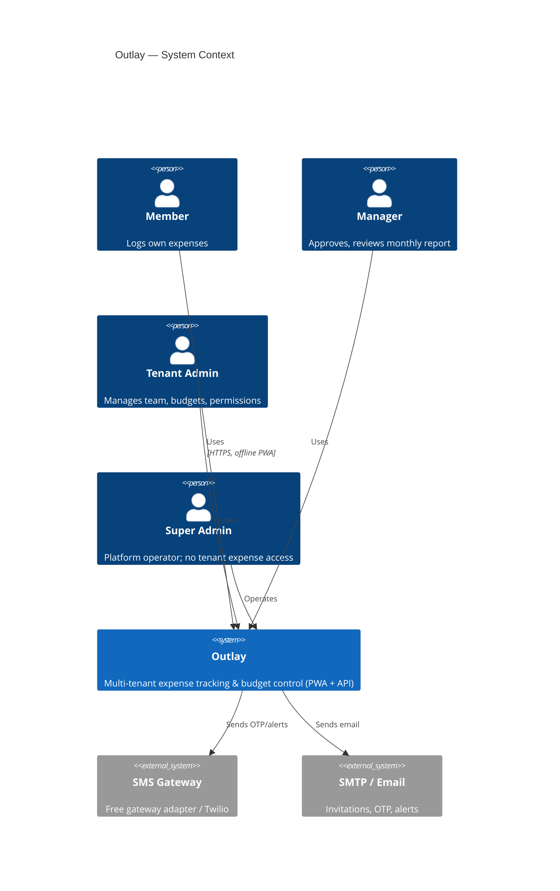
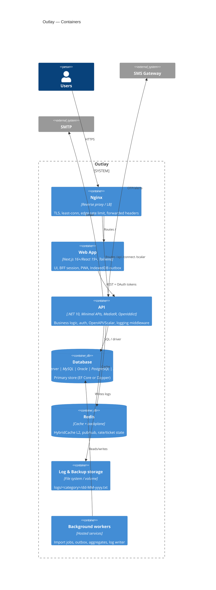
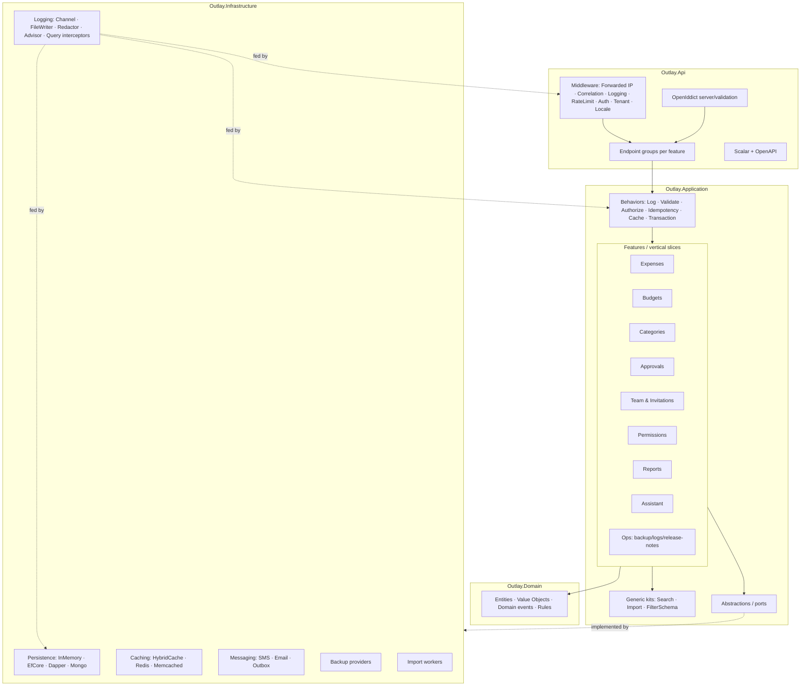
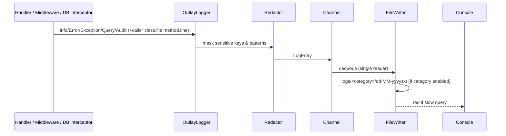
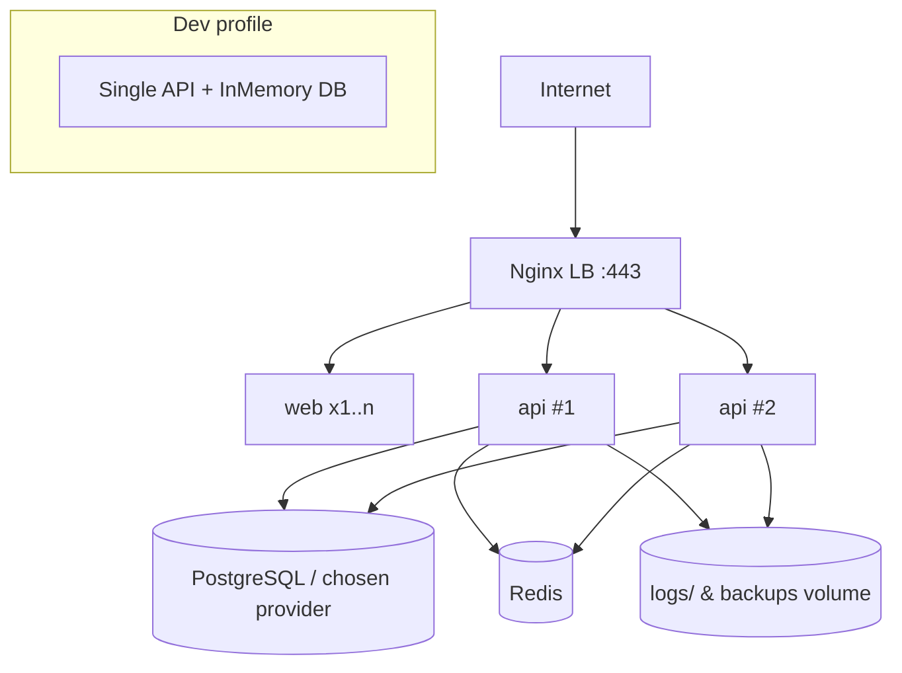

# C4 Diagrams — Outlay

Mermaid; renders on GitHub. Levels: Context (1), Containers (2), Components (3), Deployment, plus Data (ER lives in `Schema.md`).

## Level 1 — System Context


## Level 2 — Containers


## Level 3 — API components (feature slices + shared pipeline)


## Level 3 — Frontend components
```mermaid
flowchart LR
  Pages[app/[locale] pages] --> Features[features/*]
  Features --> UI[components/ui kit: DataTable · AdvancedFilterBar · BulkImportDialog · …]
  Features --> Hooks[TanStack Query hooks]
  Hooks --> Http[lib/http: auth · correlation · idempotency · locale]
  Hooks --> Off[lib/offline: Dexie · outbox · sync]
  Http --> BFF[app/api/session BFF] --> API[(Outlay API)]
  SW[service-worker.js] --- Pages
  Off --- IDB[(IndexedDB)]
  I18n[next-intl en/bn] --- Pages
```

## Dynamic — Log pipeline


## Deployment view

Note: InMemory profile = **one** API container (A-07). Compose profiles add `mssql`, `mysql`, `oracle`, `mongo`, `mail`.
