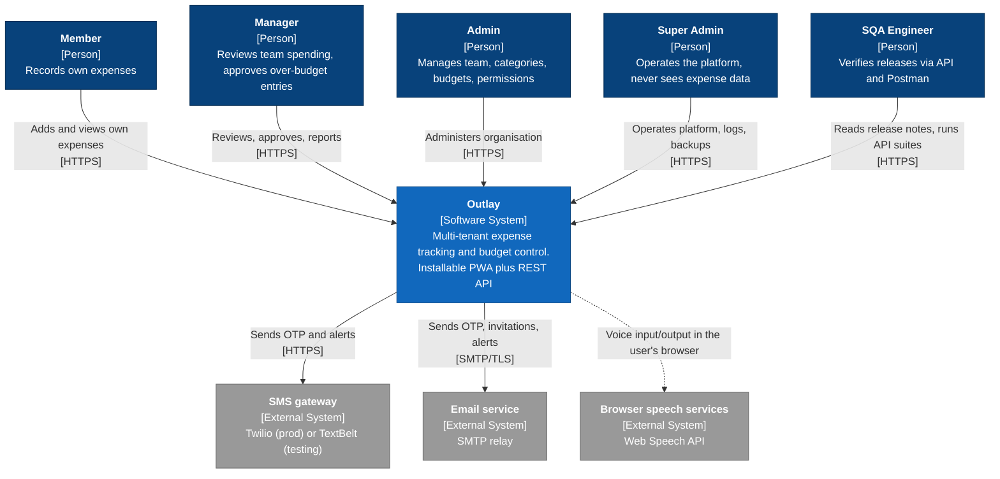
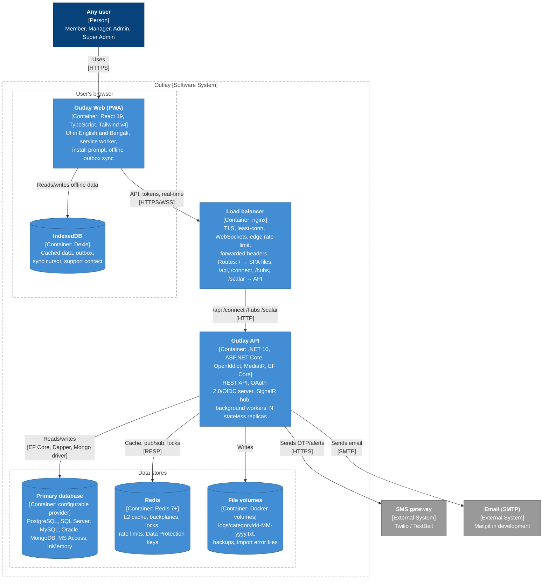
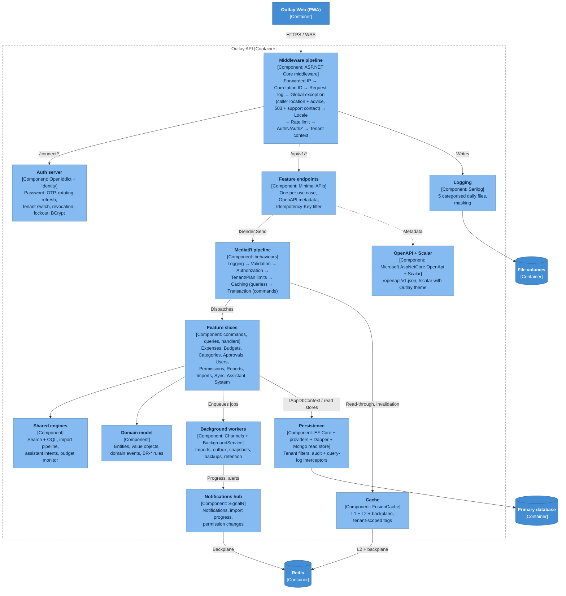
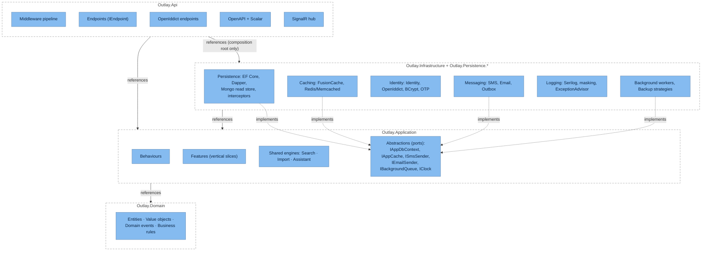
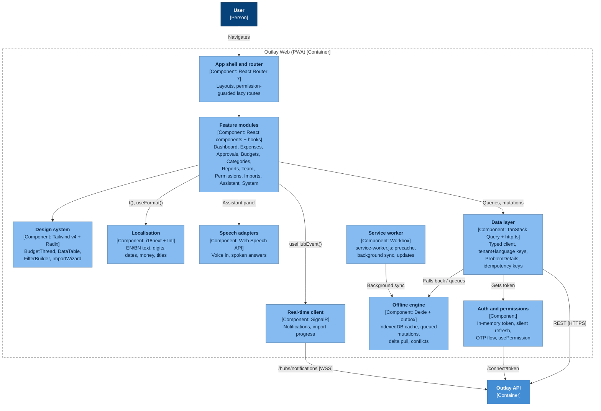
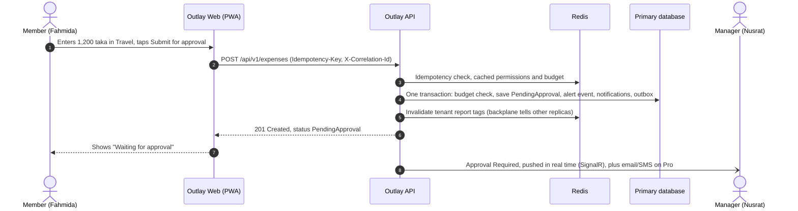
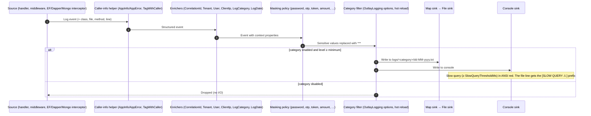
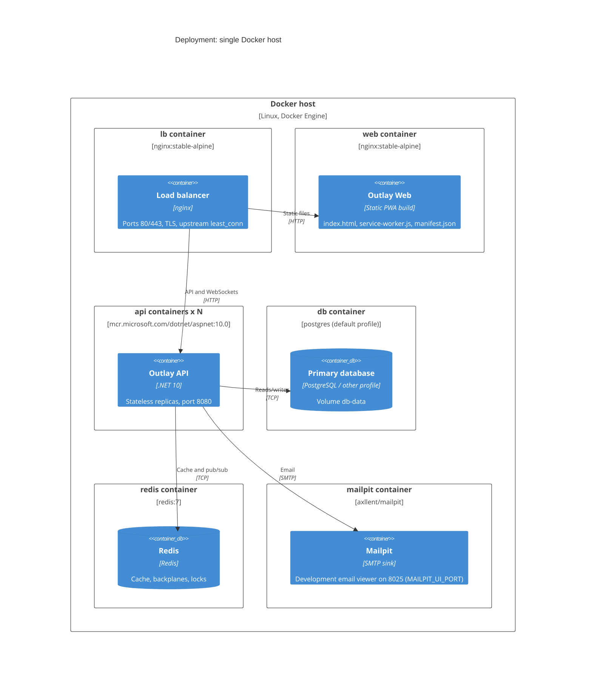
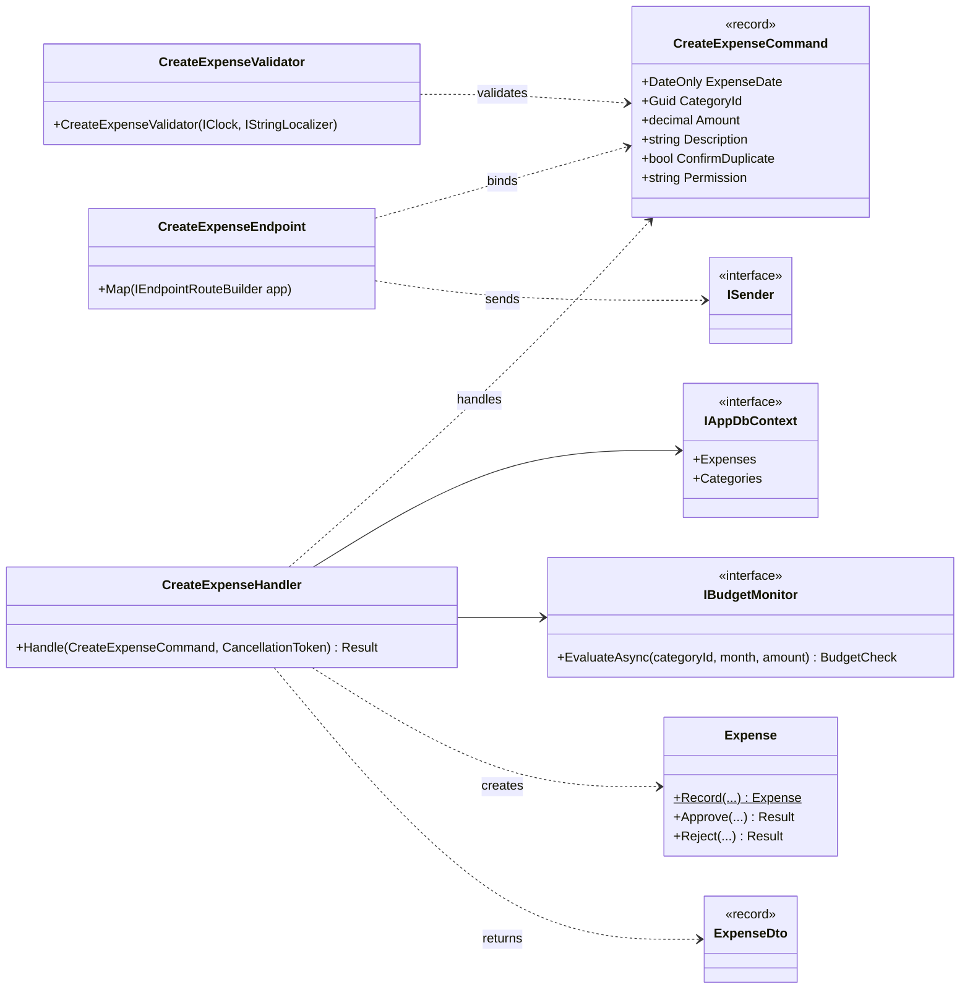

# Outlay — C4 Architecture Diagrams

| Field | Value |
|---|---|
| Version | 0.0.0 · 2026-10-28 |
| Model | [C4 model](https://c4model.com/): System Context → Containers → Components → Code, plus Dynamic and Deployment views |
| Format | Mermaid (renders on GitHub/GitLab and in VS Code with a Mermaid extension). Exported SVGs go in `docs/diagrams/svg/` at milestone M13-08. |
| Related | [TRD.md](../TRD.md) (technical detail) · [Schema.md](../Schema.md) (data) · [AppFlow.md](../AppFlow.md) (user flows) |

> **This file is the canonical home of the architecture diagrams.** TRD §2 points here. When the architecture changes, update the diagram in the same PR as the code.

**How to read them:** boxes are people, software systems, containers (separately deployable or runnable things) or components (groupings inside a container). Arrows show the main direction of a dependency or data flow, labelled with purpose and protocol.

**Notation:** standard C4 colours: dark blue = person, blue = Outlay system, mid blue = container, light blue = component, grey = external system, dashed box = boundary. Levels 1–3 are drawn as Mermaid flowcharts in C4 notation, because Mermaid's experimental `C4*` diagram types lay larger views out in a single column with crossing arrows. The deployment view uses Mermaid's native `C4Deployment`, and the dynamic view uses sequence notation.

---

## Level 1 — System Context

*Who uses Outlay and which outside systems it depends on.*

| Element | Responsibility | Trust boundary |
|---|---|---|
| Member / Manager / Admin | Tenant users. One login may belong to several organisations with different roles. | Authenticated, tenant-scoped |
| Super Admin | Platform operations only | Authenticated, platform scope, step-up OTP for sensitive actions |
| SMS gateway / Email | Delivery of OTP and alerts | External. Credentials in secrets. Calls wrapped in retry + circuit breaker. |
| Browser speech | Speech-to-text / text-to-speech on the user's device | External to Outlay. The user sees a privacy note. |

---

## Level 2 — Containers

*The deployable and runnable pieces of Outlay and how they talk.*

| Container | Technology | Scales by | Key decisions |
|---|---|---|---|
| Outlay Web | React 19 PWA | CDN/nginx static files | ADR-0012 (offline), ADR-0018 (stack) |
| Load balancer | nginx | Single instance (or managed LB) | TRD §11.6 |
| Outlay API | .NET 10 | Horizontal replicas (stateless) | ADR-0002…0011 |
| Primary database | Configurable provider | Vertical, read replicas later | ADR-0008, ADR-0009 |
| Redis | Redis 7 | Single node (Sentinel/managed in production) | ADR-0010. Optional: the API degrades gracefully without it. |
| File volumes | Docker volumes | Per replica, or a central log sink | ADR-0011 |

---

## Level 3 — Components of the Outlay API

| Component | Project / folder | Notes |
|---|---|---|
| Diagnostics middleware | `Outlay.Api/Middleware` | `UseOutlayDiagnostics()` (TRD §8.4) |
| Auth server | `Outlay.Infrastructure/Identity` | ADR-0005, ADR-0006 |
| Feature endpoints | `Outlay.Api/Endpoints/<Feature>` | ADR-0004 |
| MediatR pipeline | `Outlay.Application/Behaviors` | ADR-0003 |
| Feature slices | `Outlay.Application/Features/<Feature>/<UseCase>` | ADR-0002 |
| Shared engines | `Outlay.Application/{Search, Import, Assistant}` | TRD §13 |
| Domain model | `Outlay.Domain` | No dependencies |
| Persistence | `Outlay.Infrastructure/Persistence` + `Outlay.Persistence.<Provider>` | ADR-0008, ADR-0009 |
| Cache | `Outlay.Infrastructure/Caching` | ADR-0010 |
| Background workers | `Outlay.Infrastructure/Background` | Distributed lock for scheduled jobs |
| Notifications hub | `Outlay.Api/Hubs` | Groups per tenant and user |
| Logging | `Outlay.Infrastructure/Logging` | ADR-0011 |

---

## Level 3 — Outlay API by project (the dependency rule)

*The same components grouped by the .NET project they live in. Arrows show compile-time references. Infrastructure **implements** the abstractions that Application defines (dependency inversion), so Application and Domain never reference infrastructure packages. `Outlay.ArchitectureTests` enforces this.*

| Rule | Enforced by |
|---|---|
| Domain references nothing | `Outlay.ArchitectureTests` |
| Application references only Domain (no EF provider, Serilog or Redis packages) | `Outlay.ArchitectureTests` |
| Api uses Infrastructure only in `Program.cs`/DI extensions | `Outlay.ArchitectureTests` |
| A feature never references another feature's internals | `Outlay.ArchitectureTests` (namespace rule per `Features.<Name>`) |

---

## Level 3 — Components of Outlay Web (PWA)

---

## Dynamic view — Member submits an expense over a Hard limit

*Runtime collaboration for the most important business flow (AppFlow F-03 → F-04). Drawn in sequence notation, which C4 allows for dynamic views and which stays readable with many steps.*

If step 2 fails because the device is offline, the request waits in the IndexedDB outbox and is replayed later with the **same** Idempotency-Key, so the expense is created exactly once (ADR-0012).

---

## Dynamic view — Log pipeline (from code to `logs/<category>/dd-MM-yyyy.txt`)

*How one log event travels. It covers the owner's requirements: five categories, on/off from configuration, caller location, masking of sensitive values, and red slow queries (TRD §8, ADR-0011).*

Exceptions take the same path, plus one step. `GlobalExceptionMiddleware` resolves the first `Outlay.*` stack frame (class, file, method, line, available because PDBs are embedded) and asks `ExceptionAdvisor` for the probable cause and fixes. It writes a one-line entry to `application-error-logs` and the full entry to `application-exceptions-logs`, linked by the exception id.

---

## Deployment view — Docker Compose (development, staging)

| Environment | Topology | Differences |
|---|---|---|
| Local (no Docker) | `dotnet run` + `npm run dev` | InMemory DB, no Redis (`Cache:L2=None`), OTP 111111, console SMS. **Exactly one API instance** (see warning below). |
| Docker compose (dev/demo) | The diagram above, `--scale api=2` | PostgreSQL profile by default, Mailpit, OTP 111111 |
| Docker compose, `inmemory` profile | lb + web + **one** api, no db container | For quick demos only. `--scale api` is ignored by this profile. |
| Staging | Same images. Managed DB and Redis. | Real OTP. TextBelt or Twilio test credentials. Nightly k6. |
| Production | Same images behind a managed load balancer, ≥ 3 API replicas | Real OTP via Twilio. Central log sink recommended. Migration job before rollout. Manual approval gate. |

> ⚠ **InMemory means one API instance.** The InMemory provider keeps data inside one process. With two replicas behind the load balancer, each would have its own separate data, so users would see records appear and disappear between requests. The API refuses to start with `Database:Provider=InMemory` when `Deployment:ExpectedReplicas > 1`, and the compose `inmemory` profile runs a single API container.

---

## Level 4 — Code (one vertical slice)

*Code level is shown for one representative slice only. The rest follow the same shape.*

---

## Maintenance

- Diagrams are code: edit the Mermaid here, and CI renders every block with `mmdc` to catch syntax errors.
- Keep names identical to code (`Outlay.Api`, `IAppDbContext`) and to TRD section titles.
- A new container (e.g. a separate auth server or a reporting worker) needs an ADR first, then updates to Level 2, Level 3 and the Deployment view.
